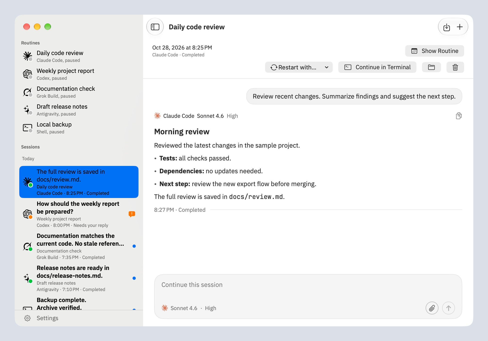
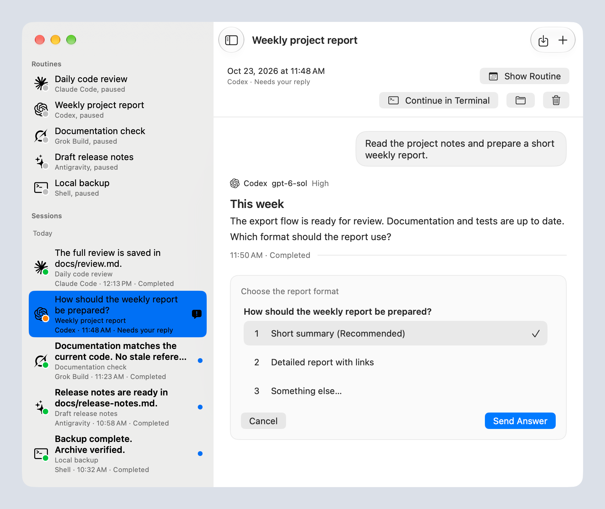

# Rota

**One place for your agent routines.**

Schedule work across **Claude Code, Codex, Grok Build, Antigravity, and shell
commands**. Read the results, answer questions, and continue conversations in
one native macOS app. Choose the harness and model for each routine, and
change them when another agent fits the job better.

[Download Rota](https://github.com/wiltodelta/rota/releases/latest) ·
[Get started](#get-started) · [User guide](docs/user-guide.md) ·
[Website](https://wiltodelta.com/projects/rota/)

[](https://github.com/wiltodelta/rota/actions/workflows/build.yml)

<picture>
  <source media="(prefers-color-scheme: dark)" srcset="docs/screenshots/sessions-dark.png">
  
</picture>

*The real app with synthetic routines and conversations. Screenshots follow
your light or dark appearance.*

## Why I built Rota

I started with Claude Code, then added Codex. I also used Grok Build for some
tasks, and now use Antigravity. Managing routines across different tools
became a chore. I wanted one place to schedule them and see what they did,
whichever harness ran the work.

The choice of agent matters. A routine that works well on Claude Code today
might work better on Codex with a different model tomorrow. I wanted to make
that choice per routine and keep its schedule and results together.

The scheduler in super.engineering didn't fit this workflow, so I built
Rota as a companion Mac app for recurring work. Keeping
access to native harness capabilities was a requirement from the start,
including browser automation and computer use. Those differences are part
of why I use several harnesses in the first place.

## Choose the harness for the job

A routine is a project folder, a prompt or project skill, and a schedule.
Use it for a morning code review, a documentation check, a weekly report,
or release notes. Shell routines run a command in the same way, without a
model.

Pick the agent, model, and supported reasoning effort for each routine.
Change them without rebuilding the schedule. Rota reads model choices from
the installed CLIs, so the options come from the harness you actually use.

Rota runs those harnesses through their own interfaces, with the project
context and configured tools available in that execution mode. Browser
automation, computer use, and MCP support depend on the harness and your
setup. For example, Claude Code's built-in computer use needs an interactive
session, which Rota supports in trusted project folders. Its print-mode
fallback cannot load that tool. Rota warns when a project skill names a tool
the selected harness lacks.

The [user guide](docs/user-guide.md#features) explains the execution modes
and differences between agents.

## Every run is a conversation

Sessions from all your routines appear in one inbox. Open a result to read
the agent's response, inspect its tool activity, or ask a follow-up. Attach
files and keep working in the same conversation, while the agent runs or
after it finishes.

When an agent needs a decision, supported questions appear with their
choices or input fields. The session stays marked as needing your reply
until you answer it or explicitly cancel the request.

<picture>
  <source media="(prefers-color-scheme: dark)" srcset="docs/screenshots/questions-dark.png">
  
</picture>

*Questions stay with the work that prompted them.*

Claude Code, Codex, and Grok Build sessions can also continue in Terminal.
Rota follows the new activity while it stays open. Question forms,
mid-run messages, and terminal continuation differ by agent; see
[agent questions](docs/agent-questions.md) and the [user guide](docs/user-guide.md).

## Bring the routines you already have

Import copies existing schedules from **Claude Desktop and the Codex app**.
It is the quickest way to move them into Rota without recreating everything
by hand. Once imported, each routine can run on the harness you choose.

Use **File > Import Routines…**, select the routines, and review the copies.
Rota reads the original stores without changing them. Imports start paused:
turn off each original schedule before enabling its Rota copy.

## Get started

You need **macOS 15 Sequoia or later, on Apple silicon**, and the agent CLIs
you want to use, installed and signed in: `claude`, `codex`, `grok`, or `agy`.
Shell routines need no agent CLI.

1. Download `Rota-vX.Y.Z-macOS.zip` from the
   [latest release](https://github.com/wiltodelta/rota/releases/latest).
2. Unzip it, move **Rota.app** to `/Applications`, and open it.
3. Check **Settings > Agents**. Rota finds CLIs on your login shell's PATH
   and in common install locations; you can also choose an executable.

To create a routine:

1. Choose **File > New Routine…** or press **Command-N**.
2. Choose the project folder and harness. Write a prompt or select a project
   skill. For a Shell routine, enter the command.
3. Pick a schedule preset or enter a five-field cron expression. Rota shows
   the next three run times. Choose a model, supported effort, and optional
   time limit.
4. Save. The routine runs on its schedule; **Run Now** starts it immediately.

Rota lives in the menu bar and runs routines while the app is open. Turn on
**Launch at login** in Settings to have it available after a restart. Pause
any routine with its switch. The panel uses Liquid Glass on macOS 26 and later.

## Handle the gaps between runs

A local scheduler has to deal with a sleeping Mac, a lost connection, and
work that takes longer than expected.

- A recently missed schedule runs once when Rota returns. Older slots are
  recorded as skipped.
- A routine already running skips its next slot, so it cannot overlap itself.
- Interrupted agent work can resume in the same session after sleep,
  shutdown, or a network error. Shell commands are never automatically retried.
- Failures and questions can notify you. Normal completion notifications
  are optional, and repeated scheduled failures pause the routine.

Unread results and unanswered questions stay visible in Rota. See the
[user guide](docs/user-guide.md#features) for catch-up windows, recovery
limits, retention, and notification behavior.

## Let agents manage routines

Enable an agent in **Settings > Routines from agents** to let it create,
change, run, or pause routines through Rota's MCP server. The same controls
are available through the `rota` CLI, including reading sessions and
answering questions. Enable the command in Settings, then start with:

```bash
rota list
rota help
rota tools
```

## Your Mac, your agent accounts

Rota stores routines, session logs, and attachment copies locally. It has no
analytics or hosted scheduling service. Agents use their own services under
your existing accounts and configuration.

**Routines run with unattended tool permissions.** They can change files
and use the tools available to their agent. Use projects and skills you
trust. Supported questions and explicit plan confirmations that reach Rota
wait for your answer. The [execution policy](docs/user-guide.md#usage)
describes each harness's configuration.

Settings controls the terminal app, interface scale, chat fonts, and
notifications. [Sparkle](https://sparkle-project.org) checks for updates
daily; installation happens when you choose. **Check for Updates…** checks
immediately.

## Troubleshooting

- **Icon hidden by the notch or a menu bar manager?** Open Rota again from
  Finder or Spotlight to show its window.
- **Agent unavailable?** Check Settings > Agents, then confirm its CLI works
  and is signed in from Terminal.
- **Routine did not run?** Check that Rota is open and the routine is enabled.
  Its history shows skipped slots and errors.
- **Notifications disappear too quickly?** Choose the Persistent alert style
  for Rota in System Settings > Notifications. Informational notices still
  expire as described in the [user guide](docs/user-guide.md#features).

## Build from source

Requires Xcode 26 or later.

```bash
git clone https://github.com/wiltodelta/rota.git
cd rota
./create-app.sh
open Rota.app
```

The script assembles and signs a development app with its own bundle identity
and data folder, separate from the installed release. It uses Developer ID
when available, with ad hoc signing as a fallback.

Run `bash maintain.sh` for lint, tests, and the signed bundle build.
`scripts/ui-check.sh` checks the interface in both appearances at the minimum
window width; its optional `--live` mode uses a real Codex session.
`scripts/capture-screenshots.sh` regenerates the README images from disabled
synthetic routines. See the [capture recipe](docs/screenshots/README.md) for
permissions and setup.

Implementation details: [architecture](docs/architecture.md),
[transcript format](docs/transcript-format.md), and
[build and release](docs/build-and-release.md).

## Uninstall

Quit Rota and move **Rota.app** to the Trash. To also remove its settings,
routine history, and attachment copies:

```bash
defaults delete com.wiltodelta.rota
rm -rf ~/Library/Application\ Support/Rota ~/Library/Logs/Rota ~/Library/Caches/Rota
```

## License

[Apache License 2.0](LICENSE).

Made by [Victor Kuznetsov](https://wiltodelta.com/).
