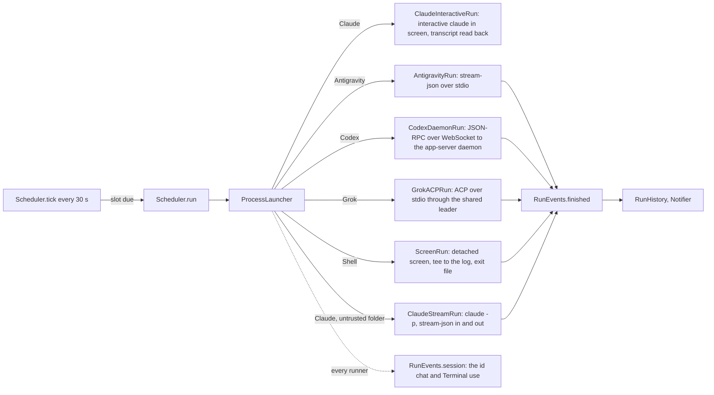

# Architecture

## RotaCore

- `CronSchedule` parses five-field cron (Vixie semantics: day of month and day
  of week OR when both are restricted; weekday 7 is Sunday) and finds the next
  fire time day by day, skipping wall-clock times a DST change removes. Range
  endpoints must both be integers; malformed ranges are rejected rather than
  silently dropping empty or nonnumeric components.
- `Scheduler` owns the routines (`routines.json` in Application Support) and
  persists each routine's `nextFire`. Each launch has a separate token, even
  when continuing the same session: late callbacks cannot update or finish a
  later launch, and expired question callbacks receive cancellation. A tick fires a due slot (a catch-up or a
  skip when it is late, below) and moves `nextFire` past now either way.
- `Harness` holds everything per CLI: default path, headless arguments, launch
  mode and chat arguments.
- A routine's explicit `model` and `effort` (nil leaves the CLI's default) are
  captured in `RunRecord` at session creation and passed through `LaunchSpec`;
  historical labels and continuations use that snapshot, even after editing
  the routine. Old records without a snapshot resume without explicit model or
  effort overrides; their composer can recover configuration from the harness
  or readable log as described below. Each runner turns the options into its own form, Claude
  `--model`/`--effort` and Grok `--model`/`--reasoning-effort` through
  `LaunchSpec.modelFlags`, Codex fields in `thread/start` and `turn/start`. A
  session keeps its original harness. `Scheduler.restart` creates a separate manual
  session on another agent harness, using the target's default model and effort;
  it never saves the temporary choice to the routine. `ModelCatalog` lists the choices without
  spending quota: Codex `model/list` with each model's efforts, `grok models`,
  and Claude's control initialization with resolved model IDs and efforts.
  Claude, Codex and Grok write the model the CLI actually picked into their
  log headers; Antigravity retains only configuration its stream reports.
  A Grok model passed on the
  command line in leader mode left `grok models`' default untouched (live test,
  2026-10-09); Grok's agent-mode guide says a `session/set_config_option`
  model change is synced to the leader's other clients, so Rota does not use it.
- `RoutineImport.scanAll` reads every source read-only into `ImportCandidate`s:
  `ClaudeDesktopImport` (`scheduled-tasks.json` and its stubs) and
  `CodexAutomationsImport` (the `automations` table of the Codex app's
  `~/.codex/sqlite/*.db`, opened `mode=ro`; schedules are RFC 5545 RRULEs that
  `ScheduleText.cron(fromRRule:anchor:)` converts where cron can say the same,
  and a rule without an hour, such as the default `FREQ=HOURLY;INTERVAL=24`,
  takes it from `next_run_at`). A Codex automation that continues a thread,
  has no folder, uses multiple folders or has no cron equivalent is listed with the reason and cannot
  be picked. Grok Build has nothing to import: its scheduler holds one
  session's `/loop` tasks for at most seven days. `ScheduleText.describe` puts
  common cron shapes in words for the import list and the schedule field.
  `Routine.importIdentity` preserves the source's stable id separately from the
  routine's name and local id. Duplicate names receive unused local ids; later
  scans recognize imported records by source identity, including after a rename.
  Legacy imports without identity match their original id, folder and prompt.
  Minute lists and the anchor phase of hourly/minutely intervals survive RRULE
  conversion; unsupported shapes are refused rather than substituted.
- Other processes reach the scheduler through `ControlServer`, a Unix socket
  at `Application Support/Rota/rota.sock` (0600, one JSON request and reply
  per line), whose methods are `Scheduler.control` in `ControlCommands.swift`:
  routines list/get/create/update/setEnabled/run/stop/delete and sessions
  list/get/read/message/delete/dismiss/markRead/questions/answer, all through
  the scheduler, the routines file's only writer. `ControlMethod` declares the
  socket operations; `ControlInterface` supplies the public CLI command and MCP
  schema for each. Tests require every public method and editable routine field
  to be covered by both interfaces, and exercise each declared method's handler.
  Only `questions.create` and `questions.poll` are private hook transport.
  Accepted sockets suppress SIGPIPE and use nonblocking writes. Each response
  belongs to a connection object, so descriptor reuse cannot deliver it to a
  later client. Pending input and output are bounded to 32 MiB per connection;
  exceeding the bound closes that connection. ControlClient checks a unique
  request id and handles partial writes. Routine edits publish memory only after
  the atomic save succeeds; UI and control callers retain drafts/report failure
  when it fails. Deletion invalidates launch callbacks before stopping the runner
  and removing its history, preventing a late completion from recreating it.
  The `RotaCLI` target, bundled as `Contents/Helpers/rota`, is the `rota`
  command and, as `rota mcp`, an MCP stdio server. `rota tools` reports the
  current catalog without contacting the app; both interfaces update with the
  bundled helper. An already-running MCP process keeps its loaded catalog until
  the client reconnects; CLI invocations load the updated helper immediately.
  It starts Rota in the background when the socket does not answer. `AgentAccess` links it into `~/.local/bin` and runs each
  agent CLI's own `mcp add`/`mcp remove` (Claude Code and Grok Build at user
  scope) when the user asks in Settings. A routine created over the socket is
  on, like one made in the window, and `RunNotifying.routineAdded` says so.
  `Routine.problem(checkingID:)` is the one rule for what may be saved: the
  control methods refuse with its sentence, and the New and Edit sheets keep
  Add and Save off with it beside the buttons. An update skips the id check,
  so a routine keeps the id it was imported with. Integer control parameters
  reject fractional and out-of-range numbers; log-tail limits are converted to
  byte offsets without integer overflow.
- Session control replies include the run's model and effort snapshot, unread
  state, available message/delete actions and pending structured questions.
  `session` gets metadata; `questions` reads question field, option and action
  ids. `answer` requires an explicit question and action, validates the same
  `QuestionAnswer` as the app, and must only carry the user's actual decision.
  A plain `send` or `dismiss` cannot resolve a pending question. `mark-read`
  changes only the read mark. `delete-session` requires an explicit session id
  and uses `Scheduler.deleteSession`, keeping running sessions and the provider's
  native history intact. Reads never mark a session read implicitly.
  `send --attach FILE` (repeat the option for multiple files) and MCP
  `message_session.attachments` accept absolute regular-file paths. The socket's
  async `Scheduler.controlRequest` uses the history-owned attachment store to
  copy files off the main actor, then rechecks the pinned session before sending
  the same `ChatMessage` manifest the composer uses. Rejected sends discard their
  staged copies. `ControlInterface.sessionArguments` binds in-run requests to
  their own session for both clients; deletion always needs an explicit target.
- Each run gets `ROTA_SESSION` (its `RunRecord` id), `ROTA_ROUTINE` and
  `ROTA_CLI` (the bundled `rota`) in its environment, so `rota notify` and the
  `notify_user` MCP tool know their session without arguments. The `notify`
  control method posts through `RunNotifying.sessionNotified`; with
  `needsReply` it sets `RunRecord.attention`, kept on the active copy too (the
  run's finish saves that copy), and `Scheduler.message` clears it before a
  continued run saves the record. The notification carries the session id for
  the click and, only when `Scheduler.canMessage` allows it, a text-input Reply
  action that answers like the composer. Shell and unavailable agent sessions
  say "Needs your attention" and have no Reply action.
  Attention is explicit metadata, not inferred from questions in assistant text.
  `notify_user` defaults `needsReply` to false; an ordinary notification that
  asks for a decision therefore does not mark the session as waiting. Even
  `needsReply: true` marks the record rather than suspending a tool call, and
  the agent's turn can still finish with a successful process outcome.
  Routine instructions still decide when an agent needs the operator's decision;
  successful no-op runs should not manufacture questions. Structured requests
  use a separate path and do not depend on `notify_user` or question detection
  in prose.
- `Notifier` withdraws informational notifications 8 seconds after successful
  submission to Notification Center. Delivery, the expiry scheduler and removal
  are injected in notification tests, which advance expiry without waiting or
  sending real notifications. Failures (including missed slots), automatic
  pauses, explicit `needsReply` requests and sessions with outstanding attention
  or structured questions have no expiry. macOS owns the app-wide banner style:
  users select Persistent for Rota in System Settings > Notifications to keep
  these banners visible until dismissed. Withdrawal also removes informational
  notices from Notification Center, and only runs while Rota is running.
- `AgentQuestion` normalizes native questions, plan approvals and MCP forms/URL
  requests. `RunEvents.question` registers the request with the scheduler,
  persists its fields in `RunRecord.questions`, marks the session as needing
  a reply and posts a notification. `SessionView` owns a `QuestionDraft` for
  `QuestionCard`, independently of `ChatComposer`. The card presents single/multiple
  numbered option rows. Optional `AgentQuestion.context` keeps technical tool input
  in a collapsed Tool details disclosure with a bounded scroll area. The card presents
  its own text/private/numeric fields inside the transcript's
  scroll view, while the composer stays pinned below it. The form never squeezes
  the transcript into a near-zero nested scroll viewport.
  The card is measured outside the lazy message stack, even while offscreen.
  It registers its own transcript viewport marker and participates in
  the same zoom-anchor handling as message rows.
  Its end anchor sits outside the spaced lazy rows, with a compact form tail;
  scrolling to the absolute bottom must leave the final actions visible even
  at minimum height and 150% zoom.
  While a form is pending, a pinned Show Question control above the ordinary
  composer scrolls to the actual document bottom after the reader scrolls away,
  leaving the card's final actions visible. The end request survives delayed
  transcript loading and lazy height recalculation until manual scrolling cancels it.
  Native document-frame and clip-bounds notifications also correct late layout changes,
  including zoom adjustments that settle after SwiftUI's geometry callback.
  The floating
  latest-message button stays hidden so it cannot cover the form.
  Free-text fields, including a selected Other answer, stay inside the card.
  Each field keeps its own text draft;
  Multiple fields appear one at a time, with a progress count and Back/Next.
  Next validates only the current field and never sends a partial form; the final
  action validates all fields. Going back preserves selections and text.
  Selecting Something else focuses the card's answer field directly, with no
  intermediate edit link. Option rows highlight selection and expose it through
  Accessibility; no option is preselected. Text bindings
  capture their field ID, so late editing events cannot overwrite another field
  or fall through into the ordinary message draft. Ordinary
  message drafts and attachments remain in AppModel and are not sent with a
  question answer. Next and the final answer actions stay in the card; typing
  into an answer field cannot submit the ordinary message draft.
  The ordinary composer remains editable while questions are pending. Compact
  spacing and a shorter visible editor preserve room for the scrollable form;
  longer message drafts scroll inside the editor. Async
  questions allow independent messages and attachments without resolving the form
  or clearing its attention. A blocking question disables ordinary sending and
  explains that the draft is retained. Unblocking never automatically sends it.
  Multiple-action forms retain explicit action buttons in the card.
  Cancel and Decline stay with the question card's actions. The scroll content reserves
  scaled space on every edge for native field focus rings, which paint outside
  their layout bounds. Check a
  focused first and last input at the minimum window height. Something else is a
  numbered row for a single choice and an independent selectable row for multiple choices.
  Its answer field appears only when selected; a hidden draft is retained but never submitted.
  An empty selected Other blocks submission. Only elicitation and permission
  requests show the additional Decline action. Provider dismissal choices are
  not duplicated among approval buttons. When action buttons cannot fit in
  a row, a native Choose popup keeps their full labels available without
  consuming the question viewport. It reuses InterfacePicker's explicit
  AppKit font, fitting the selected title while retaining full menu labels.
  Persistent policy choices name their command prefix or host. Short requests
  fit their content. Renderer checks must verify the actual window size, a
  nonzero transcript/form viewport and the final field after native scrolling.
  At the 520 pt minimum height, fields and actions stay reachable in the same
  transcript scroller above the pinned input. MCP messages belong in the
  scrolling detail, not the fixed session header. Setting an offscreen AX value
  alone does not establish reachability. Include long option descriptions and
  approval labels at the minimum width and 150% interface scale.
  Text answers can span several lines, while secret and numeric inputs stay
  compact. No answer is selected or sent
  automatically. Ordinary chat messages and Dismiss cannot clear an outstanding
  structured question. Blocking requests resolve on an explicit answer, provider
  withdrawal or run cancellation; concurrent requests remain independently pending.
  Private answers are redacted in Rota's journal. After an app interruption,
  old RPC callbacks expire and the session must be continued to ask again.
  Message-delivered async questions retain their fields and attention across
  completion, cancellation and restart. Their explicit answer is delivered as a
  user message to the active session or resumes the same native session, keeping
  other questions pending. A failed continuation preserves the unanswered form.
  Independent-composer verification uses `scripts/fixtures/question-stream.py`,
  a local synthetic stream peer, and the actual `questions.create` socket path. Both appearances were checked
  at 820 x 520 pt with 100%/150% zoom, plus a larger 1100 x 720 pt window.
  Native Return, Option-Return, field switching, multi-select answers, Cancel,
  explicit multi-action forms and ordinary-draft restoration were exercised.
  A selected custom answer stays separate from ordinary message text. The
  numbered option rows use primary text and a neutral selected background.
  `QuestionDraftTests` reject mutations that drop Other selection, replace
  selected multiple choices with custom text, or lose per-field drafts.
- Codex receives deferred JSON-RPC server requests through `onRequestAsync`;
  the transport keeps reading while the user answers. It handles native input,
  command/file/permission approvals, legacy approvals and standard MCP form/URL
  elicitation. `serverRequest/resolved` invalidates late answers. The per-thread
  `features.default_mode_request_user_input` override makes the input tool
  available in Default mode without changing the user's configuration.
  Codex's `request_user_input_async` instead emits an `agentMessage` with
  `questions` metadata. `QuestionRequest.codexMessage` turns that metadata into
  an `AgentQuestion` with `replyViaMessage`, preserving the original message in
  the journal. `CodexAsyncQuestions` reconciles all turn pages and deferred
  events before publishing open questions. Only a valid Rota answer envelope
  matching the question ID and fields in the same thread closes it; accept,
  decline and cancel all count. Confirmed answers survive duplicate events,
  while in-flight answers suppress replay only until delivery succeeds or fails.
  The scheduler retains Codex forms until the runner acknowledges delivery, so
  an unavailable daemon or failed continuation leaves the answer retryable.
  Existing receipt and history formats remain unchanged.
  `SessionView` presents forms for finished sessions too.
  `QuestionElicitation` also accepts `openai/form` and its `openaiForm` wire alias.
  Device-verification challenges and unsupported extended schemas have a visible
  cancel/decline path, without an ordinary approval standing in for proof or data.
  The full protocol inventory and test boundaries are in [agent questions](agent-questions.md).
- Grok's `_x.ai/ask_user_question`, `_x.ai/exit_plan_mode` and
  `_x.ai/mcp/elicit` requests use the same UI and return their own wire results.
  Ordinary execution permissions retain the runner's existing always-approve
  policy; explicit questions and plan approvals never use that shortcut.
- `ClaudeRunSettings` installs per-run `PreToolUse` hooks for `AskUserQuestion`
  and `ExitPlanMode`, plus an `Elicitation` hook, in both Claude runners.
  The bundled `rota question-hook` reads the native hook input from stdin,
  registers the form over the private control socket, and waits for the user's
  answer via bounded polling requests. It returns the native `updatedInput`
  or elicitation action; losing the session cancels rather than approves.
  `PermissionRequest` hooks collect explicit tool approvals in the same form.
  Print mode also installs the stdio permission host and handles native
  `can_use_tool` requests. Hook settings are ephemeral and do not change the
  user's CLI configuration.
  Both Claude runners keep a run open while a background shell or agent it
  started is running: Claude answers the task's notification in a turn of its
  own, and ending at the earlier turn's end stopped the task. Until 2026-10-26
  the interactive runner typed `/exit` at the first `turn_duration`, which
  killed four review agents 15 seconds after a turn that promised to wait for
  them. The wait covers Claude's own task list only: a process a command
  detaches with `&` is not waited for.
- `ProcessLauncher` runs every CLI through `zsh -lc 'exec "$0" "$@"'` from
  `baseEnvironment` (the account's own variables only), so a routine sees what
  a new Terminal window sees, whatever started Rota: started by `rota` inside
  an agent session, Rota had passed that session's `CLAUDECODE`,
  `ANTHROPIC_BASE_URL` and super.engineering variables to every run. The
  interactive run's once-a-second `screen` calls skip the login shell
  (`capture(..., loginShell: false)`, 0.04 s against 0.17 s a call).
- Codex's app-server daemon and Grok's leader outlive the run that starts them
  and keep its folder and environment, so they start in the home folder with
  no run variables (`ProcessLauncher.helperDirectory`). A leader started in a
  routine's temporary folder that was later deleted failed every `npx` MCP
  server for every Grok session (Node's `uv_cwd`), playwright included, from
  2026-10-10 until it was restarted. Each session gets its folder over the
  protocol, and its `ROTA_*` variables as a Codex thread `config` override
  (`shell_environment_policy.set.*`, verified live in the command's
  environment) or, for Grok, whose commands have no per-session environment,
  as a `_meta.rules` sentence naming the session and the `rota notify` command.
  When Rota MCP is already registered, `SessionBridge` additionally overrides
  only that server's command and environment per Codex thread or Grok session;
  `notify_user` then has the run identity without editing global agent settings.
- What a run can reach, checked live 2026-10-11 through Rota on each harness
  (`GLOBAL`/`CHROME`/`COMPUTER` self-report, Claude's `system/init` tool list,
  Codex `mcpServerStatus/list`, Grok session `events.jsonl`): all three load
  the global instructions; Claude has 22 `mcp__claude-in-chrome__` tools from
  `env.CLAUDE_CODE_ENABLE_CFC` in the user's settings, and Rota passes
  `--chrome` when `claudeInChromeDefaultEnabled` in `~/.claude.json` is on
  (`ClaudeUserSettings`: a run follows the user's settings, never a guess from
  the prompt); in print mode it has no built-in computer use, which Claude Code
  adds only to an interactive session, hence `ClaudeInteractiveRun`, where an
  interactive run in a computer-use project listed 27 `mcp__computer-use__`
  tools and answered `list_granted_applications`; Codex has its `computer-use`, `cua_repl` and
  `node_repl` plugins (Chrome through them); Grok has `playwright` from
  Claude's user config. Claude and Grok reach native apps through the
  `cua-driver` skill, whose grants belong to CuaDriver.app, not Rota.
- `ExecutableDiscovery` lists each agent CLI's installed copies: the PATH of a
  login shell started from an empty environment (an app opened from a terminal
  inherits that terminal's PATH, which put another tool's agent wrappers first
  on 2026-10-09), then the folders installers use, one entry per real file, each with
  the first line of its `--version`. A run uses the copy picked in Settings,
  else the first one found, else `Harness.defaultExecutable`. Shell routines
  always run in `/bin/zsh`, so Settings lists agents only.
- `ClaudeStreamRun` runs Claude the way Claude Desktop does
  (read from its live `ps` on 2026-10-09): `claude -p --input-format
  stream-json --output-format stream-json --verbose --permission-mode
  bypassPermissions`. Rota adds `--permission-prompt-tool stdio` and ephemeral
  `--settings` hooks to host native questions. The prompt and later messages are on
  stdin; a message sent mid-turn joins that turn; the `result` event ends the
  run and closing stdin lets Claude exit and save the session; the `system`
  `init` event starts each turn and carries the session id, and `--resume <id>`
  continues it. `-p` asks no folder-trust question. The session lives in Rota's
  process. `system`/`background_tasks_changed` lists the running background
  shells and agents (`local_bash`, `local_agent`; a subagent's own tools are
  not listed; `ambient` watchers such as Monitor are not activity and are
  skipped); a `result` while it is non-empty shows `Waiting for N background
  tasks` and keeps stdin open, and the task's `task_notification` starts the
  next turn. A task that finishes before the turn's last tool call is answered
  in that turn, which a tool result after the notification shows; one that
  finishes while Claude writes its last answer is answered in a new turn after
  the `result`, so after a notification with no tool result since, the run
  waits five seconds (`settle`) for a new `init` before closing stdin (claude
  2.1.310, 2026-10-26).
- `ClaudeInteractiveRun` is the default for Claude (Settings > Agents), because
  only an interactive session loads computer use (`ClaudeUserSettings`). It
  runs `claude --session-id <id> --settings <hooks> --permission-mode
  bypassPermissions -- <prompt>` (`--resume <id>` to continue) in a detached
  `screen` session, which gives it a terminal and lets Open in Terminal
  attach. The chat is Claude's transcript, `~/.claude/projects/*/<id>.jsonl`,
  read from where it ended: assistant entries have the stream-json shape, a
  message typed mid-turn appears as a `queued_command` attachment, and
  `system`/`turn_duration` ends a turn (`ClaudeTranscript`, shapes from Claude
  Code 2.1.296 on 2026-10-11); its `entrypoint` names the runner that wrote
  it (`cli` this one, `sdk-cli` `ClaudeStreamRun`). A background task starts with a tool result
  whose `toolUseResult` carries `backgroundTaskId` (shell) or
  `status: async_launched` and `agentId` (agent), and ends with a
  `<task-notification>` naming its `<task-id>`s, as a user entry or, mid-turn, a
  `queued_command` attachment; `TaskStop` sends no notification, only a result
  with `task_id` and `task_type`, a shape no other tool result had (2.1.310,
  2026-10-26). The notification starts a turn, so it clears the ended turn. Messages are typed in as a bracketed paste
  (`screen -X stuff` passes `^`, `\`, `$` through as typed); once the last turn
  ended with nothing typed since and no background task running, the run types `/exit`.
  Dialogs Claude draws in the terminal reach the chat (`ClaudeDialog`). Claude
  draws its permission dialog while the `PermissionRequest` hook waits, and
  sends `permission_prompt` about six seconds later; a dialog no hook answers,
  such as computer use's app access (`computer_use_approval`, opened by
  `request_access` without any permission hook) or a paused session, sends
  the same notification (claude 2.1.311, 2026-10-27). The `Notification` hook
  appends Claude's payload to `$ROTA_SESSION_DIALOG`, where `rota question-hook`
  also marks its own question open and closed. A notification while a question
  hook waits is that request, already in the chat; once no hook waits, the run
  reads the screen again for a dialog opened alongside. Otherwise the run hardcopies
  the screen, reads the options numbered from 1 with one marked as selected,
  and asks the chat; the tool call Claude is waiting on comes from the
  transcript, because `screen` 4.00.03's hardcopy keeps only each character's
  low byte. The answer types the option's number, which Claude takes at once,
  then Return if an option that takes text is still shown; Cancel types Escape.
  Nothing is typed unless the screen still shows the same options; a dialog
  answered at the terminal closes its question. A dialog without readable
  options can only be canceled from the chat. The bridge keeps retrying an
  unreadable dialog without another notification, replacing its fallback card
  with the native choices when they become readable, without sending input.
  Until 2026-10-27 the hook marked
  every such session "Open in Terminal", even when the chat already held the
  permission question. Claude shows a folder-trust dialog nobody could answer,
  so a folder without `hasTrustDialogAccepted` (itself or its repository) runs
  in print mode with a note; Rota never answers that dialog or sets the flag.
  macOS attributes computer use to Rota (`responsible=com.wiltodelta.rota` in
  tccd's log), so Settings shows Rota's Accessibility and Screen Recording
  grants and asks for them.
- Every run stays reachable while it works, which is the point of each runner
  (verified live 2026-10-09 with `ROTA_LIVE=1 swift test --filter LiveHarnessTests`):
  - `CodexDaemonRun` runs `codex app-server daemon start`, then speaks JSON-RPC
    to the daemon through `codex app-server proxy`, which pipes the daemon's
    Unix socket; the socket is WebSocket, so `WebSocketTransport` does the
    RFC 6455 handshake and frames (Network.framework would not stack TCP on a
    Unix endpoint). `thread/start` with `approvalPolicy: never` and
    `sandbox: danger-full-access`, then `turn/start`; `turn/completed` ends the
    run; `send` is `turn/steer`, which joins the running turn. Codex's TUI could
    not be shown joining a live turn (`codex resume --remote` stalled behind its
    update prompt in a pty), so Rota offers the in-app field while running and
    `codex resume` after.
  - `GrokACPRun` runs `grok agent --leader --always-approve stdio` and speaks
    ACP: `session/new`, `session/prompt`, `session/update` chunks. The Grok TUI
    has no leader mode for joining a live session, so messages go through
    Rota's field as further `session/prompt`s, which Grok answers after the
    current turn; the run ends when every prompt has returned, or the queued
    answer would be lost with the connection, and Grok has no work left that
    will wake the session (`GrokActivity`): the leader's `_x.ai/queue/changed`
    names the running turn and the queue, `_x.ai/session_notification`
    `background_tasks` lists tasks with their status, `_x.ai/task_completed`
    and `subagent_finished` carry `will_wake`, and `turn_completed` names the
    turn it ends by `prompt_id`. A woken turn runs under its own prompt id
    (`task-completed-<task id>`) with its text on ordinary `session/update`s
    (grok 1.0.70, live 2026-10-26). The persisted `updates.jsonl` names these
    differently (all `_x.ai/session/update`), so its shapes do not show the
    live method names.
  - `ScreenRun` writes a zsh script that runs the command with its output
    `tee`d to the log and writes `${pipestatus[1]}` to an exit file, starts it
    with `screen -dmS rota-<id>` (macOS ships screen 4.00, which has no
    `-Logfile`), and polls the exit file. When the file is missing and
    `screen -ls` no longer lists the session, it reads the file once more
    before calling the run interrupted: the script writes it just before
    screen ends, and a command that ended between the two checks read as
    interrupted. `RunJournal` appends with
    `seekToEndOfFile`, because tee writes the same file.
- A run is a session. `Scheduler.message(_:to:)` sends into a live session
  through its runner's `send`, or, for a finished one, `continueSession`
  starts a run of the same `RunRecord` with `LaunchSpec.resume` set to its
  session id, appending to the same log: Claude `--resume <session id>`, Codex
  `thread/resume`, Grok `session/load` with native replay reconciled by item ID.
  Verified live 2026-10-09 by the `*Continues*` tests in `LiveHarnessTests`.
  A runner whose session is ending (Claude typing `/exit` or past its result,
  Antigravity after closing its input, any run already finished) hands a
  message back through `RunEvents.undelivered`; the scheduler keeps it until
  the run ends and then continues the session with it, so it is never dropped
  while the composer reports it sent.
- Runner adapters map supported output into a small Rota transcript contract.
  `RunJournal` serializes normalized JSONL and a readable log under one lock.
  `TranscriptReader` incrementally replays stable IDs, completed messages and
  partial text. New agent sessions display those entries in recorded order;
  tool schemas and provider event names never reach the view. Unknown optional
  output does not hide supported text. Storage, compatibility, failure and
  extension rules, incremental paging, and write consistency:
  [Transcript format](transcript-format.md).
- Legacy sessions and Shell retain their readable-log reader (`Transcript`):
  `[you] ` for user text, `-> ` for a tool, `[rota: …]` for status, `[error] `.
  `TranscriptTurn.group` preserves their existing inferred turn layout. Legacy
  continuation does not manufacture a normalized history from old log text.
- Codex daemon events and approval requests must carry the run's root `threadId`.
  Other roots and child threads are ignored without replying to their requests;
  a root's collaboration events represent its child work. Foreign turns cannot
  write content, resolve questions, change plans or finish this run.
  JSON-RPC transports and agent input pipes disable SIGPIPE per descriptor,
  so a peer exiting during a write produces an I/O error rather than killing Rota.
- `Completed` means the harness ended normally, not that its business task succeeded.
  The persisted `succeeded` outcome remains compatible with earlier releases.
  Old `Succeeded after` notes display as `Completed after` without rewriting files.
  A completed run with a pending agent question shows `Needs your reply` as its
  status, with an orange status dot, so the sidebar and header never call it done.
  A Claude stream process exiting without a result is interrupted even at exit 0.
- Whole Claude task-notification envelopes and the exact tool-interruption marker
  render as collapsible service notices, never human turns. This classification
  also applies when reading old journals; arbitrary markup remains user text.
  Rota's asynchronous answer envelopes show the selected answers with the original
  questions behind a disclosure instead of exposing their transport JSON.
- Agent text renders through `MarkdownBlock` (headings, list items, fenced
  code, pipe tables, paragraphs; inline Markdown inside each), because SwiftUI `Text` draws
  inline Markdown only. Typed messages preserve their complete text, including
  service-looking prefixes and code fences; the legacy parser keeps a fenced
  block with blank lines in one message. Pipe tables require a header and matching
  delimiter row. They preserve cell alignment, escaped pipes and inline styles;
  short rows are padded and excess cells ignored. `MarkdownTableView` shares
  column widths across rows, wraps text and scales fonts and padding with the
  chat preferences and interface zoom. Column widths use visible cell text,
  excluding Markdown syntax and link destinations. Compact columns keep their
  natural width; longer columns share the remaining space by the square root of
  their longest cell's character count, balancing wrapping without giving long
  descriptions and short values equal space. These proportions survive narrow
  layouts and zoom; a six-em minimum protects readable words, and wide tables
  scroll horizontally inside the message without widening the transcript.
  Content-proportional widths are regression-tested and measured in the running
  app at 100% and 150%, in both appearances at 820 by 520 pt.
- Selection: SwiftUI `Text` ends a selection at its own edge and ignores
  paragraph styles, so `MarkdownProse` joins a message's consecutive headings,
  paragraphs and list items into one attributed string in one non-editable
  `NSTextView` (`ProseText`). A drag or Select All crosses those blocks, lists
  keep their hanging indent, and Copy gives plain text with list markers.
  Code blocks, tables and image blocks stay separate views. The view measures
  itself at SwiftUI's proposed width and never tracks its frame width, which
  layout resets mid-measurement. A legacy log ends a message at each blank line,
  so `TranscriptTurn.answerMessages` rejoins an answer's paragraphs. Selection
  cannot cross from one message to the next; hovering a message shows a Copy
  button (beside a prompt, at the end of the agent's header row) that copies
  its source text, Markdown included.
  Focused verification on 2026-10-18 used synthetic Russian cells in the signed
  development app at 820 pt width, including the 520 pt minimum height, 80%,
  100% and 150% zoom and a 28 pt chat font. Light was checked before dark.
  At 80%, native `AXLink` hit bounds extend 1 pt beyond their parent `Text`,
  both in ordinary paragraphs and in table cells. The layout gate reports that
  native overhang; the links remain inside the padded row and render unclipped.
- Scheduling follows Claude Desktop's policy: a missed slot runs once late, as
  `RunTrigger.catchUp`, when under `missedRunGrace` (7 days) old, otherwise a
  skip is recorded; an overlap is skipped without a notification. Skips stay
  in the routine's history and out of `allRecords()`, the sessions list.
  Five failed scheduled runs in a row (`failuresBeforePause`; skips and manual
  runs do not count) turn the routine off and notify once.
- `Resilience.swift`: the Mac cuts runs off, and Rota picks them up. `tick`
  starts nothing while `isOnline` is false (`MacState` watches `NWPathMonitor`),
  so a slot due on waking waits for the network. A run going when the Mac
  slept (`systemWillSleep`) that then fails or is interrupted, one that
  fails while offline or whose log ends on a network error (`NetworkFailure`),
  and every resumable agent run `closeOrphans` finds still open at launch (a shutdown, a
  crash), is queued in `pendingResumes`; an agent run that failed that way
  before it had a session goes to `pendingReruns` and runs again whole (twice
  at most in a row). Neither starts until `ServiceProbe` gets any HTTP answer
  from the agent's API host (the Mac can report a network before DNS or a
  captive portal lets anything through); otherwise it asks again after
  `retryDelay` (60 s). A resume is continued in
  its session with `resumeMessage` ("Continue", shown in the chat as a
  message) once online, at most `resumeLimit` (2) times
  per run (`RunRecord.resumes`). An interactive Claude whose screen session is
  still up (Rota crashed, Claude did not) is left alone, and shell commands are
  never rerun. On `willPowerOff` the app quits without its confirmation, so
  the system is not held up and the open runs are orphans for the next launch.
  Go transport errors from Antigravity (`read: operation timed out`,
  `no route to host`, `dial tcp: lookup`) qualify for the same recovery even
  when the network is already back and Rota did not observe the sleep.
  A successful run is not continued merely because its log contains an earlier
  transport error; cancellation and routine time limits are also left alone.
- A finished session is unread until `markRead`, which `SessionView` calls
  when it shows a finished session (`RunRecord.readAt`, `isUnread`); the
  sidebar and the panel show unread counts. The Dock badge counts only records
  with `attention != nil`, including pending agent questions, and clears at zero.
  `AppDelegate.observeStatus` tracks the history snapshot to keep it current.
  Notification authorization includes badges so macOS can display the count.
  Opening a window clears the cached badge before entering regular activation
  policy and reapplies the current count after showing the window. A label set
  while accessory can remain stored without appearing on the new Dock icon.
- Quitting with runs going asks first (`applicationShouldTerminate`), then
  `stopAll` stops each the way Stop does and the app waits up to five seconds
  for them to end. Without that a Shell run's `screen` outlived Rota while its
  record read interrupted. A shutdown (`MacState.poweringOff`) and an update
  relaunch (Sparkle's `updaterWillRelaunchApplication` sets
  `Updater.relaunchingForUpdate`) skip both: their runs stay open for the next launch,
  which follows a surviving screen or daemon and continues the rest as above.
  A Shell routine killed mid-run with its screen alive finished in the same
  record after relaunch (2026-10-28).
- A notification carries its session id (its routine's, for a skip or a
  pause) in `userInfo`; clicking it opens that item.
- A run has no time limit unless its routine sets `timeLimitMinutes`; each
  runner arms its timer only when `LaunchSpec.timeout` is set. The key replaced
  0.1's `timeoutMinutes`: `Routine.init(from:)` reads its 60, the default, as
  no limit and keeps any other value. An overlap is still skipped, so a long run never stacks.
- `RunHistory` keeps the last 50 finished sessions and 50 skipped slots per
  routine, plus every running session and every session with pending questions. It writes the retained history before
  deleting dropped logs, preserving any log still referenced by a retained
  record. Updates refuse unreadable history rather than replacing it with an
  empty collection. New log filenames include the run UUID as well as the
  timestamp, so launches within one second cannot overwrite each other;
  existing records continue using their saved log paths. Runs left `running` by a previous launch become
  `interrupted` at start.
- UI history reads use `Scheduler.records(for:)` and `allRecords()`: decoded
  per-routine records and the sorted session list are reused between changes.
  `historyVersion` invalidates both snapshots after record writes, deletion and
  startup orphan recovery; routine changes invalidate the combined list.
  `canDelete` also uses the display snapshot and checks the active run, so
  building a sidebar row's context menu does not decode its routine's history
  again. A native scrolling sample exposed this eager context-menu evaluation;
  menu construction happens even without opening the menu. `deleteSession`
  still reloads storage and checks surviving processes at confirmation time.
  A regression test changes storage beneath a warm snapshot and verifies that
  availability reuses the snapshot, the action rejects the missing record, and
  invalidation refreshes availability. `RunHistory` remains uncached for mutation
  guards, so deletion and replies still recheck stored state. `SessionView` uses the record supplied by
  `MainWindow` and the active copy instead of reading a history file in `body`.
  Cold reads and writes remain synchronous; this avoids repeated work during UI
  updates but does not establish a frame-rate or scrolling latency improvement.
  `ROTA_PERFORMANCE=1 swift test --filter HistoryPerformanceTests` measures
  repeated reads on synthetic history; scheduler tests count reads and verify
  invalidation rather than enforcing machine-dependent timing thresholds.
- Manual session deletion uses `Scheduler.deleteSession`, which reloads the
  stored record and rejects active runs, including interactive Claude processes
  surviving an app restart. `RunHistory.remove` deletes the readable log and
  transcript journal only inside that routine's owned log directory, preserves
  files referenced by another record, and tolerates missing files. Other file
  errors retain the history entry for retry; deleting the pair is not atomic.
  Successful deletion cancels pending resumes and clears the composer draft.
  The UI requires confirmation, selects a neighboring session or the routine
  when empty, and leaves the routine and provider history untouched.
  Verification covers all finished outcomes, running/shared/foreign logs,
  symlink escapes, missing files and deletion failures. The native confirmation,
  Cancel, adjacent-session selection and empty history were exercised on
  synthetic data in both appearances at the 820 pt minimum width.

## App

`ImportSheet` separates the fixed search header and action footer from the
scrolling source groups. It is 640 x 500 pt and fits the 820 x 520 pt minimum content size.
Search matches names, folders and source apps; imported routines are hidden
by default and remain readable but unselectable when shown. Select All acts
only on visible, supported, not-yet-imported rows. Filtering preserves the
selection, and the footer counts all selected rows, including hidden ones.
Source activity uses neutral row text; the selected-active warning occupies a
reserved footer area so controls do not move when selection changes. Import
rechecks availability, saves paused routines, and clears model/effort only
when changing the original agent. Source stores remain read only.
Rows use native checkbox toggles with the whole label as the selection target;
already imported rows are checked and disabled, outside the selection count.
The signed development sheet was checked at minimum window size in both
appearances. Synthetic instances of the shipping view exercised long names,
search, hidden selections, filtered Select All, imported and unsupported rows,
Cancel, and actual scheduler saves into isolated storage. No source routine was
imported or run during verification.

Settings success labels (`Allowed`, `Installed`, CLI versions) share
`StatusLabelStyle`: a green symbol, readable secondary text and a 4 pt
icon-to-title layout gap. Check consistency between sibling states, including
rendered glyph edges, rather than judging each row in isolation. A native
520 pt Settings fixture using the production permission row and label style
was checked in both appearances at 2x: visible icon-to-letter gaps were
5.5-6 pt (different letter bearings), and status text contrast was 4.83:1 in
light and 5.64:1 in dark. The fixture supplies granted permissions; it does not
change system grants or install the command.

`SessionView` distinguishes an unread transcript snapshot from a completed read
with no messages. It creates `ChatTranscript` after the first read, or after
confirming that the record has no log, so the lazy stack's initial bottom anchor
sees the loaded page. Starting the stack empty and inserting that page later can
leave the viewport blank until scrolling or an Accessibility query forces layout.
Subsequent refreshes and earlier-page loads update the existing transcript view
without resetting its reading position or disclosures.

Chat implementation research and proposed changes, including the evidence and
limits of inspecting super.engineering, live in [Chat UI research](chat-ui-research.md).
The intended direction is a small provider-independent transcript contract
with tolerant handling of optional output, not full harness output parity.
The proposed adapter, journal, and view boundary is documented in that report;
the implemented subset and journal schema are in [Transcript format](transcript-format.md).

AppKit shell, SwiftUI content, the same structure as watch-me-sleep:
`AppDelegate` owns an `NSStatusItem`, the borderless `NSPanel` dropdown
(`MenuBarPanel.swift`, ported from watch-me-sleep with its sizing and Liquid
Glass rules), and the main window as an `NSWindow` around an
`NSHostingController`. The app turns `.regular` while the window is open and
back to `.accessory` when it closes. Window tabbing is off. Settings is a mode
of the main window, not the family's separate Settings window: the main window
is Rota's primary surface, and agent settings belong beside the routines they
run (decided 2026-10-27). `AppModel.settingsPane` swaps the sidebar for Back and
the General, Chat and Agents sections (`SettingsMode.swift`) and the detail for
the selected form, hides the import/new actions and titles the window after the
section. Back (Escape, as its cancel shortcut, from any focus), picking a session
from a notification and closing the window leave the mode and restore the
previous selection; Command-, reopens the last section. `SidebarSettingsButton` sits below the routines
and sessions list, not over it, so the history never scrolls under it and it needs
no bar of its own; it shares the section rows' label style and text edge. Settings shows a hidden
sidebar through `AppModel.sidebarShown` without changing the saved preference.
The sidebar toggle and View > Hide Sidebar are dimmed in Settings, since its
sections and Back live there.
Section rows and Back use `ScaledSidebarLabelStyle`: the sidebar row style keeps
its own icon gap and font at 100%, so the label sets them itself, with a routine
row's icon column and gap (`SidebarIconColumn`, 16 pt symbols), so every name in both
sidebars starts on one edge at each zoom level (measured within 1 pt, 80-150%),
colours the icon with the accent, and on the focused selection gives name and
icon the routine rows' `SidebarText` foreground.
SwiftUI widens the window by the sidebar's width whenever a hidden sidebar
returns, by the toggle or by Settings; neither the split item's
`collapseBehavior` nor a `setFrame` override in an `NSWindow` subclass stopped
it (2026-10-27). `keepMainWindowWidth` watches `didResizeNotification` for a
second after the reveal and puts back the frame when only the width grew, so
the detail gives up the room as with a dragged divider. `ui-check.sh` checks it. The
panel footer places Open Rota on the left and groups Settings with Quit on
the right, per the requested Rota layout rather than the family default.
Two more departures from `macos-apps.md` came from the 2026-10-21 UX audit: the
footer actions are text only in the primary colour (one gear among three read as a
different kind of action, and secondary gray read as captions), and the Updates
footer follows the automatic-check switch instead of always promising a daily check.
Rota uses one appearance-adaptive content backing over the glass, with 75% opacity.
The shared panel host accepts `contentBackgroundOpacity`; Rota sets it to zero
so a second backing does not mask the material. Other callers retain the 96%
default. Text contrast is checked on black, white, gray and colored backdrops.
Settings forms scroll when the screen is shorter
than their natural height, and the window frame stays inside the visible screen.
Unsent composer drafts live in `AppModel.sessionDrafts`, keyed by session ID,
until sent or the app quits. The chat's base fonts never fall below 10 pt before interface scaling. Reduce
Motion stops the stop-ring rotation and suppresses shimmer.
Progress animations (`ActivityAnimations.swift`: the spinners and the shimmer) run as Core
Animation on their own layers. A SwiftUI-driven animation, whether a per-frame `TimelineView`
or a repeating animation, made SwiftUI re-rasterize every text in the same hosting view on each
frame, so an open running session cost most of a core, more the longer its transcript.
A `CAGradientLayer` `locations` animation stayed still on screen, so the shimmer moves its band.
The File menu holds New Routine and Import, the Routine menu Run Now, Stop and
Edit Routine for `AppModel.selectedRoutine`; sheets open from `AppModel`
flags so menus and buttons share them. The session header's Show Routine action
selects its owning routine's existing detail page, where Edit opens the settings.
At narrow widths the session header moves its utility actions onto a second row,
keeping the labeled navigation action visible. Utility actions use accessible
icons with help text when their full titles no longer fit. The routine header
also moves its actions onto a second row instead of truncating their labels. `ChatTextSettings` holds the chat's
font family, monospaced family and text scale in UserDefaults. Its font defaults are
IBM Plex Sans and JetBrains Mono. `BundledFonts` registers the bundled faces with
Core Text at process scope before the settings resolve any fonts. SwiftPM copies
`Resources/Fonts` into `Rota_Rota.bundle`; `create-app.sh` embeds that resource
bundle, including the OFL notices, in `Contents/Resources`. `BundledFonts`
resolves it there explicitly for a packaged app and uses `Bundle.module` for
tests and command-line builds. SwiftPM's command-line resource accessor does
not search `Contents/Resources`; the Xcode build accessor does, which can mask
a packaging defect during local testing. Explicit font preferences,
including empty names selecting system fonts, keep their previous meaning.
Font sources and update instructions are in `Sources/Rota/Resources/Fonts/README.md`.
`chatTextScale` ranges from 0.7 to 2 and multiplies the interface scale. On first
load without that key, the legacy `chatFontSize` (clamped to its previous
10–28 pt range) is divided by the 14 pt body base and saved without rounding.
The old key is retained but is no longer read after migration. Body text uses
14/22 pt (font/line height), code blocks 12.5/20 pt; headings H1–H6 use
19/27, 17/25, 14.5/22, 14/22, 13.5/21 and 13.5/21 pt. H1–H4 use semibold,
H5–H6 regular. Prose and code blocks use native paragraph minimum line heights,
allowing a taller user-selected font to fit. SwiftUI message text, tables and
the composer add matching line spacing. Paragraph gaps and list indents follow
both scales; surrounding controls and container padding follow the interface
scale. The two preferences persist independently, and View > Reset resets
only the interface scale. View > Chat Zoom changes the chat multiplier in 5%
steps within its existing bounds and resets it independently to 100%. Its
Option-Command shortcuts leave the interface zoom unchanged.
`InterfaceScaleSettings`
stores one app-wide scale (80%, 90%, 100%, 110%, 125% or 150%). View menu zoom
commands and Settings > General change that same value. AppKit inserts a separator
before the native `toggleFullScreen:` action after AppKit menu changes finish,
because SwiftUI can discard a trailing command-group divider. The check
uses the action selector and preserves an existing separator after menu rebuilds.
This repair is incomplete in 0.1.15. A follow-up on 2026-10-18 reproduced a
missing visible separator in the signed development bundle on macOS 27, in
light appearance, after Zoom In (100% to 110%), Zoom Out (100% to 90%), Actual
Size (now Reset, 125% to 100%), and entering or leaving Full Screen. Independent launches
started with a visible separator before each zoom action. After the failure,
the separator remained in the Accessibility tree, but its frame overlapped
the Full Screen item: the gap below Actual Size fell from 11 pt to zero.
Screenshots confirmed that the line was absent. Reopening View sometimes
restored it after Zoom Out, but did not reliably repair the other states.
Hiding the sidebar after a clean launch removed the entire Full Screen item,
including on the next menu opening. Opening Settings could restore native menu
layout; it is not a reliable repair contract. Settings tabs and the New Routine
and Import sheets retained the separator in the initial checks before these
transitions. The existing `MainMenuTests` exercise structural insertion only;
a regression check must open the actual menu after each transition and verify
the rendered separator, item geometry and continued presence of Full Screen.
The native menu lifecycle cause and a repair remain open. Dark appearance was
not checked while the light-appearance reproduction remained broken.
`InterfaceScale` in the
SwiftUI environment scales layout dimensions. `InterfaceTypography` resolves
bundled IBM Plex Sans at the system's semantic text sizes, including semibold
headlines. The inherited SwiftUI font, explicit text styles, main-window title,
native popup values and Settings section labels share that family. Registration
through `BundledFonts` also works when a native control is created before the
chat settings. SF Symbols and system-owned menus retain their system fonts;
the routine's prompt and schedule editors retain their monospaced design.
`InterfacePicker` uses an `NSPopUpButton` with
an explicit final font, because SwiftUI's macOS Picker retains its default title
font even when the surrounding environment font changes. Popup values align
right beside their arrows; the native intrinsic width includes the longest menu
item, so default alignment leaves short values far from the arrow. Control rows
in Settings and routine forms use `InterfaceFormRowStyle` to center their labels;
pickers apply it themselves too. The default grouped form places labels above
popup values and, at larger control sizes, above buttons and switches.
The Chat text-scale row uses it for the slider and its formatted value as well.
`InterfaceFormToggleStyle` keeps the native switch in that same centered row.
Its label aligns the center between the first and last text baselines, adjusted
by the interface font's cap height, with the switch. This centers visible text
rather than its line box, including labels that wrap.
Raster alignment tests include antialiased glyph edges when measuring text
bounds; a strong-ink-only threshold can discard rows in small 1x text.
Its explicit accessibility press action forwards to the toggle binding: the
custom row otherwise keeps the checkbox role and value but exposes no action.
The UI check enables and disables the routine's time limit to verify that action
and its resulting control, not just the accessibility call's return code.
The optional time-limit row centers its label, formatted value and native stepper
in that same layout; the UI check measures their vertical centers after revealing it.
Multi-line labels stay in an explicit leading-aligned stack so the whole label
block, rather than its first line, aligns with the control.
Native button labels
also receive an explicit scaled font. Menu items keep the system font.
Sidebar routine names and session previews apply `interfaceFont(.body)` directly
to their `Text`: the font inherited from the row wrapper does not reliably reach
the primary label in a native sidebar list. Verify the rendered font family and
size when checking zoom, not only the row's geometry.
Chat typography multiplies its base dimensions by both the chat text scale and
the same observable interface scale without rewriting either preference. No layer, bitmap or view
transform enlarges an already rendered interface. Every hosted root, including
Settings and the menu bar panel, receives the scale; sheets inherit it. Detail
views can shrink below their old 520 pt minimum, sheets cap their width at 780 pt,
and the panel retains its 340 pt width while content reflows. Its footer moves
whole actions to two rows when they no longer fit. Import caps its height at
500 pt so its action row remains inside the minimum-height window. System-owned menus,
window chrome and file dialogs retain their native size. Preserve the original
main-toolbar presentation: navigation and title start beside the actual sidebar,
with the import/new action pair at the trailing edge; Settings hides that pair.
`MainWindowToolbar` scales symbols, type, glass shapes and spacing in logical
points. Its circular surface is 36 pt, the two-action capsule 64 x 36 pt, and the
bar 52 pt at 100%; all grow with zoom. The bar retains a native 52 pt minimum.
`WindowToolbarOverlay` places these controls in the existing title-bar region,
above the unchanged full-size split view. The hosting controller and overlay
share the AppKit root of `MainWindowContainer`; never add subviews inside the
hosting controller's managed view. Both pinned hosting views disable automatic
sizing constraints; the main window owns its explicit minimum size, and long
content must reflow or truncate instead of expanding the window. A native title-bar accessory reserves
additional height. Do not insert a separate row above the sidebar or move the
controls to the window's leading edge. Both glass surfaces use real interactive
Liquid Glass on macOS 26+, with a material fallback on older systems.
Compact chat controls reuse native Liquid Glass through `ControlSurface`: Attach,
Send, Stop, the latest-message arrow, and Show Question. Nearby composer controls
share a `GlassEffectContainer`; the foreground belongs inside each effect so
shared glass compositing cannot cover its icon. The composer's `ComposerSurface`
adds a quiet regular-glass shell over a dense adaptive text backing. It decorates
only the background, keeping editor identity, focus, and draft storage stable.
The transcript retains its neutral reading surface. Reduce Transparency and Increase Contrast
select opaque adaptive control backgrounds, with stronger outlines for increased
contrast; older macOS versions also use the opaque fallback.
Session header push buttons and routine Run Now/Stop and Edit buttons use native
glass through `GlassActionStyle`, with bordered buttons on older macOS versions. Their `GlassControls` groups share a sampling region;
macOS owns button sizing, keyboard feedback, and accessibility appearance.
Restart menus apply the shared `ControlSurface` directly to a combined accessible
label. A plain native menu button supplies menu behavior, with an explicit chevron
inside the same glass surface. This also covers the usage-limit banner.
An empty native toolbar preserves window chrome; it must use `iconOnly`, because
its default display mode adds 14 pt even without visible items. Position the
overlay in window coordinates: the hosting view's alignment rectangle can extend
above the window, so its top anchor is not the visible window top. Removing the
representable also removes its overlay and accessory. Native autoresizing keeps
the overlay at full width and attached to the top during window resizing; do not
rely on `NSWindow.didUpdate` or a SwiftUI rebuild to update its frame. Native traffic lights keep
their system placement. SwiftUI toolbar/title bridging stays off; the selection
sets the window's accessible name and the scaled visible title. The split view
and its detail views omit `navigationTitle` preferences so this component owns
the visible title and window name together. Window updates reconcile that name
too: native setup can replace an initially installed title with `Untitled`
without another SwiftUI body update.
Long titles
truncate before the trailing actions. Text and blank toolbar space retain window
dragging through `WindowDragGesture`.
The standard unified toolbar stays 52 pt high when an item requests more height.
Transforming its bounds is not a supported zoom solution: sidebar tracking uses
window coordinates and system glass keeps its own sizing. Never ship such a
transform, a fixed cap on enlarged glass, or a replacement layout that changes
the original visible grouping and placement. Review must measure the whole bar,
both glass surfaces, common vertical centers and equal vertical margins during
live zoom changes, sidebar toggles, long titles and minimum-width resizing.
Assert the actual capture width after resizing. Reopening the sidebar at minimum
width can enlarge the window by the sidebar and divider width; restore 820 pt
before judging a long title at minimum width, rather than attributing that earlier
resize to the title.
Focused toolbar verification on 2026-10-18 used the signed development bundle
and disabled synthetic routines. All six live zoom levels, 80-150%, passed in
light appearance before the same checks ran in dark appearance. Captures covered
820 pt width, 520 pt height, sidebar visibility, long names, renaming and the
new/import sheets. Ten consecutive native resize states passed; window captures
and ScreenCaptureKit composites were inspected. The native-window regression
fixtures detected deliberate display-mode, autoresizing and position mutations.
Settings sections are ordinary sidebar rows, so they scale with the rest of the
sidebar; the custom toolbar tabs the separate window needed are gone.

New views must use the shared scaled fonts and point dimensions for app content.
The root modifier reads the observable scale inside its SwiftUI body. Reading it
only when AppKit constructs a hosting controller freezes that window's initial
scale. Verification must change the setting on an existing host and measure the
resulting font or geometry, rather than merely check the selected percentage.
Settings uses one scroll owner: the native grouped Form, filling the detail
column at a readable width (640 pt, scaled, capped at the 780 pt sheet width).
Do not wrap it in another scroll view: an earlier nested arrangement revealed
lower controls through Accessibility while swallowing wheel input over the Form.
The UI check stops at the first failure and completes light appearance before
starting dark appearance, following the shared macOS UI verification rules.
The UI check uses the native Command-0 and Command-Plus shortcuts for zoom, so
menu validation runs. A closed SwiftUI menu can retain a stale disabled state
after zoom resets; direct AXPress may report success while dropping the first
Zoom In action. Other menu actions remain available through the AX driver.
The driver's press action re-resolves invalidated AX elements before retrying;
other action errors remain failures, so a changed menu item does not hide a failed command.
Development checkouts share the default app identity. When another development
copy is open, sign the test copy with a session-specific bundle ID ending in
`.dev` and set the driver's `ROTA_BUNDLE_ID` to match. Keep `ROTA_DATA_DIR` isolated
as well: a separate data directory does not isolate app identity.
It restores development defaults and any existing terminal command files after
the run, and stops development-owned MCP inspection children before quitting
their parent. The default terminal coverage includes iTerm2 when installed;
`ROTA_UI_TERMINAL=terminal` explicitly uses Terminal for both appearances when
another terminal's shell startup is blocked. This override is printed and does
not verify iTerm2. A synthetic historical message exercises headings, a wrapping
nested list and the shipping Markdown table inside the chat at normal and maximum zoom, including horizontal scrolling.
`scripts/ui-check.sh --scroll-only` exercises a long normalized transcript with
variable-height messages, collapsed tool groups and status rows, pixel and line
wheel input, reading-position preservation across earlier-message pages, Show Question, and final
actions at minimum width and 150% zoom in both appearances.
Agent access checks wait for asynchronous CLI discovery before requiring its
Add or Remove buttons; a busy indicator is not the final action to measure.
Release verification on 2026-10-18 completed the full UI scenario in light before
dark, using Terminal for both. Rota's live log confirmed opening the command in
iTerm2, but its new tab's shell startup blocked in `brew shellenv` at `access()`
before running it, so iTerm2 attachment remained unverified in that environment.
Review must reach the last Agents action at maximum zoom in both appearances,
assert its full visibility after scrolling, and change zoom on an already open
window. Use real wheel input in both discrete line and continuous pixel modes,
scrolling from `agentCLIsHeading` to `agentAccessFooter` and back. AXReveal and
setting a scrollbar value bypass the event-delivery bug and do not establish
that a person can scroll. The driver raises the exact window, moves the pointer
over its content and posts through the system event tap; posting a scroll event
to the app's pid alone does not reliably route it to that window. It restores
the pointer after delivery and waits for visible targets after elastic scrolling.
The isolated 0.1.15 release bundle, reidentified and signed as a development app,
failed the footer-visibility check with both input modes at 150% in light
appearance. Merely finding an offscreen Accessibility element is not evidence
that the control is reachable. The driver checks every enclosing scroll viewport.
A focused check of the single-Form implementation then passed General, Chat and
Agents at 100% and 150%, in light before dark. Both wheel modes reached the
Agents footer and returned to its first section; the last action and footer were
fully visible, every capture passed the screen and layout bounds gate, and the
captures were inspected. These are Settings checks, not a repeat of the full
session and terminal scenario.
Control-row reviews also measure vertical centers and
exercise optional rows, including the enabled time limit.
`ui-check.sh --harnesses-only` isolates Reasoning and the CLI/service version
warning using disabled synthetic sessions. It captures both disclosure states
in both appearances at minimum width. Reasoning exposes a stable accessibility
group; empty blocks are hidden, and expanded tool results include textual diffs.
It has its own button and an explicit Expanded/Collapsed value. The driver's
`disclose` command requires fresh state confirmation: SwiftUI returned an AX
action error after successfully opening the content on this Mac. The error is
reported alongside the confirmed transition, rather than treated as proof of
failure or success. Ordinary `press` remains strict. Before any key, the driver
rechecks the console and refuses input while it is locked or its state is unknown.

The UI layout gate checks the window frame against the screen's visible area,
including menu bar and Dock exclusions, as well as checking the controls inside it.
`Scheduler.continueInTerminal` reserves the session while locating its native
transcript off the main actor, then starts `TerminalRun` with the CLI's native
resume arguments. The existing run ID, session ID, log and normalized journal
are retained. `NativeTranscript` checkpoints the provider file before launch
and reads only appended complete JSONL records: Claude's project transcript,
Codex's rollout (user `item_completed` events and assistant `response_item`
messages, excluding injected user-role instructions), Grok's persisted ACP
updates including `_x.ai/session/update` turn boundaries, or Antigravity's
completed native steps. Provider-exposed reasoning and tool output remain
separate from answers. Grok text retains `promptId`/`streamStartMs` identities
in both transports, so adjacent messages of the same kind stay separate.
Codex lookup includes active and archived `.jsonl` and `.jsonl.zst` rollouts.
For compressed sources, Rota waits for the native CLI to expand or move the
rollout, then follows the writable JSONL file. The pre-launch timestamp boundary
filters expanded old history; that boundary and byte offsets survive adoption
in the process lease. Rota does not decompress or move provider files. Explicit continuation of an
archived Codex session first calls native `unarchive` (RPC in Rota, CLI in
Terminal); a failed restore prevents resume. Recovery never unarchives a thread.
Native offsets are checkpointed with the process lease for adoption after
restart. Provider stores are
read-only. Partial UTF-8 lines are buffered; old history is not imported again.
Grok resumes over ACP using the directory encoded in that archive's group
(or its `.cwd` file for long paths). The routine's spelling can name the same
folder through a symlink yet point Grok's loader at a different store group.
The detached screen is owned by Rota; `screen -x` reconnects without starting a
second CLI. Closing a terminal window detaches, CLI exit reports its exit code,
and Stop first interrupts the native turn, then terminates the owned CLI and
screen. A wrapper records the native child PID and parent; Rota captures its
kernel birth time and checks it again before TERM or the KILL fallback. A TUI
that ignores HUP must not survive screen shutdown, and a reused PID must never
receive the old run's signal. Native continuation takes no routine timeout.
It remains active between turns and blocks overlapping scheduled runs of the
same routine until the CLI exits.
`RunRecord.terminalState` distinguishes a turn in progress from waiting between
turns while the CLI itself remains running. Native approval dialogs and replies
stay in Terminal; the app composer is unavailable until the terminal run ends.
Opening Terminal preserves a needs-reply mark. Only a native user message (or
an explicit dismissal) clears it; changing a read timestamp during transcript
lookup must not cancel the open or overwrite that timestamp.
A read failure visibly pauses synchronization without terminating the CLI.
Missing native history blocks launch. If the terminal app fails to open, the
session remains tracked and can be reopened or stopped from Rota; a delayed
window-opening error must not stop work that has since continued elsewhere.
Terminal-owned runs are excluded from
automatic network/crash recovery, so an interactive prompt is never turned into
an unattended continuation. Synchronization requires Rota to remain open.
`LiveTerminalTests` accepts an explicitly supplied disposable native session via
`ROTA_TERMINAL_LIVE=1`, `ROTA_TERMINAL_HARNESS`, `ROTA_TERMINAL_SESSION` and
`ROTA_TERMINAL_DIRECTORY` (optionally `ROTA_TERMINAL_CWD`). It attaches through a
real PTY, sends a harmless prompt, checks the normalized user/agent messages and
turn state, then stops the owned screen. Native test sessions require the same
cleanup as `LiveHarnessTests`. `ROTA_TERMINAL_APP_ONLY=1` isolates the return
into the app against existing native history, without submitting another
native-terminal prompt.
The terminal states were rendered in light before dark at 820 × 520 pt and
100%/150% zoom. Bounds checks passed for the waiting, working, updated history
preview and restored composer states. Waiting must not show a working clock;
a new native turn resets that clock rather than including terminal idle time.
Centered status notes keep text ahead of their decorative hairlines in layout
priority, so zoom does not squeeze a short note into a narrow vertical column.

`ChatOpener` writes a `.command` file, which needs no Automation permission,
and `TerminalLauncher` opens it in the terminal picked in Settings: Terminal,
iTerm2 or another app as a document, Ghostty as a new instance with `-e`
(it does not run a script handed to it), or in the macOS default terminal:
the app that opens Unix executables, which "Make iTerm2 Default Term"
changes while `.command` files stay with Terminal, then the `.command` handler. A live test checks `TERM_PROGRAM` in each installed one.

Layout rules learned while measuring the narrowest window (820 pt):

- Sidebar routine rows share the menu panel's `NextRunFormat.subtitle`: agent and next run, running, or paused. The caption wraps to two lines in the narrow column and refreshes every 30 seconds.
- Sidebar titles carry an explicit primary color and captions `secondaryText`: in an
  inactive window SwiftUI dims an unstyled title to about 3:1, below its caption.
  While the list holds keyboard focus in the active window, selected titles and
  captions use `SidebarText` to choose black or white for the better contrast
  against the native fill. Moving focus to the composer restores primary and
  secondary text colors against the gray selection. Window activity alone does
  not track this transition; the list observes it through `@FocusState`.
  On macOS 27 the control accent
  determines the foreground in both appearances; older systems use the selected
  content background color. Monochrome harness marks, attention symbols and
  selected-dot outlines share that foreground; the native highlight is unchanged. `backgroundProminence` did not report that fill. Section headers
  use `secondaryText` too (native measured 2.2:1).
- The sidebar restores its last visible width from `sidebarWidth` in UserDefaults,
  defaulting to 280 pt. Geometry changes save visible widths at or above the column's
  minimum; hiding the sidebar does not replace that preference with collapsed geometry.
  The launch ideal stays stable in view state while later geometry updates save the
  next launch's preference.
  The ideal stays in points rather than scaling with zoom: the split view applies it
  when the window opens, so a scaled ideal kept 360 pt after zooming back to 100%; rebuilding
  the split view per zoom level put a 360 pt sidebar into the 820 pt window at 150%.
- With no routines the detail is the one empty state, with Import Routines… and a
  prominent New Routine…; the sidebar only says there are none. The New Routine form
  starts with Runs on, which decides the models and whether the id field is a Skill
  or an ID, and keeps the prompt above schedule and time limit so it is in view on
  open. The sheet's messages use that field's name; the `rota` command and MCP keep "id".
  The prompt editor names itself through `accessibilityLabeledPair` with its title:
  an `accessibilityLabel` on the editor made AXPress on the sheet's Add report failure
  although the routine was saved.
- A running turn's "Working for" clock is a status text, not a disabled button:
  disabling dimmed it to 3.3:1.
- Sidebar and menu panel rows lead with `HarnessStatusIcon`, a 20 pt harness
  mark in a 24 pt slot with the existing status in its bottom trailing corner.
  Captions retain the harness name. Routine history uses the compact
  `HarnessMetadata` mark beside its metadata. Sessions use their recorded
  harness and routines use their current configuration.
  Mark sources and dimensions: `docs/harness-logos.md`.
- `SessionHistoryRow` keeps date and status above a two-line excerpt, with the
  run's agent/model snapshot and completed duration below. Header metadata
  stacks at narrow widths. Skipped slots are informational history entries,
  not session buttons: they show their reason with a neutral clock and no
  duration. They remain outside `Scheduler.allRecords()`, so selecting a skip
  must never navigate to a session detail. `SessionPreview` prioritizes pending questions and
  attention, then recorded failure reasons or the latest agent/command output.
  Tool calls and agent tool output never replace the latest readable message, including while a
  session is running. A leading `pre-commit:` paragraph, including inline Markdown formatting, is omitted when the same
  agent message contains a following content paragraph. No task outcome is inferred
  from prose. User prompts and routine instructions never become previews. Markdown is
  reduced to plain text through the block parser and the shared `inlineMarkdown`
  policy used by chat messages. Each visible row
  reuses `TranscriptSessionReader` off the UI actor, polling active sessions
  every three seconds and reading finished sessions once. Previews are derived
  from logs rather than persisted as another copy of session content.
- Routines appear first in a collapsible sidebar section. Its expanded state
  is stored in the `routinesExpanded` preference, which defaults to true.
  The Sessions section below it leads with each session's actual message preview,
  followed by its routine name, time and status. Harness logos remain the primary
  row icons. The menu panel selects the latest actual session, skipping scheduled
  slots that never ran and falling back to the routine when none exists.
  History stays grouped by day; date labels
  are nonselectable accessibility headers, and only session rows select a chat.
  Collapsing routines leaves the current detail open. The sidebar and
  menu bar panel share `RoutineOrder.byNextRun`: enabled routines with a next
  slot appear earliest first, followed by routines without a scheduled launch
  (including paused routines). Equal slots and unscheduled routines retain
  their stored order. Running routines use their next scheduled slot too.
  Sorting is for display only and follows schedule and enabled-state changes.
  `SessionView`
  is the chat with its composer. A routine's view
  is its header and sessions; the settings form, used rarely, is a sheet
  (`EditRoutineSheet`). Do not nest a `Form` in a SwiftUI `ScrollView`: it scrolls
  itself and, nested, lays out at its ideal width and overflows. The native
  Settings adapter above sets its document dimensions explicitly. Inside the old
  `VSplitView` it also left a 41 pt empty strip at the window's right edge.
- Never put a log or chat in an `HSplitView`: the split view sizes panes by
  their ideal width, and a log's ideal is its longest line, which overflowed
  the window.
- The harness picker is a menu: four fixed-width segments overflow.
- Sheets take a minimum and ideal height, never a fixed one: a 640 pt New
  routine sheet put its buttons below a 600 pt window.

The session-to-routine route was checked in the signed dev bundle at
820 x 552 and 1100 x 720 pt in both appearances, including a hidden sidebar,
opening Edit from the routine page, and returning to the same session with its
unsent draft preserved. Bounds checks found no overflow. The native navigation
and terminal buttons both measured 24 pt high; visible icon-to-label gaps were
10-11 pt, with native glyph-edge variation. Calibrated navigation-label samples
measured 13.14:1 in light and 9.73:1 in dark. Precision candidates were existing
section gaps, native button glyph bounds, distinct composer controls and the
centered summary/action row; no confirmed new alignment defect remained.
Verification used Accessibility actions, not assistive-technology task completion.

The routines-first sidebar was rendered at 820 x 552 pt in both appearances
with two synthetic routines and 40 sessions. The Routines heading appeared above
Today in both captures, and routine/session selection still worked. Bounds checks
found no overflow. Precision candidates were native section spacing, virtualized
history rows, scrollbar edges and existing control glyph bounds; no new confirmed
alignment defect remained.

## Checking the UI

`scripts/ui-check.sh` builds the app and drives it through the Accessibility
API with `scripts/ui-driver.swift` (System Events clicks and keystrokes do not
reach the windows here; `AXPress`, `AXValue` and a key event posted to Rota's
pid do). `--live` types Option-Return and Return into a running Codex
session's composer and checks the line break, the send and the reply. Controls it needs carry
`accessibilityIdentifier`s. Its `gate` command lists elements whose frame
leaves the window or its parent; inside a scroll area only what is scrolled
into view counts, and a list cell's content may pass the cell sideways by the
row's 8 pt inset and up or down as far as the list (a pinned section header
floats over the rows). Every
capture runs it. `choose` reads the pop-up back and retries,
because SwiftUI can redraw the form while its menu is open and drop the pick.

Initial transcript rendering needs a window capture before walking the
Accessibility tree. An AX walk can materialize lazy rows and hide a blank first
frame, so an AX-based visibility assertion alone cannot catch this regression.

## Session configuration and attachments

`RunRecord.model` and `effort` remain requested snapshots. Optional
`reportedModel`, optional `reportedModelTitle` and `reportedEffort` hold session configuration from each adapter
through `RunEvents.configuration` and `RunJournal.configure`. Scheduler merges
updates into both active and historical copies, guarded by run ID. Continuation
clears reported values before querying the harness again. The composer prefers
the reported model and applied effort. Codex sends its explicit turn effort on
`turn/start`, so its adapter combines that override with the thread configuration
before reporting it. These are configuration values, not per-turn execution telemetry.
Older records may recover a model from a bounded tail of Rota's readable headers;
Claude sessions missing an effort snapshot can resolve the continuation configuration
through a read-only control query. Unknown effort is left out of the label, never
shown as a fictitious default. While the model is unresolved, running sessions read
`Resolving model…`; old records without recoverable configuration read `Model unavailable`.
No historical record is rewritten by this query.

`ChatAttachmentStore` copies regular files into UUID subfolders beside the owned
log, in `<log>.attachments`. Picker and URL drops share this path, off the UI actor;
a failed batch rolls back only its new copies. `ChatMessage` appends a versioned
JSON manifest to ordinary message text. All adapters retain that text and local paths. `HarnessInput` additionally sends
validated supported images as Claude stream image blocks, Codex `localImage`
items or Grok ACP image blocks. Other modes and non-image files remain file
references. ImageIO validates the contents before native encoding; unsupported,
corrupt or oversized images keep their file-reference fallback. The transcript decodes the manifest into file
chips, including file-only messages; malformed manifests remain visible text.

`MarkdownImageReference` uses Foundation's inline Markdown attributes to separate
images from surrounding text, preserving order and formatting outside code fences.
`MarkdownImageView` downsamples local images, opens them on click and labels missing
files explicitly. Remote images are links opened only on request, never fetched
while reading history. `SessionImageStore` uses `ChatAttachmentStore` to copy local
image references when an agent message completes, indexed by message ID and original URL in
`<log>.attachments/images.json`. Relative references resolve against the launch
working directory. Archiving warnings follow the completed streamed entry, so
even one-entry pages remain replayable after a copy failure. The Markdown and source files are preserved; old references
fall back to their original absolute paths. Missing source files cannot be recovered.

Tool results use `ToolOutput` inside ordinary output entries: ordered literal
text, image references and per-file diffs. Claude tool-result blocks (both
hosts), Codex RPC/terminal blocks and Grok ACP/archive blocks share the content
adapter. Inline image data is saved into session attachments before journaling, with a
filename extension detected from its actual bytes for native Open;
local tool images use the existing per-item image index. Codex image-view and
image-generation items preserve their saved image, and file-change items retain
each path and full diff. `ToolOutputView` reuses the local image preview and
opens diffs in bounded, initially collapsed disclosures. Plain output stays
literal code text. External URLs are not fetched, missing files have an explicit
placeholder, and unsupported audio/document/video formats are not decoded.

Draft text and attachment references are keyed by session ID in `AppModel`, so
switching sessions preserves both. Removing a draft chip deletes only its owned
copy; normal app termination discards remaining draft copies. Accepted messages
clear draft state and retain their files for replay. Rejected scheduler sends
preserve the draft. As before, acceptance by Scheduler is not a provider delivery
acknowledgment. Session deletion, routine deletion and retention remove owned
logs, transcript journals and attachment folders together, preserving shared
logs. Crash-time or interrupted-copy leftovers are bounded by session retention.

The composer follow-up was verified in the Developer ID-signed dev bundle with
producer-generated synthetic history at 820 x 552 pt in both appearances and
1100 x 720 pt in dark appearance. Picker selection and cancellation, duplicate
picker prevention, file-only Send availability, removing a draft file, switching
between routine and session, and draft-copy cleanup on normal quit were exercised.
No real routine was fired by the GUI check. Attach and Send measured 28 x 28 pt,
with an 8 pt gap; both label rows use a 14 pt harness mark and 6 pt text gap.
Bounds checks found no overflow. Calibrated pixel samples passed 4.5:1 for model
and filename text in both appearances. Precision candidates came from deliberate
section gaps, native header controls, distinct Delete Session/Remove Attachment
actions, and glyph bounds inside equal-height chips; no new confirmed near-miss
remained. The Finder drag route and assistive-technology task completion were not
exercised. `ComposerTests` can export the synthetic history with
`ROTA_COMPOSER_FIXTURE_DIR`; captures stay outside the public repository.

The ordinary suite passed with live tests disabled. A separate 11-test live
run covered Claude stream mode, Codex, Grok and Shell, including every agent
reading an independently copied attachment. The unchanged external-terminal
GUI test was excluded. Provider sessions and the test-started idle daemons were
cleaned up, including newly created Claude `memory/` and Grok
`prompt_history.jsonl` companions in those fixture folders. Older fixture
folders were preserved. Disposable mutation checks rejected moving originals instead of
copying, omitting attachment retention, dropping configuration callbacks, and
reporting a failed continuation launch as an accepted message.

### Resolved Claude configuration

`ClaudeConfiguration` uses `initialize` and `get_settings` control requests over
stream-json, with no prompt and `--no-session-persistence`. Initialization supplies
`resolvedModel`, versioned display names and supported efforts. The catalog stores
concrete IDs, deduplicates aliases, and retains alias matches for existing routines.
Picker bindings resolve legacy aliases for display without rewriting saved routines;
a new selection stores the versioned ID. Codex and Grok already list versioned IDs.
No model-version table is embedded in Rota.

`get_settings.response.applied` supplies the actual model and effort after CLI
resolution, including environment precedence and model or organization limits.
Stream runs request it from their own process. Interactive runs query before
launch on their runner queue, then refresh effort from `CLAUDE_EFFORT` in session-only
PreToolUse/Stop hooks. The hook writes only the level into a per-launch cache file,
which the runner removes on finish. Hook settings are per-launch files, also
removed on finish, so dev and installed runs never overwrite a shared settings file.
The user's settings and status line are unchanged.
The ordinary transcript still supplies interactive model changes. Explicit null effort
means no effort parameter is sent, rendered as `No effort`, not an invented level.

The control wire was checked against installed Claude Code 2.1.302. Public field
semantics are documented in [Claude status lines](https://code.claude.com/docs/en/statusline)
and [hook input fields](https://code.claude.com/docs/en/hooks#common-input-fields).
Run the interactive live check with `ROTA_INTERACTIVE_TEST_DIR` pointing at an
already trusted test workspace; the test never grants trust itself.

Grok's leader was observed returning `high` when its proxy was launched with
`--reasoning-effort low`. Explicit effort now uses `session/set_config_option`
for `reasoning_effort` before the first prompt; Rota checks the returned option
list and also consumes `config_option_update` notifications. Model selection
continues to use the launch flag, since setting the model through that method
would synchronize defaults to other clients. Grok 1.0.62 accepts a string `value`
on this wire; its bundled guide's `{ "value": "low" }` example was rejected with
`Invalid params`. Live checks confirmed applied `low` on all three agents and
an unchanged Grok config. Existing run records are not rewritten.

The versioned-picker follow-up was exercised in the signed dev bundle at
820 x 552 pt in both appearances. Legacy alias display and Cancel preserved the
stored alias; choosing another model and saving stored its concrete ID. Claude,
Codex and Grok selectors resolved their default versions, and Haiku 4.5 disabled
unsupported effort. Bounds checks found no overflow. Calibrated composer-label
samples measured 4.82:1 in light and 5.71:1 in dark. Precision candidates were
section/action-group gaps, scrollbar bounds beside unrelated controls and native
text-box baseline proxies; model, effort and harness controls shared the same
right edge. No confirmed new alignment defect remained. Verification used
Accessibility actions, not assistive-technology task completion.

The separate live suite covered configuration without a turn, explicit effort
on every agent, interactive Claude, continuations, steering, attachments and
stopping. The external-terminal GUI test was excluded. Provider fixtures were
removed; the pre-existing Codex daemon and installed Rota were preserved. The
Grok configuration and development defaults matched their pre-check state.
Disposable mutation checks rejected losing alias resolution and prioritizing
requested effort over applied effort.

## Antigravity CLI

`Harness.antigravity` discovers the `agy` executable, normally in
`~/.local/bin`. `AntigravityRun` sends prompts only on stdin using
`{"event":"user","message":{"content":"…"}}`. It passes `--input-format
stream-json --output-format stream-json --dangerously-skip-permissions`, with
optional `--model`, `--effort` and `--conversation` flags. Messages sent while
working wait in Rota until the current result before starting another turn.
Rota closes stdin after the last result and waits for the process to exit.
`DurableStream` reads complete NDJSON lines from a private file while the CLI
keeps writing, drains its tail before completion, and recovers the same file
after restart. A FIFO-coordinated
local peer pins message queuing without timing assumptions.

`AntigravityStream` normalizes `init`, `step_update` and `result` events into
the existing transcript journal. Text deltas retain each response's `step_index`;
`DONE`, including an event without a text delta, closes that response. The
result's full response is a fallback, never a second copy. Tool steps retain
their name, parameters, output and error when supplied. Only `SUCCESS` succeeds;
`CANCELED` and `INTERRUPTED` retain their meanings, other statuses fail, and a
zero exit without a result is interrupted. A nonzero process exit still fails
a run whose result said success. Every queued turn needs its own result: a
missing follow-up result cannot reuse the first turn's success. Stop and time
limits terminate the owned CLI
and escalate to SIGKILL after three seconds if needed.

Observed on 2026-10-21: agy retried a transport timeout successfully, then
reported that historical error again at the end of later continuations,
including after streaming a complete response. Rota keeps the failed outcome
and applies the bounded network recovery above; response text alone cannot
override the CLI's failure. The stale final error remains an upstream
verification target, not proof of a new connection failure on each continuation.

The model picker starts with `agy models`, then validates candidate family
aliases with the read-only `agy -p /model --model <family> --output-format json`.
Only a native resolution to a listed variant authorizes grouping; a matching
suffix alone is insufficient. The picker shows one family name, without its
effort suffix, and keeps variant IDs as aliases. Each family's separate effort
picker comes from `agy -p /effort --model <family> --output-format json`:
`adjustable: false` disables it, and `available` supplies the exact supported
tiers. CLI-wide `--help` choices are not a per-model capability list. Catalog reads
skip missing executables before starting a protocol peer: probing an absent
Codex CLI reproduced a process-wide `SIGPIPE` during UI fixture startup. These
commands report zero turns and an empty conversation ID, use no generation
quota, and do not change saved defaults. The current `/model` marks the
catalog's default family. Failed families leave independently verified families available. The read has
an overall deadline and reports incomplete metadata to compatibility checks.
The next catalog refresh retries the read. Unverified
effort-specific variants never become selectable families. `AppSettings` publishes each agent's catalog as it
arrives, so a slow CLI cannot delay another agent's ready models. The form
reports loading and unavailable catalogs separately from a verified model
whose effort is fixed. A canceled refresh cannot replace newer results.
Before a new or continued run, `AntigravityConfiguration` resolves `/model` with
that run's folder, environment, model/effort flags and optional conversation ID.
The read-only command returns the concrete variant and effort without a turn.
Rota pins that variant on the stream launch and saves the resolved configuration
and a readable model header. The native display label is saved without its
effort suffix, using the same normalization as the model catalog. `ModelLabel`
uses catalog titles across pickers, routine details, imports, session history,
message headers and the composer; the saved label also works before catalog
loading finishes. Effort is always formatted separately. A model change clears
a stale saved title. The installed CLI's stream `init` omits model and
effort, and rejects slash commands over stream-json, so this query runs separately
on the runner queue. A failed query leaves requested values intact and does not
invent a default. Old runs lacking a snapshot cannot recover it from today's
catalog. Explicit choices remain in the run's requested snapshot. MCP registration uses `agy mcp add rota <helper> mcp` and
`agy mcp remove rota`; status reads enabled rows from `agy mcp list`.
Settings changes remain explicit user actions. On a machine whose MCP file is
generated by a configuration manager, register Rota in that manager's source
instead, or its next sync can overwrite the CLI change.

`AntigravityQuestionArchive` reads only structured tool-call metadata from
the CLI's native `brain/<conversation id>/.system_generated/logs/transcript.jsonl`.
Its stream reports `ask_question` as an opaque `unknown` step. The archive
contains the questionnaire in a completed `PLANNER_RESPONSE.tool_calls[].args`,
with `questions` encoded as a JSON string. Rota preserves single/multiple
selection and custom text, assigns stable call/field ids, and publishes a durable
message question through the shared scheduler. The native headless tool returns
`User Skipped` even while stdin remains open; Rota's form answer is an explicit
later user turn in the same conversation, not a suspended native tool response.
On continuation, the reader starts after the existing archive, so answered
questions do not return. Partial lines wait for completion; duplicate native
rows are ignored, and corrupt/truncated sources report that question sync paused
and fail the Rota run even when the model process exits successfully.
No model reasoning or prose is converted to a form. Exposed reasoning is stored separately from the answer.
Reasoning already available at a response's start precedes its text. Reasoning
that arrives from the archive during streaming is deferred until that response
ends, with its native step identity retained, so it cannot split a word or sentence.
Tool-only steps drain reasoning through their own wire step index before the
tool is recorded, rather than waiting behind an earlier text response.

Antigravity's execution permissions retain the unattended policy. Archived
`ask_permission` and `ask_custom_permission` calls, as well as unsupported
question shapes, have a visible cancel/decline-only surface. These send user
instructions; they do not grant or revoke native permissions. There is no
verified MCP elicitation bridge. Synchronized terminal continuation remains
unavailable: the documented stream input rejects control requests.
Chrome-specific Claude tools are marked missing;
Rota notifications remain available through the run's `ROTA_*` environment.
No public inference health endpoint has been verified for Antigravity, so its
service probe is skipped rather than probing a documentation website.

Protocol reference: [Antigravity headless mode](https://www.antigravity.google/docs/cli/headless/).
CLI flags, model listing and MCP table shape were checked against the installed
`agy` on 2026-10-19. Parser and process tests use synthetic local peers and spend
no quota. Live verification requires `ROTA_LIVE=1` and explicit approval.

The first 2026-10-19 smoke test returned `RESOURCE_EXHAUSTED` (HTTP 429,
process exit 3). A later default-model run generated its first answer but hit
that limit on continuation. Selecting another verified model completed both
turns and recalled the phrase from the first turn. A separate live check read
the staged attachment after the original file had changed, using an explicit
model and effort. The default model's refusal did not prevent those later successful runs; this
does not establish quota availability for every model.

`LiveHarnessTests.testAntigravityMCPRegistrationIsIsolated` exercises agy's
actual add, list, disable and remove commands with a disposable `HOME`, and
compares the user's MCP file before and after. `ANTIGRAVITY_GEMINI_DIR` did not
isolate the CLI's MCP configuration in the installed version; it must not be
used as a substitute for a separate home. A separate home has no saved login,
so registration checks do not prove model-driven tool use. The optional
`testAntigravityCreatesRoutineOverMCP` requires `ROTA_DATA_DIR` and
`ROTA_MCP_TEST_HELPER` pointing at a disposable development instance with a
disabled `rota-e2e-probe` routine. It first reads that routine's unique prompt
through MCP, checks the tool output, and only then creates a disabled synthetic
routine. It uses an existing enabled Rota registration without rewriting it.

The rendered UI check uses `scripts/fixtures/antigravity-catalog.sh`, the same
synthetic CLI metadata producer as `AntigravityCatalogTests`, without model
requests. It checks model/effort selection, fixed effort, and switching away
from and back to Antigravity in both appearances. The driver activates Rota
before opening a popup: an inactive menu could open through AX but silently
drop the selection.

The follow-up verification on 2026-10-19 also passed a live queued message and
the model-driven MCP scenario above: the agent read the isolated probe, created
a disabled shell routine, and the candidate helper verified and removed it.
The user's MCP configuration and development preferences were unchanged.

Final model-picker verification used the installed `agy` directly, separately
from the synthetic regression fixture. Every family and every adjustable tier
reported by its native metadata was selected in the running signed development
bundle, in light and dark appearances at 820 pt, including fixed effort and
switching to Shell and back. The captured picker text measured 14.13:1 in
light and 11.08:1 in dark against its actual backgrounds; the capture reader
was calibrated against known sRGB swatches. The complete UI check also passed
both appearances, including the added agent's row in Settings at 150% scale.
An additional check launched Antigravity from the routine's Run Now button in
each appearance at 820 pt. Both native runs returned the expected response;
the transcript, composer and persisted run retained the selected model and
effort. The layout gate passed, and both finished-session captures were
visually inspected. The disposable development app was closed and its complete
preferences restored after the check.

## Reliability boundaries

A Claude screen that survives Rota's restart is followed again
(`Scheduler.adoptSurviving`, `LaunchSpec.adopt`): its record runs again, and
the interactive runner reads the transcript, rebuilding its state (turn ended,
background tasks) from the entries up to the log's last write and recording
only those after it, then closes the session as usual when Claude is done.
The log's modification time stands in for how far the chat had read, so an
entry Claude wrote between Rota's last poll and a later log write is not
shown. Without a transcript to follow, the screen reserves its routine until
it exits.
The scheduler rechecks those reservations on ticks and before launching or
continuing work. Scheduled slots skip while reserved; manual starts and chat
continuations refuse. Open in Terminal attaches to that existing screen rather
than starting another writer. Close the surviving screen before deleting its
routine.
Rota's `screen -X` commands (`ScreenRun.command`, used by the Shell, Terminal
and interactive Claude runs) have a five-second limit: one hung while Claude
inside retried an unreachable API, which on the run's queue also held Stop and
the time limit. A `quit` that fails ends the screen process by the pid
`screen -ls` lists for exactly that session name.

Codex queues user messages received before the turn/start reply and flushes them
in order once both thread and turn ids are available. A turn that ends before
readiness records explicit delivery failures for queued messages.

Short helper capture drains stdout with nonblocking reads and an injected
monotonic clock. Its deadline sends SIGTERM, escalates to SIGKILL after 0.2 s,
and signals an owned process group, never Rota's. A descendant holding stdout
cannot extend the hard deadline; timeout returns a failure even if the immediate
parent already exited successfully. Synthetic tests cover a TERM-ignoring helper
and an exited parent with an inherited output pipe.

## Feature coverage across harnesses

Capabilities belong to `LaunchMode`, including Claude's two execution modes,
not just to the harness name. `HarnessCapabilities` is the code contract;
[Harness compatibility](harness-compatibility.md) describes verification and updates.
The selected executable and its reported version, the host mode, execution ID
and optional native server version are saved with each run. A CLI/server version
mismatch is visible in the chat and session API. Rota never restarts a shared
service that may host somebody else's work.

| Feature | Claude stream | Claude interactive | Codex | Grok Build | Antigravity | Shell |
|---|---|---|---|---|---|---|
| Model and effort | native configuration | native configuration | native configuration | native model/options verified | native family/options verified | n/a |
| Message while running | joins turn | terminal input | steer | queued prompt | queued prompt | Terminal |
| Continue finished session | yes | yes | yes | yes | yes | n/a |
| Restart with another agent | new session | new session | new session | new session | new session | n/a |
| Stop and routine time limit | owned process tree | owned screen/tree | native turn confirmation | native prompt confirmation | owned process tree | owned screen/tree |
| Native images | image blocks | file references | localImage | ACP image blocks | file references | n/a |
| Questions | hooks/control | hooks, terminal dialogs | RPC/message | ACP | later message | n/a |
| Reasoning/tool output | exposed blocks | native archive | exposed RPC items | ACP thought/tool content | native archive/stream | log |
| Tool images | result blocks | result blocks | RPC/native output blocks | ACP/archive images | no verified image result block | n/a |
| Subagent activity | native task notifications | native task notifications | root lifecycle/status items | spawn/finish updates | confirmed launch only | n/a |
| Live answer text | partial events | transcript entries | deltas | chunks | deltas | log |
| Retry progress | api_retry status | api_error status | willRetry status | live retry payload unverified | CLI owns retries | n/a |
| Recover after Rota restart | durable spool | surviving screen | native thread/turn history | load replay/active prompt | durable spool | surviving screen |
| Terminal continuation | after run | live/after | after | after | after | live |
| Wait for background work | non-ambient tasks | shells/agents | no root wake signal verified | native activity | CLI controls its grace period | n/a |
| Session identity in Rota MCP | inherited | inherited | per-thread server config | per-session server config | inherited | CLI only |
| Import schedules | Claude Desktop | Claude Desktop | Codex app, read-only | no verified routine store | store unverified | n/a |

Codex subagent activity and collaboration states show brief parent-session
status notes; child messages and results never become root answers. Grok
summarizes native spawn/finish updates in live and terminal modes. Antigravity's
`subagent` step with `DONE` confirms the invocation, not child completion, so
it shows "started" only. Its free-form worker messages do not provide a verified
completion/failure lifecycle, and terminal archives have no equivalent structured
launch event. Claude retains its native task notifications. These display notes
do not change any harness's background-wait behavior.

Antigravity tool steps preserve output and errors in both `DONE` and `ERROR`
states. Its archive reader also preserves `ERROR_MESSAGE` and failed `GENERIC`
steps, including diagnostic content. Archive-only errors reach the stream host;
identical error text from a result summary and its native archive appears once.

Cross-harness restart is an explicit user action on a finished session. It uses
`TranscriptReader` off the main actor to carry the first user request and a
bounded recent excerpt of normalized transcript (`SessionRestart.context`), with
the readable log path for additional context. It does not translate native session IDs or provider options.
`RunRecord.originalRequest` preserves the root request across repeated restarts;
prior handoff prompts are excluded from excerpts. The scheduler rechecks stored
state after reading and rejects overlapping runs, terminal opens and reserved
native sessions. Both Claude modes use the current
interactive preference and folder trust through the existing launch-spec builder.
Shell sources and destinations are excluded because command text is not an agent
request. `SessionRestart.hitUsageLimit` recognizes common textual quota/rate-limit
errors only in the latest turn's agent answer or error notes; it is a UI suggestion,
not an automatic retry or a structured provider limit signal.
`scripts/ui-check.sh --restart-only` exercises the choice, context transfer and
unchanged routine settings with a synthetic Antigravity process in both appearances.

Recovery submits no prompt. Codex loads all turn pages before following the
active turn; Grok replays `session/load`, including its native running-prompt
metadata and archived background activity. New Claude stream and Antigravity
runs persist a private stdout spool and process lease; the wrapper saves the
actual exit code. Shell and terminal runs follow the existing screen and
native archive. Process ownership includes kernel birth time, so stale leases
cannot signal a reused PID. Stop waits for owned descendants to exit and
escalates when they ignore termination. Codex waits for a turn ID and native
completion even if Stop arrives before the start reply. A lost connection
reserves the routine until reconciliation succeeds; scheduled slots, manual
runs and follow-up messages cannot create another writer while state is unknown.

Recovery source IDs and native item IDs let new normalized logs replay missing
output without appending known chunks again. Legacy journals lack these IDs;
exact duplicate suppression cannot be promised for their first native replay.
Interactive Claude uses the existing transcript timestamp boundary, so output
between its last poll and a later log write can be omitted. Older stream runs
without a durable lease cannot be reconstructed from a spool that never existed.
These limitations do not authorize sending an implicit Continue at startup.

Transcript adapters preserve exposed reasoning separately from answers. Claude
stream closes content blocks and messages explicitly and suppresses completed
copies only for the kind actually streamed. Grok
preserves text and textual file diffs on both ACP and terminal continuation;
Antigravity checks its native archive before recording subsequent tool activity.
Empty reasoning has no disclosure row. These are new-event and presentation
rules; existing journals are read without provider-archive backfill or migration.

Remaining provider boundaries:

- Claude control approvals offer Allow Once. Other control requests have an
  explicit refusal path; arbitrary elicitation/device verification is not a
  generic form protocol. Ambient tasks such as Monitor do not keep a run open.
- Codex child completion has not been verified to wake a root turn. Rota follows
  root turn completion and filters events belonging to other threads.
- Grok model catalogs come from ACP initialization metadata, with per-model
  effort lists. Launch checks the returned model and effort configuration.
  Retry status parsing is defensive; a live retry payload has not been induced
  in the compatibility suite. Archive and live notification method names differ.
- Antigravity owns its background grace period and may terminate remaining
  tasks on exit. Rota does not infer a background completion guarantee. Its
  scheduled-task import store is unverified. A failed model family does not
  discard independently verified families, with missing families retried on the next catalog refresh.
- Only provider-exposed reasoning is shown. Encrypted reasoning, hidden model
  thoughts, unsupported optional events and output absent from native archives
  cannot be recovered. Interactive/file-reference modes require native tools
  to read attachments; they do not receive multimodal blocks.
