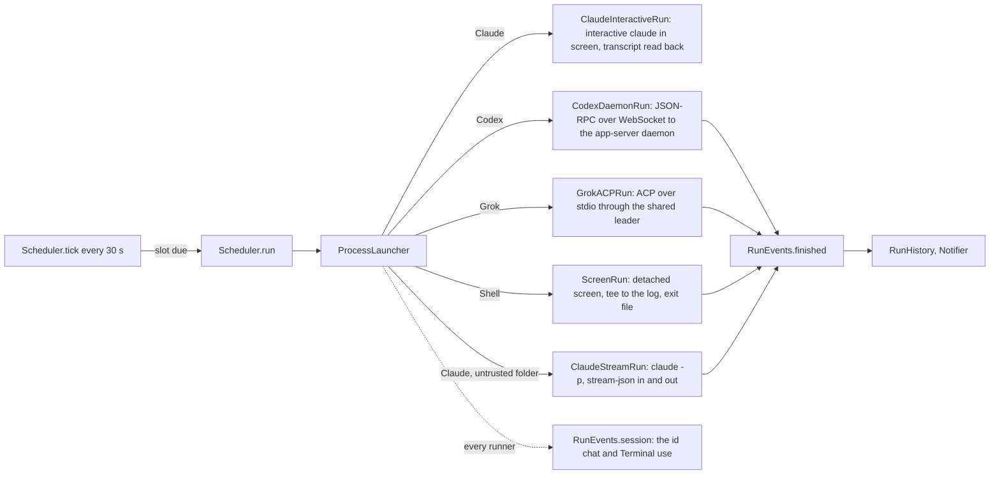

# Architecture

## RotaCore

- `CronSchedule` parses five-field cron (Vixie semantics: day of month and day
  of week OR when both are restricted; weekday 7 is Sunday) and finds the next
  fire time day by day, skipping wall-clock times a DST change removes.
- `Scheduler` owns the routines (`routines.json` in Application Support) and
  persists each routine's `nextFire`. A tick fires a due slot (a catch-up or a
  skip when it is late, below) and moves `nextFire` past now either way.
- `Harness` holds everything per CLI: default path, headless arguments, launch
  mode, chat arguments, and which capabilities (Chrome, phone push) it has.
  `SkillRequirements` reads the routine's `.claude/skills/<id>/SKILL.md` for
  markers of those capabilities.
- A routine's explicit `model` and `effort` (nil leaves the CLI's default) are
  captured in `RunRecord` at session creation and passed through `LaunchSpec`;
  historical labels and continuations use that snapshot, even after editing
  the routine. Old records without a snapshot resume without explicit model or
  effort overrides; their composer can recover configuration from the harness
  or readable log as described below. Each runner turns the options into its own form, Claude
  `--model`/`--effort` and Grok `--model`/`--reasoning-effort` through
  `LaunchSpec.modelFlags`, Codex fields in `thread/start` and `turn/start`. A
  session keeps its original harness. `ModelCatalog` lists the choices without
  spending quota: Codex `model/list` with each model's efforts, `grok models`,
  and Claude's control initialization with resolved model IDs and efforts. Each runner writes the model
  the CLI actually picked into its log header. A Grok model passed on the
  command line in leader mode left `grok models`' default untouched (live test,
  2026-10-09); Grok's agent-mode guide says a `session/set_config_option`
  model change is synced to the leader's other clients, so Rota does not use it.
- `RoutineImport.scanAll` reads every source read-only into `ImportCandidate`s:
  `ClaudeDesktopImport` (`scheduled-tasks.json` and its stubs) and
  `CodexAutomationsImport` (the `automations` table of the Codex app's
  `~/.codex/sqlite/*.db`, opened `mode=ro`; schedules are RFC 5545 RRULEs that
  `ScheduleText.cron(fromRRule:anchor:)` converts where cron can say the same,
  and a rule without an hour, such as the default `FREQ=HOURLY;INTERVAL=24`,
  takes it from `next_run_at`). A Codex automation that continues a thread,
  has no folder or has no cron equivalent is listed with the reason and cannot
  be picked. Grok Build has nothing to import: its scheduler holds one
  session's `/loop` tasks for at most seven days. `ScheduleText.describe` puts
  common cron shapes in words for the import list and the schedule field.
- Other processes reach the scheduler through `ControlServer`, a Unix socket
  at `Application Support/Rota/rota.sock` (0600, one JSON request and reply
  per line), whose methods are `Scheduler.control` in `ControlCommands.swift`:
  routines list/get/create/update/setEnabled/run/stop/delete and sessions
  list/read/message, all through the scheduler, the routines file's only
  writer. The `RotaCLI` target, bundled as `Contents/Helpers/rota`, is the
  `rota` command and, as `rota mcp`, an MCP stdio server whose tools map one
  to one onto those methods; it starts Rota in the background when the socket
  does not answer. `AgentAccess` links it into `~/.local/bin` and runs each
  agent CLI's own `mcp add`/`mcp remove` (Claude Code and Grok Build at user
  scope) when the user asks in Settings. A routine created over the socket is
  on, like one made in the window, and `RunNotifying.routineAdded` says so.
  `Routine.problem(checkingID:)` is the one rule for what may be saved: the
  control methods refuse with its sentence, and the New and Edit sheets keep
  Add and Save off with it beside the buttons. An update skips the id check,
  so a routine keeps the id it was imported with.
- Each run gets `ROTA_SESSION` (its `RunRecord` id), `ROTA_ROUTINE` and
  `ROTA_CLI` (the bundled `rota`) in its environment, so `rota notify` and the
  `notify_user` MCP tool know their session without arguments. The `notify`
  control method posts through `RunNotifying.sessionNotified`; with
  `needsReply` it sets `RunRecord.attention`, kept on the active copy too (the
  run's finish saves that copy), and `Scheduler.message` clears it before a
  continued run saves the record. The notification carries the session id for
  the click and, only when `Scheduler.canMessage` allows it, a text-input Reply
  action that answers like the composer. Shell and unavailable agent sessions
  say "Needs your attention" and have no Reply action.
- `ProcessLauncher` runs every CLI through `zsh -lc 'exec "$0" "$@"'` from
  `baseEnvironment` (the account's own variables only), so a routine sees what
  a new Terminal window sees, whatever started Rota: started by `rota` inside
  an agent session, Rota had passed that session's `CLAUDECODE`,
  `ANTHROPIC_BASE_URL` and super.engineering variables to every run. The
  interactive run's once-a-second `screen` calls skip the login shell
  (`capture(..., loginShell: false)`, 0.04 s against 0.17 s a call).
- Codex's app-server daemon and Grok's leader outlive the run that starts them
  and keep its folder and environment, so they start in the home folder with
  no run variables (`ProcessLauncher.helperDirectory`). A leader started in a
  routine's temporary folder that was later deleted failed every `npx` MCP
  server for every Grok session (Node's `uv_cwd`), playwright included, from
  2026-10-10 until it was restarted. Each session gets its folder over the
  protocol, and its `ROTA_*` variables as a Codex thread `config` override
  (`shell_environment_policy.set.*`, verified live in the command's
  environment) or, for Grok, whose commands have no per-session environment,
  as a `_meta.rules` sentence naming the session and the `rota notify` command.
- What a run can reach, checked live 2026-10-11 through Rota on each harness
  (`GLOBAL`/`CHROME`/`COMPUTER` self-report, Claude's `system/init` tool list,
  Codex `mcpServerStatus/list`, Grok session `events.jsonl`): all three load
  the global instructions; Claude has 22 `mcp__claude-in-chrome__` tools from
  `env.CLAUDE_CODE_ENABLE_CFC` in the user's settings, and Rota passes
  `--chrome` when `claudeInChromeDefaultEnabled` in `~/.claude.json` is on
  (`ClaudeUserSettings`: a run follows the user's settings, never a guess from
  the prompt); in print mode it has no built-in computer use, which Claude Code
  adds only to an interactive session, hence `ClaudeInteractiveRun`, where an
  interactive run in a computer-use project listed 27 `mcp__computer-use__`
  tools and answered `list_granted_applications`; Codex has its `computer-use`, `cua_repl` and
  `node_repl` plugins (Chrome through them); Grok has `playwright` from
  Claude's user config. Claude and Grok reach native apps through the
  `cua-driver` skill, whose grants belong to CuaDriver.app, not Rota.
- `ExecutableDiscovery` lists each agent CLI's installed copies: the PATH of a
  login shell started from an empty environment (an app opened from a terminal
  inherits that terminal's PATH, which put another tool's agent wrappers first
  on 2026-10-09), then the folders installers use, one entry per real file, each with
  the first line of its `--version`. A run uses the copy picked in Settings,
  else the first one found, else `Harness.defaultExecutable`. Shell routines
  always run in `/bin/zsh`, so Settings lists agents only.
- `ClaudeStreamRun` runs Claude the way Claude Desktop does
  (read from its live `ps` on 2026-10-09): `claude -p --input-format
  stream-json --output-format stream-json --verbose --permission-mode
  bypassPermissions`. The prompt and each later message are user messages on
  stdin; a message sent mid-turn joins that turn; the `result` event ends the
  run and closing stdin lets Claude exit and save the session; the `system`
  `init` event carries the session id, and `--resume <id>` continues it. `-p`
  asks no folder-trust question. The session lives in Rota's process.
- `ClaudeInteractiveRun` is the default for Claude (Settings > Agents), because
  only an interactive session loads computer use (`ClaudeUserSettings`). It
  runs `claude --session-id <id> --settings <hooks> --permission-mode
  bypassPermissions -- <prompt>` (`--resume <id>` to continue) in a detached
  `screen` session, which gives it a terminal and lets Open in Terminal
  attach. The chat is Claude's transcript, `~/.claude/projects/*/<id>.jsonl`,
  read from where it ended: assistant entries have the stream-json shape, a
  message typed mid-turn appears as a `queued_command` attachment, and
  `system`/`turn_duration` ends a turn (`ClaudeTranscript`, shapes from Claude
  Code 2.1.296 on 2026-10-11). Messages are typed in as a bracketed paste
  (`screen -X stuff` passes `^`, `\`, `$` through as typed); once the last turn
  ended with nothing typed since, the run types `/exit`. A `Notification` hook
  (permission or app-access prompt) marks the session needs-reply through
  `$ROTA_CLI notify`. Claude shows a folder-trust dialog nobody could answer,
  so a folder without `hasTrustDialogAccepted` (itself or its repository) runs
  in print mode with a note; Rota never answers that dialog or sets the flag.
  macOS attributes computer use to Rota (`responsible=com.wiltodelta.rota` in
  tccd's log), so Settings shows Rota's Accessibility and Screen Recording
  grants and asks for them.
- Every run stays reachable while it works, which is the point of each runner
  (verified live 2026-10-09 with `ROTA_LIVE=1 swift test --filter LiveHarnessTests`):
  - `CodexDaemonRun` runs `codex app-server daemon start`, then speaks JSON-RPC
    to the daemon through `codex app-server proxy`, which pipes the daemon's
    Unix socket; the socket is WebSocket, so `WebSocketTransport` does the
    RFC 6455 handshake and frames (Network.framework would not stack TCP on a
    Unix endpoint). `thread/start` with `approvalPolicy: never` and
    `sandbox: danger-full-access`, then `turn/start`; `turn/completed` ends the
    run; `send` is `turn/steer`, which joins the running turn. Codex's TUI could
    not be shown joining a live turn (`codex resume --remote` stalled behind its
    update prompt in a pty), so Rota offers the in-app field while running and
    `codex resume` after.
  - `GrokACPRun` runs `grok agent --leader --always-approve stdio` and speaks
    ACP: `session/new`, `session/prompt`, `session/update` chunks. The Grok TUI
    has no leader mode for joining a live session, so messages go through
    Rota's field as further `session/prompt`s, which Grok answers after the
    current turn; the run ends when every prompt has returned, or the queued
    answer would be lost with the connection.
  - `ScreenRun` writes a zsh script that runs the command with its output
    `tee`d to the log and writes `${pipestatus[1]}` to an exit file, starts it
    with `screen -dmS rota-<id>` (macOS ships screen 4.00, which has no
    `-Logfile`), and polls the exit file. When the file is missing and
    `screen -ls` no longer lists the session, it reads the file once more
    before calling the run interrupted: the script writes it just before
    screen ends, and a command that ended between the two checks read as
    interrupted. `RunJournal` appends with
    `seekToEndOfFile`, because tee writes the same file.
- A run is a session. `Scheduler.message(_:to:)` sends into a live session
  through its runner's `send`, or, for a finished one, `continueSession`
  starts a run of the same `RunRecord` with `LaunchSpec.resume` set to its
  session id, appending to the same log: Claude `--resume <session id>`, Codex
  `thread/resume`, Grok `session/load` with its replayed updates ignored.
  Verified live 2026-10-09 by the `*Continues*` tests in `LiveHarnessTests`.
- Runner adapters map supported output into a small Rota transcript contract.
  `RunJournal` serializes normalized JSONL and a readable log under one lock.
  `TranscriptReader` incrementally replays stable IDs, completed messages and
  partial text. New agent sessions display those entries in recorded order;
  tool schemas and provider event names never reach the view. Unknown optional
  output does not hide supported text. Storage, compatibility, failure and
  extension rules, incremental paging, and write consistency:
  [Transcript format](transcript-format.md).
- Legacy sessions and Shell retain their readable-log reader (`Transcript`):
  `[you] ` for user text, `-> ` for a tool, `[rota: …]` for status, `[error] `.
  `TranscriptTurn.group` preserves their existing inferred turn layout. Legacy
  continuation does not manufacture a normalized history from old log text.
- Agent text renders through `MarkdownBlock` (headings, list items, fenced
  code, paragraphs; inline Markdown inside each), because SwiftUI `Text` draws
  inline Markdown only. Typed messages preserve their complete text, including
  service-looking prefixes and code fences; the legacy parser keeps a fenced
  block with blank lines in one message.
- Scheduling follows Claude Desktop's policy: a missed slot runs once late, as
  `RunTrigger.catchUp`, when under `missedRunGrace` (7 days) old, otherwise a
  skip is recorded; an overlap is skipped without a notification. Skips stay
  in the routine's history and out of `allRecords()`, the sessions list.
  Five failed scheduled runs in a row (`failuresBeforePause`; skips and manual
  runs do not count) turn the routine off and notify once.
- `Resilience.swift`: the Mac cuts runs off, and Rota picks them up. `tick`
  starts nothing while `isOnline` is false (`MacState` watches `NWPathMonitor`),
  so a slot due on waking waits for the network. A run going when the Mac
  slept (`systemWillSleep`) that then fails or is interrupted, one that
  fails while offline or whose log ends on a network error (`NetworkFailure`),
  and every agent run `closeOrphans` finds still open at launch (a shutdown, a
  crash), is queued in `pendingResumes`; an agent run that failed that way
  before it had a session goes to `pendingReruns` and runs again whole (twice
  at most in a row). Neither starts until `ServiceProbe` gets any HTTP answer
  from the agent's API host (the Mac can report a network before DNS or a
  captive portal lets anything through); otherwise it asks again after
  `retryDelay` (60 s). A resume is continued in
  its session with `resumeMessage` ("Continue", shown in the chat as a
  message) once online, at most `resumeLimit` (2) times
  per run (`RunRecord.resumes`). An interactive Claude whose screen session is
  still up (Rota crashed, Claude did not) is left alone, and shell commands are
  never rerun. On `willPowerOff` the app quits without its confirmation, so
  the system is not held up and the open runs are orphans for the next launch.
- A finished session is unread until `markRead`, which `SessionView` calls
  when it shows a finished session (`RunRecord.readAt`, `isUnread`); the
  sidebar, the panel and the Dock badge read `unreadCount`.
- Quitting with runs going asks first (`applicationShouldTerminate`), then
  `stopAll` stops each the way Stop does and the app waits up to five seconds
  for them to end. Without that a Shell run's `screen` outlived Rota while its
  record read interrupted.
- A notification carries its session id (its routine's, for a skip or a
  pause) in `userInfo`; clicking it opens that item.
- A run has no time limit unless its routine sets `timeLimitMinutes`; each
  runner arms its timer only when `LaunchSpec.timeout` is set. The key replaced
  0.1's `timeoutMinutes`: `Routine.init(from:)` reads its 60, the default, as
  no limit and keeps any other value. An overlap is still skipped, so a long run never stacks.
- `RunHistory` keeps the last 50 finished sessions and 50 skipped slots per
  routine, plus every running session. It writes the retained history before
  deleting dropped logs, preserving any log still referenced by a retained
  record. Runs left `running` by a previous launch become
  `interrupted` at start.
- Manual session deletion uses `Scheduler.deleteSession`, which reloads the
  stored record and rejects active runs, including interactive Claude processes
  surviving an app restart. `RunHistory.remove` deletes the readable log and
  transcript journal only inside that routine's owned log directory, preserves
  files referenced by another record, and tolerates missing files. Other file
  errors retain the history entry for retry; deleting the pair is not atomic.
  Successful deletion cancels pending resumes and clears the composer draft.
  The UI requires confirmation, selects a neighboring session or the routine
  when empty, and leaves the routine and provider history untouched.
  Verification covers all finished outcomes, running/shared/foreign logs,
  symlink escapes, missing files and deletion failures. The native confirmation,
  Cancel, adjacent-session selection and empty history were exercised on
  synthetic data in both appearances at the 820 pt minimum width.

## App

`ImportSheet` separates the fixed search header and action footer from the
scrolling source groups. It is 640 x 500 pt and fits the 820 x 520 pt minimum content size.
Search matches names, folders and source apps; imported routines are hidden
by default and remain readable but unselectable when shown. Select All acts
only on visible, supported, not-yet-imported rows. Filtering preserves the
selection, and the footer counts all selected rows, including hidden ones.
Source activity uses neutral row text; the selected-active warning occupies a
reserved footer area so controls do not move when selection changes. Import
rechecks availability, saves paused routines, and clears model/effort only
when changing the original agent. Source stores remain read only.
Rows use native checkbox toggles with the whole label as the selection target;
already imported rows are checked and disabled, outside the selection count.
The signed development sheet was checked at minimum window size in both
appearances. Synthetic instances of the shipping view exercised long names,
search, hidden selections, filtered Select All, imported and unsupported rows,
Cancel, and actual scheduler saves into isolated storage. No source routine was
imported or run during verification.

Settings success labels (`Allowed`, `Installed`, CLI versions) share
`StatusLabelStyle`: a green symbol, readable secondary text and a 4 pt
icon-to-title layout gap. Check consistency between sibling states, including
rendered glyph edges, rather than judging each row in isolation. A native
520 pt Settings fixture using the production permission row and label style
was checked in both appearances at 2x: visible icon-to-letter gaps were
5.5-6 pt (different letter bearings), and status text contrast was 4.83:1 in
light and 5.64:1 in dark. The fixture supplies granted permissions; it does not
change system grants or install the command.

Chat implementation research and proposed changes, including the evidence and
limits of inspecting super.engineering, live in [Chat UI research](chat-ui-research.md).
The intended direction is a small provider-independent transcript contract
with tolerant handling of optional output, not full harness output parity.
The proposed adapter, journal, and view boundary is documented in that report;
the implemented subset and journal schema are in [Transcript format](transcript-format.md).

AppKit shell, SwiftUI content, the same structure as watch-me-sleep:
`AppDelegate` owns an `NSStatusItem`, the borderless `NSPanel` dropdown
(`MenuBarPanel.swift`, ported from watch-me-sleep with its sizing and Liquid
Glass rules), and the main and settings windows as `NSWindow`s around
`NSHostingController`s. The app turns `.regular` while a window is open and
back to `.accessory` when the last one closes. Window tabbing is off. The
panel footer places Open Rota on the left and groups Settings with Quit on
the right, per the requested Rota layout rather than the family default.
The content has an appearance-adaptive backing over the glass to maintain text
contrast across backdrops. Settings forms scroll when the screen is shorter
than their natural height, and the window frame stays inside the visible screen.
Unsent composer drafts live in `AppModel.sessionDrafts`, keyed by session ID,
until sent or the app quits. The chat's base fonts never fall below 10 pt before interface scaling. Reduce
Motion stops the stop-ring rotation and suppresses shimmer.
The File menu holds New Routine and Import, the Routine menu Run Now, Stop and
Edit Routine for `AppModel.selectedRoutine`; sheets open from `AppModel`
flags so menus and buttons share them. The session header's Show Routine action
selects its owning routine's existing detail page, where Edit opens the settings.
At narrow widths the session header moves its utility actions onto a second row,
keeping the labeled navigation action visible. Utility actions use accessible
icons with help text when their full titles no longer fit. The routine header
also moves its actions onto a second row instead of truncating their labels. `ChatTextSettings` holds the chat's
font family, monospaced family and base size in UserDefaults. `InterfaceScaleSettings`
stores one app-wide scale (80%, 90%, 100%, 110%, 125% or 150%). View menu zoom
commands and Settings > General change that same value. AppKit inserts a separator
before the native `toggleFullScreen:` action after AppKit menu changes finish,
because SwiftUI can discard a trailing command-group divider. The check
uses the action selector and preserves an existing separator after menu rebuilds.
`InterfaceScale` in the
SwiftUI environment scales layout dimensions; semantic font modifiers resolve
system fonts at their final size. `InterfacePicker` uses an `NSPopUpButton` with
an explicit final font, because SwiftUI's macOS Picker retains its default title
font even when the surrounding environment font changes. Popup values align
right beside their arrows; the native intrinsic width includes the longest menu
item, so default alignment leaves short values far from the arrow. Native button labels
also receive an explicit scaled font. Menu items keep the system font.
Chat fonts multiply their base size by the same
observable scale without rewriting chat preferences. No layer, bitmap or view
transform enlarges an already rendered interface. Every hosted root, including
Settings and the menu bar panel, receives the scale; sheets inherit it. Detail
views can shrink below their old 520 pt minimum, sheets cap their width at 780 pt,
and the panel retains its 340 pt width while content reflows. Its footer moves
whole actions to two rows when they no longer fit. Import caps its height at
500 pt so its action row remains inside the minimum-height window. System-owned menus,
window chrome, Settings toolbar tabs and file dialogs retain their native size.
New views must use the shared scaled fonts and point dimensions for app content.
The root modifier reads the observable scale inside its SwiftUI body. Reading it
only when AppKit constructs a hosting controller freezes that window's initial
scale. Verification must change the setting on an existing host and measure the
resulting font or geometry, rather than merely check the selected percentage.
Settings reports the form's actual geometry to AppKit after layout, coalescing
updates to its natural `contentSize`. A callback resizes the selected tab's window
within the screen's visible frame. The scroll controller must not publish the
full document height as `preferredContentSize`: AppKit turns it into a viewport
height constraint, defeating the screen cap and leaving the bottom unreachable.
The document keeps its natural height while the viewport scrolls independently.
The UI layout gate checks the window frame against the screen's visible area,
including menu bar and Dock exclusions, as well as checking the controls inside it.
The hosting controller's cached preferred size alone does not update an already
open Settings pane after zoom.
`ChatOpener` writes a `.command` file, which needs no Automation permission,
and `TerminalLauncher` opens it in the terminal picked in Settings: Terminal,
iTerm2 or another app as a document, Ghostty as a new instance with `-e`
(it does not run a script handed to it), or in the macOS default terminal:
the app that opens Unix executables, which "Make iTerm2 Default Term"
changes while `.command` files stay with Terminal, then the `.command` handler. A live test checks `TERM_PROGRAM` in each installed one.

Layout rules learned while measuring the narrowest window (820 pt):

- Routines appear first in the sidebar, above session history grouped by day,
  so history growth does not push routine navigation below it. `SessionView`
  is the chat with its composer. A routine's view
  is its header and sessions; the settings form, used rarely, is a sheet
  (`EditRoutineSheet`). A `Form` is never inside a `ScrollView`: it scrolls
  itself and, nested, lays out at its ideal width and overflows. Inside the old
  `VSplitView` it also left a 41 pt empty strip at the window's right edge.
- Never put a log or chat in an `HSplitView`: the split view sizes panes by
  their ideal width, and a log's ideal is its longest line, which overflowed
  the window.
- The harness picker is a menu: four fixed-width segments overflow.
- Sheets take a minimum and ideal height, never a fixed one: a 640 pt New
  routine sheet put its buttons below a 600 pt window.

The session-to-routine route was checked in the signed dev bundle at
820 x 552 and 1100 x 720 pt in both appearances, including a hidden sidebar,
opening Edit from the routine page, and returning to the same session with its
unsent draft preserved. Bounds checks found no overflow. The native navigation
and terminal buttons both measured 24 pt high; visible icon-to-label gaps were
10-11 pt, with native glyph-edge variation. Calibrated navigation-label samples
measured 13.14:1 in light and 9.73:1 in dark. Precision candidates were existing
section gaps, native button glyph bounds, distinct composer controls and the
centered summary/action row; no confirmed new alignment defect remained.
Verification used Accessibility actions, not assistive-technology task completion.

The routines-first sidebar was rendered at 820 x 552 pt in both appearances
with two synthetic routines and 40 sessions. The Routines heading appeared above
Today in both captures, and routine/session selection still worked. Bounds checks
found no overflow. Precision candidates were native section spacing, virtualized
history rows, scrollbar edges and existing control glyph bounds; no new confirmed
alignment defect remained.

## Checking the UI

`scripts/ui-check.sh` builds the app and drives it through the Accessibility
API with `scripts/ui-driver.swift` (System Events clicks and keystrokes do not
reach the windows here; `AXPress`, `AXValue` and a key event posted to Rota's
pid do). `--live` types Option-Return and Return into a running Codex
session's composer and checks the line break, the send and the reply. Controls it needs carry
`accessibilityIdentifier`s. Its `gate` command lists elements whose frame
leaves the window or its parent; inside a scroll area only what is scrolled
into view counts, and a list cell's content may pass the cell sideways by the
row's 8 pt inset and up or down as far as the list (a pinned section header
floats over the rows). Every
capture runs it. `choose` reads the pop-up back and retries,
because SwiftUI can redraw the form while its menu is open and drop the pick.

## Session configuration and attachments

`RunRecord.model` and `effort` remain requested snapshots. Optional
`reportedModel` and `reportedEffort` hold session configuration from each adapter
through `RunEvents.configuration` and `RunJournal.configure`. Scheduler merges
updates into both active and historical copies, guarded by run ID. Continuation
clears reported values before querying the harness again. The composer prefers
the reported model and applied effort. Codex sends its explicit turn effort on
`turn/start`, so its adapter combines that override with the thread configuration
before reporting it. These are configuration values, not per-turn execution telemetry.
Older records may recover a model from a bounded tail of Rota's readable headers;
Claude sessions missing an effort snapshot can resolve the continuation configuration
through a read-only control query. Unknown effort is labeled `Effort unavailable`,
never a fictitious default. No historical record is rewritten by this query.

`ChatAttachmentStore` copies regular files into UUID subfolders beside the owned
log, in `<log>.attachments`. Picker and URL drops share this path, off the UI actor;
a failed batch rolls back only its new copies. `ChatMessage` appends a versioned
JSON manifest to ordinary message text. All adapters receive the same text and
local paths, letting agent tools read files without requiring native attachment
payload support in every provider. This does not promise native multimodal input
or support for every file format. The transcript decodes the manifest into file
chips, including file-only messages; malformed manifests remain visible text.

Draft text and attachment references are keyed by session ID in `AppModel`, so
switching sessions preserves both. Removing a draft chip deletes only its owned
copy; normal app termination discards remaining draft copies. Accepted messages
clear draft state and retain their files for replay. Rejected scheduler sends
preserve the draft. As before, acceptance by Scheduler is not a provider delivery
acknowledgment. Session deletion, routine deletion and retention remove owned
logs, transcript journals and attachment folders together, preserving shared
logs. Crash-time or interrupted-copy leftovers are bounded by session retention.

The composer follow-up was verified in the Developer ID-signed dev bundle with
producer-generated synthetic history at 820 x 552 pt in both appearances and
1100 x 720 pt in dark appearance. Picker selection and cancellation, duplicate
picker prevention, file-only Send availability, removing a draft file, switching
between routine and session, and draft-copy cleanup on normal quit were exercised.
No real routine was fired by the GUI check. Attach and Send measured 28 x 28 pt,
with an 8 pt gap; both label rows use a 14 pt harness mark and 6 pt text gap.
Bounds checks found no overflow. Calibrated pixel samples passed 4.5:1 for model
and filename text in both appearances. Precision candidates came from deliberate
section gaps, native header controls, distinct Delete Session/Remove Attachment
actions, and glyph bounds inside equal-height chips; no new confirmed near-miss
remained. The Finder drag route and assistive-technology task completion were not
exercised. `ComposerTests` can export the synthetic history with
`ROTA_COMPOSER_FIXTURE_DIR`; captures stay outside the public repository.

The ordinary suite passed with live tests disabled. A separate 11-test live
run covered Claude stream mode, Codex, Grok and Shell, including every agent
reading an independently copied attachment. The unchanged external-terminal
GUI test was excluded. Provider sessions and the test-started idle daemons were
cleaned up, including newly created Claude `memory/` and Grok
`prompt_history.jsonl` companions in those fixture folders. Older fixture
folders were preserved. Disposable mutation checks rejected moving originals instead of
copying, omitting attachment retention, dropping configuration callbacks, and
reporting a failed continuation launch as an accepted message.

### Resolved Claude configuration

`ClaudeConfiguration` uses `initialize` and `get_settings` control requests over
stream-json, with no prompt and `--no-session-persistence`. Initialization supplies
`resolvedModel`, versioned display names and supported efforts. The catalog stores
concrete IDs, deduplicates aliases, and retains alias matches for existing routines.
Picker bindings resolve legacy aliases for display without rewriting saved routines;
a new selection stores the versioned ID. Codex and Grok already list versioned IDs.
No model-version table is embedded in Rota.

`get_settings.response.applied` supplies the actual model and effort after CLI
resolution, including environment precedence and model or organization limits.
Stream runs request it from their own process. Interactive runs query before
launch on their runner queue, then refresh effort from `CLAUDE_EFFORT` in session-only
PreToolUse/Stop hooks. The hook writes only the level into a per-launch cache file,
which the runner removes on finish. Hook settings are per-launch files, also
removed on finish, so dev and installed runs never overwrite a shared settings file.
The user's settings and status line are unchanged.
The ordinary transcript still supplies interactive model changes. Explicit null effort
means no effort parameter is sent, rendered as `No effort`, not an invented level.

The control wire was checked against installed Claude Code 2.1.302. Public field
semantics are documented in [Claude status lines](https://code.claude.com/docs/en/statusline)
and [hook input fields](https://code.claude.com/docs/en/hooks#common-input-fields).
Run the interactive live check with `ROTA_INTERACTIVE_TEST_DIR` pointing at an
already trusted test workspace; the test never grants trust itself.

Grok's leader was observed returning `high` when its proxy was launched with
`--reasoning-effort low`. Explicit effort now uses `session/set_config_option`
for `reasoning_effort` before the first prompt; Rota checks the returned option
list and also consumes `config_option_update` notifications. Model selection
continues to use the launch flag, since setting the model through that method
would synchronize defaults to other clients. Grok 1.0.62 accepts a string `value`
on this wire; its bundled guide's `{ "value": "low" }` example was rejected with
`Invalid params`. Live checks confirmed applied `low` on all three agents and
an unchanged Grok config. Existing run records are not rewritten.

The versioned-picker follow-up was exercised in the signed dev bundle at
820 x 552 pt in both appearances. Legacy alias display and Cancel preserved the
stored alias; choosing another model and saving stored its concrete ID. Claude,
Codex and Grok selectors resolved their default versions, and Haiku 4.5 disabled
unsupported effort. Bounds checks found no overflow. Calibrated composer-label
samples measured 4.82:1 in light and 5.71:1 in dark. Precision candidates were
section/action-group gaps, scrollbar bounds beside unrelated controls and native
text-box baseline proxies; model, effort and harness controls shared the same
right edge. No confirmed new alignment defect remained. Verification used
Accessibility actions, not assistive-technology task completion.

The separate live suite covered configuration without a turn, explicit effort
on every agent, interactive Claude, continuations, steering, attachments and
stopping. The external-terminal GUI test was excluded. Provider fixtures were
removed; the pre-existing Codex daemon and installed Rota were preserved. The
Grok configuration and development defaults matched their pre-check state.
Disposable mutation checks rejected losing alias resolution and prioritizing
requested effort over applied effort.
