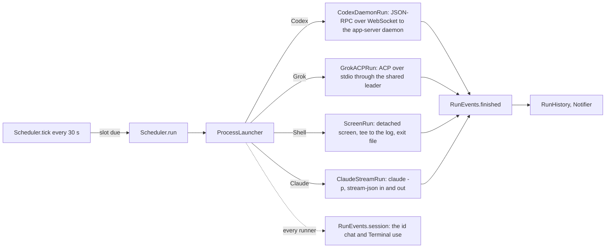

# Architecture

## RotaCore

- `CronSchedule` parses five-field cron (Vixie semantics: day of month and day
  of week OR when both are restricted; weekday 7 is Sunday) and finds the next
  fire time day by day, skipping wall-clock times a DST change removes.
- `Scheduler` owns the routines (`routines.json` in Application Support) and
  persists each routine's `nextFire`. A tick fires a due slot (a catch-up or a
  skip when it is late, below) and moves `nextFire` past now either way.
- `Harness` holds everything per CLI: default path, headless arguments, launch
  mode, chat arguments, and which capabilities (Chrome, phone push) it has.
  `SkillRequirements` reads the routine's `.claude/skills/<id>/SKILL.md` for
  markers of those capabilities.
- A routine's `model` and `effort` (nil leaves the CLI's default) travel only
  in `LaunchSpec`; each runner turns them into its own form, Claude
  `--model`/`--effort` and Grok `--model`/`--reasoning-effort` through
  `LaunchSpec.modelFlags`, Codex fields in `thread/start` and `turn/start`. A
  session continued on a harness the routine has since left runs without them. `ModelCatalog` lists the choices without
  spending quota: Codex `model/list` with each model's efforts, `grok models`,
  and Claude's family aliases (it has no list). Each runner writes the model
  the CLI actually picked into its log header. A Grok model passed on the
  command line in leader mode left `grok models`' default untouched (live test,
  2026-10-09); Grok's agent-mode guide says a `session/set_config_option`
  model change is synced to the leader's other clients, so Rota does not use it.
- `RoutineImport.scanAll` reads every source read-only into `ImportCandidate`s:
  `ClaudeDesktopImport` (`scheduled-tasks.json` and its stubs) and
  `CodexAutomationsImport` (the `automations` table of the Codex app's
  `~/.codex/sqlite/*.db`, opened `mode=ro`; schedules are RFC 5545 RRULEs that
  `ScheduleText.cron(fromRRule:anchor:)` converts where cron can say the same,
  and a rule without an hour, such as the default `FREQ=HOURLY;INTERVAL=24`,
  takes it from `next_run_at`). A Codex automation that continues a thread,
  has no folder or has no cron equivalent is listed with the reason and cannot
  be picked. Grok Build has nothing to import: its scheduler holds one
  session's `/loop` tasks for at most seven days. `ScheduleText.describe` puts
  common cron shapes in words for the import list and the schedule field.
- `ProcessLauncher` runs every CLI through `zsh -lc 'exec "$0" "$@"'`, so a
  routine sees the PATH a login terminal sees.
- `ExecutableDiscovery` lists each agent CLI's installed copies: the PATH of a
  login shell started from an empty environment (an app opened from a terminal
  inherits that terminal's PATH, which put another tool's agent wrappers first
  on 2026-10-09), then the folders installers use, one entry per real file, each with
  the first line of its `--version`. A run uses the copy picked in Settings,
  else the first one found, else `Harness.defaultExecutable`. Shell routines
  always run in `/bin/zsh`, so Settings lists agents only.
- `ClaudeStreamRun` runs Claude the way Claude Desktop does
  (read from its live `ps` on 2026-10-09): `claude -p --input-format
  stream-json --output-format stream-json --verbose --permission-mode
  bypassPermissions`. The prompt and each later message are user messages on
  stdin; a message sent mid-turn joins that turn; the `result` event ends the
  run and closing stdin lets Claude exit and save the session; the `system`
  `init` event carries the session id, and `--resume <id>` continues it. `-p`
  asks no folder-trust question. The session lives in Rota's process.
- Every run stays reachable while it works, which is the point of each runner
  (verified live 2026-10-09 with `ROTA_LIVE=1 swift test --filter LiveHarnessTests`):
  - `CodexDaemonRun` runs `codex app-server daemon start`, then speaks JSON-RPC
    to the daemon through `codex app-server proxy`, which pipes the daemon's
    Unix socket; the socket is WebSocket, so `WebSocketTransport` does the
    RFC 6455 handshake and frames (Network.framework would not stack TCP on a
    Unix endpoint). `thread/start` with `approvalPolicy: never` and
    `sandbox: danger-full-access`, then `turn/start`; `turn/completed` ends the
    run; `send` is `turn/steer`, which joins the running turn. Codex's TUI could
    not be shown joining a live turn (`codex resume --remote` stalled behind its
    update prompt in a pty), so Rota offers the in-app field while running and
    `codex resume` after.
  - `GrokACPRun` runs `grok agent --leader --always-approve stdio` and speaks
    ACP: `session/new`, `session/prompt`, `session/update` chunks. The Grok TUI
    has no leader mode for joining a live session, so messages go through
    Rota's field as further `session/prompt`s, which Grok answers after the
    current turn; the run ends when every prompt has returned, or the queued
    answer would be lost with the connection.
  - `ScreenRun` writes a zsh script that runs the command with its output
    `tee`d to the log and writes `${pipestatus[1]}` to an exit file, starts it
    with `screen -dmS rota-<id>` (macOS ships screen 4.00, which has no
    `-Logfile`), and polls the exit file. When the file is missing and
    `screen -ls` no longer lists the session, it reads the file once more
    before calling the run interrupted: the script writes it just before
    screen ends, and a command that ended between the two checks read as
    interrupted. `RunJournal` appends with
    `seekToEndOfFile`, because tee writes the same file.
- A run is a session. `Scheduler.message(_:to:)` sends into a live session
  through its runner's `send`, or, for a finished one, `continueSession`
  starts a run of the same `RunRecord` with `LaunchSpec.resume` set to its
  session id, appending to the same log: Claude `--resume <session id>`, Codex
  `thread/resume`, Grok `session/load` with its replayed updates ignored.
  Verified live 2026-10-09 by the `*Continues*` tests in `LiveHarnessTests`.
- Runners write the log as chat lines (`Transcript`): `[you] ` before every
  line of user text, `-> ` for a tool, `[rota: …]` for status, `[error] `;
  everything else is the agent's text. `Transcript.parse` turns it into the
  items `SessionView` draws.
- Agent text renders through `MarkdownBlock` (headings, list items, fenced
  code, paragraphs; inline Markdown inside each), because SwiftUI `Text` draws
  inline Markdown only. `Transcript.parse` keeps a fenced block with blank
  lines in one message.
- Scheduling follows Claude Desktop's policy: a missed slot runs once late, as
  `RunTrigger.catchUp`, when under `missedRunGrace` (7 days) old, otherwise a
  skip is recorded; an overlap is skipped without a notification. Skips stay
  in the routine's history and out of `allRecords()`, the sessions list.
  Five failed scheduled runs in a row (`failuresBeforePause`; skips and manual
  runs do not count) turn the routine off and notify once.
- A finished session is unread until `markRead`, which `SessionView` calls
  when it shows a finished session (`RunRecord.readAt`, `isUnread`); the
  sidebar, the panel and the Dock badge read `unreadCount`.
- Quitting with runs going asks first (`applicationShouldTerminate`), then
  `stopAll` stops each the way Stop does and the app waits up to five seconds
  for them to end. Without that a Shell run's `screen` outlived Rota while its
  record read interrupted.
- A notification carries its session id (its routine's, for a skip or a
  pause) in `userInfo`; clicking it opens that item.
- A run has no time limit unless its routine sets `timeLimitMinutes`; each
  runner arms its timer only when `LaunchSpec.timeout` is set. The key replaced
  0.1's `timeoutMinutes`: `Routine.init(from:)` reads its 60, the default, as
  no limit and keeps any other value. An overlap is still skipped, so a long run never stacks.
- `RunHistory` keeps the last 50 records per routine and deletes the logs of
  the ones it drops. Runs left `running` by a previous launch become
  `interrupted` at start.

## App

AppKit shell, SwiftUI content, the same structure as watch-me-sleep:
`AppDelegate` owns an `NSStatusItem`, the borderless `NSPanel` dropdown
(`MenuBarPanel.swift`, ported from watch-me-sleep with its sizing and Liquid
Glass rules), and the main and settings windows as `NSWindow`s around
`NSHostingController`s. The app turns `.regular` while a window is open and
back to `.accessory` when the last one closes. Window tabbing is off. The
File menu holds New Routine and Import, the Routine menu Run Now, Stop and
Edit Routine for `AppModel.selectedRoutine`; sheets open from `AppModel`
flags so menus and buttons share them. `ChatTextSettings` holds the chat's font family, monospaced family and size in
UserDefaults; only the chat and its composer follow them, the sidebar and
forms keep the system's sizes. `ChatOpener` writes a `.command` file and opens
it, which needs no Automation permission.

Layout rules learned while measuring the narrowest window (820 pt):

- Sessions are the main view: the sidebar lists them by day above the
  routines, and `SessionView` is the chat with its composer. A routine's view
  is its header and sessions; the settings form, used rarely, is a sheet
  (`EditRoutineSheet`). A `Form` is never inside a `ScrollView`: it scrolls
  itself and, nested, lays out at its ideal width and overflows. Inside the old
  `VSplitView` it also left a 41 pt empty strip at the window's right edge.
- Never put a log or chat in an `HSplitView`: the split view sizes panes by
  their ideal width, and a log's ideal is its longest line, which overflowed
  the window.
- The harness picker is a menu: four fixed-width segments overflow.
- Sheets take a minimum and ideal height, never a fixed one: a 640 pt New
  routine sheet put its buttons below a 600 pt window.

## Checking the UI

`scripts/ui-check.sh` builds the app and drives it through the Accessibility
API with `scripts/ui-driver.swift` (synthetic clicks and keystrokes do not
reach the windows here; `AXPress` and `AXValue` do). Controls it needs carry
`accessibilityIdentifier`s. Its `gate` command lists elements whose frame
leaves the window or its parent; inside a scroll area only what is scrolled
into view counts, and a list cell's content may pass the cell sideways by the
row's 8 pt inset and up or down as far as the list (a pinned section header
floats over the rows). Every
capture runs it. `choose` reads the pop-up back and retries,
because SwiftUI can redraw the form while its menu is open and drop the pick.
