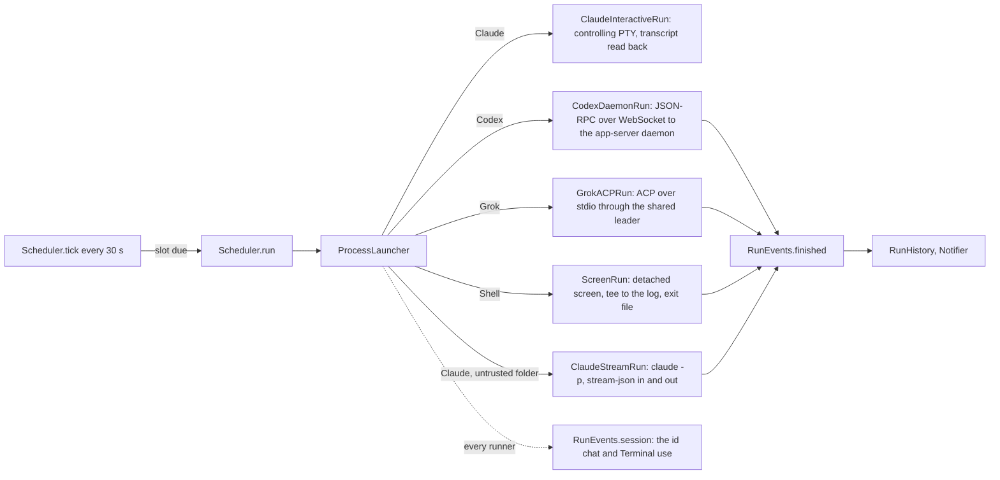

# Architecture

## RotaCore

- `CronSchedule` parses five-field cron (Vixie semantics: day of month and day
  of week OR when both are restricted; weekday 7 is Sunday) and finds the next
  fire time day by day, skipping wall-clock times a DST change removes.
- `Scheduler` owns the routines (`routines.json` in Application Support) and
  persists each routine's `nextFire`. A tick fires a due slot (a catch-up or a
  skip when it is late, below) and moves `nextFire` past now either way.
- `Harness` holds the CLI's default path, headless arguments, launch mode
  and chat arguments. Rota does not scan prompts or skill files for tool
  requirements or warn about compatibility when the harness changes. The
  selected agent resolves tool requirements during the run. Claude's Chrome
  launch flag follows the user's Claude settings, independently of skill text.
- A routine's `model` and `effort` (nil leaves the CLI's default) travel only
  in `LaunchSpec`; each runner turns them into its own form, Claude
  `--model`/`--effort` and Grok `--model`/`--reasoning-effort` through
  `LaunchSpec.modelFlags`, Codex fields in `thread/start` and `turn/start`. A
  session continued on a harness the routine has since left runs without them. `ModelCatalog` lists the choices without
  spending quota: Codex `model/list` with each model's efforts, `grok models`,
  and Claude's stream-json `initialize` control response (`models`). Claude
  choices show the CLI's versioned display names and model-specific efforts;
  family aliases keep their original IDs, and older versions use explicit IDs.
  Initialization sends no user prompt, disables hooks and MCP, and persists no
  session. An unavailable catalog is shown as unavailable, never replaced with
  a hardcoded model list; a saved selection remains intact. Each runner writes the model
  the CLI actually picked into its log header. A Grok model passed on the
  command line in leader mode left `grok models`' default untouched (live test,
  2026-10-09); Grok's agent-mode guide says a `session/set_config_option`
  model change is synced to the leader's other clients, so Rota does not use it.
- `RoutineImport.scanAll` reads every source read-only into `ImportCandidate`s:
  `ClaudeDesktopImport` (`scheduled-tasks.json` and its stubs) and
  `CodexAutomationsImport` (the `automations` table of the Codex app's
  `~/.codex/sqlite/*.db`, opened `mode=ro`; schedules are RFC 5545 RRULEs that
  `ScheduleText.cron(fromRRule:anchor:)` converts where cron can say the same,
  and a rule without an hour, such as the default `FREQ=HOURLY;INTERVAL=24`,
  takes it from `next_run_at`). A Codex automation that continues a thread,
  has no folder or has no cron equivalent is listed with the reason and cannot
  be picked. Grok Build has nothing to import: its scheduler holds one
  session's `/loop` tasks for at most seven days. `ScheduleText.describe` puts
  common cron shapes in words for the import list and the schedule field.
- Other processes reach the scheduler through `ControlServer`, a Unix socket
  at `Application Support/Rota/rota.sock` (0600, one JSON request and reply
  per line), whose methods are `Scheduler.control` in `ControlCommands.swift`:
  routines list/get/create/update/setEnabled/run/stop/delete and sessions
  list/read/message, all through the scheduler, the routines file's only
  writer. The `RotaCLI` target, bundled as `Contents/Helpers/rota`, is the
  `rota` command and, as `rota mcp`, an MCP stdio server whose tools map one
  to one onto those methods; it starts Rota in the background when the socket
  does not answer. `AgentAccess` links it into `~/.local/bin` and runs each
  agent CLI's own `mcp add`/`mcp remove` (Claude Code and Grok Build at user
  scope) when the user asks in Settings. A routine created over the socket is
  on, like one made in the window, and `RunNotifying.routineAdded` says so.
  `Routine.problem(checkingID:)` is the one rule for what may be saved: the
  control methods refuse with its sentence, and the New and Edit sheets keep
  Add and Save off with it beside the buttons. An update skips the id check,
  so a routine keeps the id it was imported with.
- Each run gets `ROTA_SESSION` (its `RunRecord` id), `ROTA_ROUTINE` and
  `ROTA_CLI` (the bundled `rota`) in its environment, so `rota notify` and the
  `notify_user` MCP tool know their session without arguments. The `notify`
  control method posts through `RunNotifying.sessionNotified`; with
  `needsReply` it sets `RunRecord.attention`, kept on the active copy too (the
  run's finish saves that copy), and `Scheduler.message` clears it before a
  continued run saves the record. The notification carries the session id for
  the click and a text-input Reply action that answers like the composer.
- `ProcessLauncher` runs every CLI through `zsh -lc 'exec "$0" "$@"'` from
  `baseEnvironment` (the account's own variables only), so a routine sees what
  a new Terminal window sees, whatever started Rota: started by `rota` inside
  an agent session, Rota had passed that session's `CLAUDECODE`,
  `ANTHROPIC_BASE_URL` and super.engineering variables to every run. The
  legacy `screen` checks skip the login shell
  (`capture(..., loginShell: false)`, 0.04 s against 0.17 s a call).
- Codex's app-server daemon and Grok's leader outlive the run that starts them
  and keep its folder and environment, so they start in the home folder with
  no run variables (`ProcessLauncher.helperDirectory`). A leader started in a
  routine's temporary folder that was later deleted failed every `npx` MCP
  server for every Grok session (Node's `uv_cwd`), playwright included, from
  2026-10-10 until it was restarted. Each session gets its folder over the
  protocol, and its `ROTA_*` variables as a Codex thread `config` override
  (`shell_environment_policy.set.*`, verified live in the command's
  environment) or, for Grok, whose commands have no per-session environment,
  as a `_meta.rules` sentence naming the session and the `rota notify` command.
- What a run can reach, checked live 2026-10-11 through Rota on each harness
  (`GLOBAL`/`CHROME`/`COMPUTER` self-report, Claude's `system/init` tool list,
  Codex `mcpServerStatus/list`, Grok session `events.jsonl`): all three load
  the global instructions; Claude has 22 `mcp__claude-in-chrome__` tools from
  `env.CLAUDE_CODE_ENABLE_CFC` in the user's settings, and Rota passes
  `--chrome` when `claudeInChromeDefaultEnabled` in `~/.claude.json` is on
  (`ClaudeUserSettings`: a run follows the user's settings, never a guess from
  the prompt); in print mode it has no built-in computer use, which Claude Code
  adds only to an interactive session, hence `ClaudeInteractiveRun`, where an
  interactive run in a computer-use project listed 27 `mcp__computer-use__`
  tools and answered `list_granted_applications`; Codex has its `computer-use`, `cua_repl` and
  `node_repl` plugins (Chrome through them); Grok has `playwright` from
  Claude's user config. Claude and Grok reach native apps through the
  `cua-driver` skill, whose grants belong to CuaDriver.app, not Rota.
- `ExecutableDiscovery` lists each agent CLI's installed copies: the PATH of a
  login shell started from an empty environment (an app opened from a terminal
  inherits that terminal's PATH, which put another tool's agent wrappers first
  on 2026-10-09), then the folders installers use, one entry per real file, each with
  the first line of its `--version`. A run uses the copy picked in Settings,
  else the first one found, else `Harness.defaultExecutable`. Shell routines
  always run in `/bin/zsh`, so Settings lists agents only.
- `ClaudeStreamRun` runs Claude the way Claude Desktop does
  (read from its live `ps` on 2026-10-09): `claude -p --input-format
  stream-json --output-format stream-json --verbose`. The prompt and each later message are user messages on
  stdin; a message sent mid-turn joins that turn; the `result` event ends the
  run and closing stdin lets Claude exit and save the session; the `system`
  `init` event carries the session id, and `--resume <id>` continues it. `-p`
  asks no folder-trust question. The session lives in Rota's process.
- `ClaudeInteractiveRun` is the default for Claude (Settings > Agents), because
  only an interactive session loads computer use (`ClaudeUserSettings`). It
  runs `claude --session-id <id> --settings <hooks> -- <prompt>` (`--resume <id>` to continue) in a detached
  controlling PTY owned by `PTYProcess`. Open in Terminal uses the bundled
  `rota attach-terminal` client through a private 0600 Unix socket. Ctrl-] detaches
  without stopping Claude; resizing the client resizes the PTY. A slow attachment
  is disconnected after its output queue reaches 512 KiB, leaving the agent free
  to continue. Terminal replay is bounded to 64 KiB. The child establishes its
  own session and controlling terminal in a C shim before `execve`; Swift never
  runs in the forked child. Rota drains terminal output and receives the actual
  process exit status through `waitpid`. The chat is Claude's transcript, `~/.claude/projects/*/<id>.jsonl`,
  read from where it ended: assistant entries have the stream-json shape, a
  message typed mid-turn appears as a `queued_command` attachment, and
  `system`/`turn_duration` ends a turn (`ClaudeTranscript`, shapes from Claude
  Code 2.1.296 on 2026-10-11). Messages are typed in as a bracketed paste
  directly into the PTY. Messages arriving during CLI startup remain pending
  until Claude writes its initial prompt to the transcript, so startup cannot
  silently discard the input. Once the last turn ended with nothing typed
  since, the run types `/exit`. A `Notification` hook
  (permission or app-access prompt) marks the session needs-reply through
  `$ROTA_CLI notify`. Claude shows a folder-trust dialog nobody could answer,
  so a folder without `hasTrustDialogAccepted` (itself or its repository) runs
  in print mode with a note; Rota never answers that dialog or sets the flag.
  macOS attributes computer use to Rota (`responsible=com.wiltodelta.rota` in
  tccd's log), so Settings shows Rota's Accessibility and Screen Recording
  grants and asks for them.
- Harness configuration owns permissions, sandbox policy, MCP servers, plugins
  and skills. Rota passes transport flags, run identity and notification hooks,
  plus model/effort only when the routine explicitly chooses them. It never
  forces permission bypass or auto-approves a tool request. Codex command,
  file-change and turn-scoped permission requests, Codex user questions, Grok
  ACP tool permissions, Claude print-mode `can_use_tool` requests and its
  `AskUserQuestion` forms wait for
  an explicit answer in the chat. `SessionRequests` holds the original reply
  closures on the run queue and validates the selected option before consuming
  a request exactly once. Codex requests resolved by another client are removed
  using `serverRequest/resolved`; Claude cancellations also dismiss their form.
  Stop, timeout and disconnect invalidate outstanding choices. The request
  broker never logs answer values; provider transcripts can still contain an
  answer if the provider echoes it. Secret question fields use secure input.
  Interactive Claude bridges `AskUserQuestion` through `PreToolUse` and one-time
  tool permissions through `PermissionRequest`. Each run owns a 0600 Unix socket
  (`ClaudeHookServer`) on its runner queue. The bundled `rota claude-hook` helper
  reads the actual hook payload from stdin and waits for a response through
  `ControlClient`; it never starts the app or routes to another session. Hook
  session IDs are validated before creating a form. Question replies preserve
  the original input and add answers keyed by the original question text;
  permission replies never persist rules or change the permission mode. Client
  EOF, stop and timeout invalidate pending choices. Bridge failures return an
  explicit denial. Generated hook settings are unique per run and removed on
  finish. The hook wait expires after 24 hours; native prompts outside those
  hook events still use the attached Terminal. Managed/user hook policies are
  respected. `LiveClaudeHookTests` verifies real interactive answers, one-time
  permissions and cancellation when `ROTA_LIVE=1` and
  `ROTA_LIVE_TRUSTED_FOLDER` names an already trusted checkout.
  A permission prompt marks the session needs-reply; answering ordinary chat
  text never approves a pending tool request.
- Every run stays reachable while it works, which is the point of each runner
  (verified live 2026-10-09 with `ROTA_LIVE=1 swift test --filter LiveHarnessTests`):
  - `CodexDaemonRun` runs `codex app-server daemon start`, then speaks JSON-RPC
    to the daemon through `codex app-server proxy`, which pipes the daemon's
    Unix socket; the socket is WebSocket, so `WebSocketTransport` does the
    RFC 6455 handshake and frames (Network.framework would not stack TCP on a
    Unix endpoint). `thread/start` or `thread/resume` omits approval and sandbox
    overrides, then `turn/start`; `turn/completed` ends the
    run; `send` is `turn/steer`, which joins the running turn. Codex's TUI could
    not be shown joining a live turn (`codex resume --remote` stalled behind its
    update prompt in a pty), so Rota offers the in-app field while running and
    `codex resume` after.
  - `GrokACPRun` runs `grok agent --leader stdio` and speaks
    ACP: `session/new`, `session/prompt`, `session/update` chunks. The Grok TUI
    has no leader mode for joining a live session. Rota sends text steering
    through `_x.ai/interject` with `sessionId` and `text`, and waits for the
    provider's queue acknowledgment (`result.status: queued` on the installed
    leader) or an explicit `accepted` acknowledgment. Unknown replies remain
    unconfirmed. The initial prompt and outstanding
    acknowledgments must finish before the connection closes. Timed-out writes
    remain unconfirmed and are never automatically retried.
  - `ScreenRun` writes a zsh script that runs the command with its output
    `tee`d to the log and writes `${pipestatus[1]}` to an exit file, starts it
    with `screen -dmS rota-<id>` (macOS ships screen 4.00, which has no
    `-Logfile`), and polls the exit file. When the file is missing and
    `screen -ls` no longer lists the session, it reads the file once more
    before calling the run interrupted: the script writes it just before
    screen ends, and a command that ended between the two checks read as
    interrupted. `RunJournal` appends with
    `seekToEndOfFile`, because tee writes the same file.
- A run is a session. `Scheduler.message(_:to:)` sends into a live session
  through its runner's `send`, or, for a finished one, `continueSession`
  starts a run of the same `RunRecord` with `LaunchSpec.resume` set to its
  session id, appending to the same log: Claude `--resume <session id>`, Codex
  `thread/resume`, Grok `session/load` with its replayed updates ignored.
  Verified live 2026-10-09 by the `*Continues*` tests in `LiveHarnessTests`.
- `RunJournal` writes normalized `SessionEvent` records beside each readable
  log, at `<log>.events.jsonl`. Message, turn, and tool IDs remain separate from
  display text. Claude partial events and completed snapshots share IDs;
  Codex phases distinguish commentary and final answers; Grok chunks create a
  new segment after tool activity. Tool updates retain input, output and status.
  `SessionEventReader` incrementally reads complete JSONL records without
  cutting off older messages; an incomplete final line waits, while a corrupt
  complete line raises and is shown as an error. `SessionTranscript` projects
  events into chat items, and `TranscriptTurn.group` respects their explicit
  turn IDs. An unphased assistant segment followed by a tool becomes activity.
  `TranscriptDocument`
  assembles every visible turn into one attributed string in a read-only
  `NSTextView`, hosted by `TranscriptScrollView`. Selection crosses paragraphs,
  lists, code and messages; native Copy and Command-C copy the selected range.
  UTF-16 offsets move with insertions before the selection, and appended
  answers do not extend it. Refreshes preserve selection and scroll position;
  automatic following pauses while text is selected. Messages use plain
  speaker labels, and plans list each step's status as text. The rounded
  composer keeps its model, run clock, Send and Stop controls.
- `ChatMessage` carries text and `ChatAttachment` metadata. The composer accepts
  file selection and file-URL drops, shows downsampled image previews and removable
  file chips, and permits attachment-only messages. `Scheduler.message` retains
  copies beside the log in `<stem>.attachments/<message-id>/<attachment-id>/` before
  launching or steering. Missing files, folders, invalid IDs and size/count limits
  fail before delivery; failed messages restore their attachments as well as text.
  `LaunchSpec.attachments` carries retained files through a continuation. Claude
  stream-json sends base64 image blocks, Codex sends `localImage` inputs on both
  start and steer, and Grok sends ACP image blocks only when initialize advertises
  `promptCapabilities.image`. Grok interject and interactive Claude receive text
  references to retained files. Other formats use references under the harness's
  existing tool permissions; attaching a file does not widen sandbox access.
  A separate normalized `attachments` event leaves old user event decoding intact.
  The transcript renders bounded thumbnails and native file links. Log retention
  removes attachment copies with the readable log and event sidecar.
- Delivery has an independent state keyed by message ID. A local row does not
  confirm delivery. Claude print mode uses replayed user messages, interactive
  Claude uses its transcript echoes, Codex validates the `turn/steer` reply's
  turn ID, and Grok checks its interject acknowledgment. Writes without a
  provider acknowledgment remain marked as sent or unconfirmed. The composer
  can restore a rejected or cancelled message as an editable draft.
- `RunRecord.configuration` captures requested model, effort and working
  directory. Continuations reuse it even after routine edits, with legacy
  records adopting it on their next continuation. Reported model/effort update
  `RunRecord.metadata` and each new response's label without rewriting earlier
  responses. The composer shows the harness and a readable model name, using
  the reported model first, then the launch snapshot, and routine settings only
  for legacy records without a snapshot. Catalog titles take priority; Claude
  versioned IDs display as names such as Opus 5.5, with the original ID in a
  tooltip. Unknown ID formats remain intact. The label may wrap to two lines at large
  zoom instead of squeezing the Send or Stop control. Claude ID formatting
  follows the [documented version scheme](https://platform.claude.com/docs/en/models/model-ids-and-versions).
  Event-save failures are retained in `RunRecord.eventError` and
  shown in the session; the readable log remains available.
- Legacy sessions and shell output still use `Transcript.parse` over the
  readable log. Before an old agent session continues, its full readable
  history is imported once as a legacy event. History retention removes
  the readable log, its event sidecar and retained attachment copies.
- Agent text renders through `MarkdownBlock` (headings, list items, fenced
  code, paragraphs; inline Markdown inside each) into native attributed text.
  Headings use the body size with semibold weight; code uses the chosen
  monospaced font and wraps inside the text column. `Transcript.parse` keeps
  a fenced block with blank lines in one message. Separate selectable views
  must not split the transcript: they prevent cross-block selection.
- `TranscriptSelectionTests` imports the app target and exercises the actual
  native text view. It copies through the view's advertised pasteboard types
  into a private pasteboard, and checks selection after streamed appends,
  inserted activity, font changes and shortening. No agent is launched.
- Scheduling follows Claude Desktop's policy: a missed slot runs once late, as
  `RunTrigger.catchUp`, when under `missedRunGrace` (7 days) old, otherwise a
  skip is recorded; an overlap is skipped without a notification. Skips stay
  in the routine's history and out of `allRecords()`, the sessions list.
  Five failed scheduled runs in a row (`failuresBeforePause`; skips and manual
  runs do not count) turn the routine off and notify once.
- `Resilience.swift`: the Mac cuts runs off, and Rota picks them up. `tick`
  starts nothing while `isOnline` is false (`MacState` watches `NWPathMonitor`),
  so a slot due on waking waits for the network. A run going when the Mac
  slept (`systemWillSleep`) that then fails or is interrupted, one that
  fails while offline or whose log ends on a network error (`NetworkFailure`),
  and every agent run `closeOrphans` finds still open at launch (a shutdown, a
  crash), is queued in `pendingResumes`; an agent run that failed that way
  before it had a session goes to `pendingReruns` and runs again whole (twice
  at most in a row). Neither starts until `ServiceProbe` gets any HTTP answer
  from the agent's API host (the Mac can report a network before DNS or a
  captive portal lets anything through); otherwise it asks again after
  `retryDelay` (60 s). A resume is continued in
  its session with `resumeMessage` ("Continue", shown in the chat as a
  message) once online, at most `resumeLimit` (2) times
  per run (`RunRecord.resumes`). A legacy interactive Claude whose screen session is
  still up (Rota crashed, Claude did not) is left alone, and shell commands are
  never rerun. On `willPowerOff` the app quits without its confirmation, so
  the system is not held up and the open runs are orphans for the next launch.
- A finished session is unread until `markRead`, which `SessionView` calls
  when it shows a finished session (`RunRecord.readAt`, `isUnread`); the
  sidebar, the panel and the Dock badge read `unreadCount`.
- Quitting with runs going asks first (`applicationShouldTerminate`), then
  `stopAll` stops each the way Stop does and the app waits up to five seconds
  for them to end. Without that a Shell run's `screen` outlived Rota while its
  record read interrupted.
- A notification carries its session id (its routine's, for a skip or a
  pause) in `userInfo`; clicking it opens that item.
- A run has no time limit unless its routine sets `timeLimitMinutes`; each
  runner arms its timer only when `LaunchSpec.timeout` is set. The key replaced
  0.1's `timeoutMinutes`: `Routine.init(from:)` reads its 60, the default, as
  no limit and keeps any other value. An overlap is still skipped, so a long run never stacks.
- `RunHistory` keeps the last 50 records per routine and deletes the logs of
  the ones it drops. Runs left `running` by a previous launch become
  `interrupted` at start.

## App

AppKit shell, SwiftUI content, the same structure as watch-me-sleep:
`AppDelegate` owns an `NSStatusItem`, the borderless `NSPanel` dropdown
(`MenuBarPanel.swift`, ported from watch-me-sleep with its sizing and Liquid
Glass rules), and the main and settings windows as `NSWindow`s around
`NSHostingController`s. The app turns `.regular` while a window is open and
back to `.accessory` when the last one closes. Window tabbing is off. The
File menu holds New Routine and Import, the Routine menu Run Now, Stop and
Edit Routine for `AppModel.selectedRoutine`; sheets open from `AppModel`
flags so menus and buttons share them. `ChatTextSettings` saves font families
and a base point size relative to app scale, keeping earlier point-size
preferences compatible. `AppZoomSettings` saves 50–200% app scale, normalized
in 10 percentage point steps, with Command-=, Command-Minus and Command-0
(reset to 100%) in View. Chat text has its own Option-Command variants. Its
rendered scale is `clamp(appScale * baseSize / 14, 0.5, 2)`, so the default
14 pt body stays within 7–28 pt. Each chat step adds or subtracts
`0.1 * appScale` to that effective scale, then stores the result divided by
app scale. A chat reset restores an effective 14 pt and leaves app scale
alone; changing app scale preserves the saved relative chat preference.
`ZoomMenuItems` observes the preferences in a view so shortcut availability
updates without reopening the menu. Increase and decrease are disabled at
their effective limits. Settings > General shows app zoom, and Settings > Chat
shows effective chat text size. Both use percentages with minus, plus and reset
controls; their explanations distinguish interface scaling from text-only changes.
`InterfaceTypography` resizes system font descriptors before drawing;
`scaledFont` applies the coefficient to body, headline, callout, caption and
explicit point sizes. Window content, settings, sheets and the menu bar panel
use real fonts and reflow naturally. `InterfaceMetrics` scales spacing, padding,
status dots, logos, card radii, outlines, editor heights and column widths.
Content button geometry scales continuously, with a 20 pt minimum hit target;
`InterfacePicker` draws selected values and chevrons in scaled points while
using an AppKit button and `NSHostingMenu` with an inline picker for selection
and checkmarks. The button exposes a native popup accessibility role and sizes
its actual font and symbol, without hiding a control behind an overlay. Native
switches use macOS control-size variants. Settings and the
menu bar panel grow with app scale. Sheets are bounded by the parent window,
and settings by the visible screen; their forms scroll before reaching those
bounds. The split view preserves room for the detail at the 820 pt minimum
window width instead of forcing a wider window. Transcript margins, list
indents and paragraph spacing follow app scale independently of chat font size.
Native transcript fonts and the composer use the same bounded effective chat
size. No view or bitmap is stretched, so text draws at the display's native
resolution. The system's menu rows and window chrome retain their native sizes.
Native toolbar symbols use real scaled system fonts, with a 10 pt minimum,
inside regular borderless controls. Content styles stay inside the split-view
panes instead of propagating to the native toolbar. On macOS 26, shared toolbar
backgrounds are hidden
to prevent nested bezels. `FullScreenMenuSeparator` adds a visible native
separator before AppKit's full-screen command; a trailing SwiftUI divider
can disappear before AppKit appends that command.
After transcript resizing, the scroll origin is constrained to the document
with `NSClipView.constrainBoundsRect`, preserving visible text and selection.
Typography keeps distinct roles: sidebar names use the system body style,
metadata uses caption, and section headings use headline. Forms and supporting
information retain system fonts; chat prose and code have separately chosen
families, with code at 90% of the chat body size. App zoom preserves these
relationships, while chat text size changes the transcript and composer
without enlarging navigation. There is no separate sidebar font preference.
The interaction follows the editor pattern: [VS Code separates window zoom
from editor font size](https://code.visualstudio.com/docs/editing/getting-started/tips-and-tricks),
and [IntelliJ IDEA applies IDE zoom to all UI elements](https://www.jetbrains.com/help/idea/ide-zoom-level.html)
while keeping [editor font preferences separate](https://www.jetbrains.com/help/idea/configuring-colors-and-fonts.html).
Their steps are not a common standard; Rota keeps the requested super.engineering
steps and shortcuts. The reference comparison, evidence boundaries and the
two-control decision are in [interface-scaling.md](interface-scaling.md).
[WCAG Resize Text](https://www.w3.org/WAI/WCAG21/Understanding/resize-text)
is a usability benchmark here: doubling text must preserve content and actions,
including at intermediate scales. This is not a claim of WCAG conformance.
For repeatable captures, `ROTA_OPEN_MAIN=1` opens the main window and
`ROTA_WINDOW_WIDTH` / `ROTA_WINDOW_HEIGHT` choose its initial size, bounded
below by the normal minimum. Use a separate development bundle and data folder.
Verify main content at 820 pt in both appearances at 50%, 100% and 200%;
also check sheets, settings, native menu selection, focus, hit targets and
selection preservation. Use point geometry and real fonts instead of magnifying
a rendered surface, matching [AppKit's high-resolution rendering model](https://developer.apple.com/library/archive/documentation/GraphicsAnimation/Conceptual/HighResolutionOSX/Introduction/Introduction.html).

`ChatOpener` writes a `.command` file, which needs no Automation permission,
and `TerminalLauncher` opens it in the terminal picked in Settings: Terminal,
iTerm2 or another app as a document, Ghostty as a new instance with `-e`
(it does not run a script handed to it), or in the macOS default terminal:
the app that opens Unix executables, which "Make iTerm2 Default Term"
changes while `.command` files stay with Terminal, then the `.command` handler. A live test checks `TERM_PROGRAM` in each installed one.
Every terminal opens through `/usr/bin/open` with
`ProcessLauncher.baseEnvironment`, including the fallback document opener.
`NSWorkspace.OpenConfiguration.environment` only adds overrides, so omitting
child-session variables there does not remove them. A newly launched terminal must not inherit the
calling agent's `CLAUDE_CODE_CHILD_SESSION` or session id, which would disable
Claude transcript saving in its future tabs. This does not change the
environment of a terminal that is already running.

Layout rules learned while measuring the narrowest window (820 pt):

- Settings uses toolbar tabs: General, Chat, Agents and Integrations. CLI
  selection and Claude's interactive mode belong to Agents; the rota command
  and MCP registration belong to Integrations. Forms cap their height at the
  screen's visible height minus 100 pt and scroll on shorter screens. The
  settings window clamps every resize, including tab-switch animation frames,
  above the Dock. Restore the saved tab before recording selection changes,
  and clear focus when opening or switching tabs.
- The UI layout gate checks standard windows against the screen's visible
  frame as well as controls against their parents. A window can pass the
  control checks while its bottom is hidden by the Dock.
- Sessions are the main view: the sidebar lists them by day above the
  routines, and `SessionView` is the chat with its composer. A routine's view
  is its header and sessions; the settings form, used rarely, is a sheet
  (`EditRoutineSheet`). A `Form` is never inside a `ScrollView`: it scrolls
  itself and, nested, lays out at its ideal width and overflows. Inside the old
  `VSplitView` it also left a 41 pt empty strip at the window's right edge.
- Never put a log or chat in an `HSplitView`: the split view sizes panes by
  their ideal width, and a log's ideal is its longest line, which overflowed
  the window.
- The harness picker is a menu: four fixed-width segments overflow.
- Sheets take a minimum and ideal height, never a fixed one: a 640 pt New
  routine sheet put its buttons below a 600 pt window.

## Checking the UI

`scripts/ui-check.sh` builds the app and drives it through the Accessibility
API with `scripts/ui-driver.swift` (System Events clicks and keystrokes do not
reach the windows here; `AXPress`, `AXValue` and a key event posted to Rota's
pid do). `--live` types Option-Return and Return into a running Codex
session's composer and checks the line break, the send and the reply. Controls it needs carry
`accessibilityIdentifier`s. Its `gate` command lists elements whose frame
leaves the window or its parent; inside a scroll area only what is scrolled
into view counts, and a list cell's content may pass the cell sideways by the
row's 8 pt inset and up or down as far as the list (a pinned section header
floats over the rows). Every
capture runs it. `choose` reads the pop-up back and retries,
because SwiftUI can redraw the form while its menu is open and drop the pick.

### Browser and desktop diagnostics

`scripts/capability-check.py --live` probes installed harness capabilities through
the signed development app, with isolated disabled routines and a loopback
browser fixture. It preserves provider defaults. The ordinary test gate runs
only the deterministic evidence checks through `CapabilityCheckTests`. Browser
proof requires the fresh DOM value in a browser tool result; desktop proof
requires a native tool's PNG image or JPEG with nonzero dimensions, separately
from browser screenshots.
Unsupported image formats or opaque wrappers remain unverified. Provider claims
are retained separately from the checker's verdict.

macOS attributes child browser-profile access to the responsible application.
Development and production Rota have separate bundle identities and permissions;
a successful Terminal run or a shared helper started elsewhere does not prove
that a freshly started Rota child can read Chrome's profile. A driver's missing
`DevToolsActivePort` error can conceal a read-permission denial. Check existence
and readability inside the failing harness and inspect the responsible bundle's
TCC decision before attributing the failure to Chrome configuration. The live
check never changes grants, accounts or browser settings.

Settings > Browsers uses `ToolConnectionChecks` and `ToolConnectionEvidence` to
launch a user-requested, read-only inventory check through `ProcessLauncher`.
It respects the selected executable, project folder and Claude launch mode,
and leaves model, effort and permission settings at their provider defaults.
Results are scoped to that launch context and kept for the current app session.
An explicit provider permission request stops the check. Native Chrome/CUA tool
results establish connection; prose, discovery and external Playwright do not.
Each check has a two-minute limit and a private log under `connection-checks`
in the app's log folder. No scheduler registration is created.

Connection status, timestamps and check details use primary text so small text
remains readable in inactive settings windows in both appearances.

Codex's native browser helper resolves `CODEX_CLI_PATH` independently from the
ordinary node REPL and the Unified Computer Use plugin's MCP environment. A
missing executable produces an app-server spawn error even when browser
discovery succeeds. Inspect the running helper's environment, not only the
config file. The shared daemon can cache plugin settings until a safe restart.
Chrome identity in native `listTabs` results comes from the provider's
`codex/toolSurface.browserFamily`, rather than numeric browser IDs.

### Composer model-label verification

The readable model label was rendered in the signed development bundle at
820 pt, in light and dark appearances, at 50%, 100% and 200% app zoom. Native
bounds kept it inside the composer and clear of Send. At 200%, its two-line
height was measured and the complete harness and model names were visible.
The text contrast passed in both appearances. The model-source and formatting
tests passed; a disposable mutation reverting to the raw ID failed the
readable-name assertion. No real agent was started for these checks.
