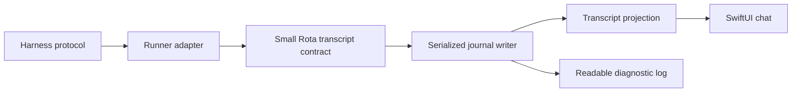

# Chat UI research

Read-only investigation of the installed super.engineering application on
2026-10-16, compared with Rota's chat implementation. These are observations
and proposed work, not implemented behavior or a performance benchmark.

The Rota source comparisons describe the starting implementation. The basic
normalized journal and ordered chat have since been implemented; their current
contract and limitations live in [Transcript format](transcript-format.md).
The broader adoption table below remains research, not a completion claim.

## Evidence and limits

The inspected bundle reports version `15aae8f8`. Its ARM64 Mach-O executable
has SHA-256
`efef5274024b69e8ca7993ef348e064521347f8fd300a9860e7d488f867e9df8`.
`file`, `otool -L`, `nm -C`, `strings`, and selected ARM64 disassembly from
`xcrun llvm-objdump` were used. Function names survive in this build. This
was disassembly, not recovery of the original Rust source.

The live window was viewed through CUA, without sending messages, launching
agents, or changing settings. It showed right-aligned user bubbles, an inline
model/effort label, prose interleaved with a tool summary, a time/duration
footer, a right-edge timeline navigator, and a composer with elapsed time,
attachment and stop controls. The accessibility tree exposed window chrome
and menus, but no chat controls in this observation. Other states, dark mode,
queue interactions, and narrow-window behavior were not exercised. No
conversation content or screenshots are included here.

Evidence below is labeled **disassembly** when instructions and call targets
were inspected, **symbols** when only implementation names were recovered,
and **source** for Rota. A symbol alone establishes neither reachable UI nor
correct behavior. Static analysis does not establish speed or memory use.

## Rendering and state

The chat uses Rust and GPUI: `ChatTimelineList::render` calls
`gpui::elements::list::list` at `0x101736dd4`, and the executable includes GPUI
Metal renderer symbols. The framework describes itself as a GPU-accelerated
Rust UI framework in its [official documentation](https://gpui.rs/).
WebKit is also linked; that dependency does not establish that chat is HTML.

The recovered implementation separates runtime sessions, transcript models,
display projections, and view components. **Disassembly** of
`apply_validated_runtime_delta` at `0x1014fbe34` shows calls to:

- `validate_runtime_delta_header`;
- `TurnAssembler::adopt_runtime_replica_delta`;
- `buffer_streaming_chunk`;
- `sync_runtime_replica_suffix`;
- `schedule_async_full_projection` on a separate branch.

This establishes distinct update paths, not the precise conditions or
performance of each path. `sync_streaming_leaf_delta` at `0x1014f0764` calls
`TranscriptProjection::sync_assistant_row_generation`, uses a Markdown content
generation, and can refresh layout while preserving scroll.

**Disassembly** of `MarkdownMessageView::set_content` at `0x101405434` shows
an early return when its incoming scalar matches the stored value, followed
by a call to `schedule_parse` when it differs. Neighboring generation symbols
suggest a revision key, but its exact contract was not recovered.
`schedule_parse` calls GPUI task spawning; this alone does not prove that all
parsing runs off the UI thread. `StreamingTextBuffer::drain_frame` at
`0x1017fc13c` computes a drain budget from elapsed time and checks UTF-8
boundaries when splitting buffered text. No exact cadence is claimed.

In Rota, **source** in `SessionView.swift` polls the last 400,000 bytes of the
log once per second while active, then `Transcript.parse` classifies text
prefixes and assigns positional integer IDs. `TranscriptTurn.group` infers
work versus answer from the last tool call. `MarkdownText` parses blocks and
inline Markdown in its view body. There are no measured rendering costs yet.

The log suffix can begin inside a line, message, or code fence. Its positional
IDs can also shift when earlier content drops out of the suffix. These are
risks apparent from the source, not reproduced user-facing regressions.

## Scroll and folding

**Disassembly** of `rebuild_display_items_preserving_scroll` at `0x101519670`
shows follow-state synchronization, rebuilding display items, and restoring
the reader's position. The restore function at `0x10151e238` resolves an
item's scroll anchor back to an index and calls `ListState::scroll_to`.
This is stronger than retaining a raw offset across a changing layout.

`suspend_bottom_pin_for_selection_drag` at `0x1015186b4` calls a predicate
about selection points in changing content, then an unpin function.
`finish_live_turn_fold` at `0x1013e94ec` invokes the scroll-preserving rebuild.
Thus folding and selection have explicit integration with scrolling.

Rota already follows the bottom and offers a return-to-latest button.
`ChatTranscript.swift` uses a 60-point bottom threshold and distinguishes
height changes from offset changes. It has no explicit message anchor or
selection-drag integration. `WorkSection` shows all live work and disables
its fold button while live. Finished work can be expanded.

Proposed contract: preserve the visible message and its relative position
when work folds, text grows, or older history loads. Pause following while
the reader scrolls or selects. Resume when the reader reaches the bottom or
requests the latest message. Verify this with the running app before claiming
the improvement.

## Sending and interactive requests

**Symbols** identify queueing, editing and dismissing queued follow-ups,
queue restoration, promotion to steer, and steer receipts. **Disassembly** of
`promote_queued_follow_up_to_steer` at `0x101509aec` shows state checks, lookup
of a queued item by ID, and enqueueing a UI command. It does not establish
provider delivery or the exact shortcut. Provider capability strings include
`supports_queue`, `supports_steer`, and `reports_steer_receipts`.

Separate symbols exist for question cards, tool approval cards, and answered
input rows. These states were not triggered in the live app.

Rota's composer explains harness-dependent sending in a tooltip. Its pending
outbox is local view state and recognizes delivery by counting matching user
text in the parsed log. `RunEvents` provides session and finish callbacks,
not transcript or delivery events. Structured message IDs and delivery states
would support clearer queued, sending, accepted, and failed presentation.
Any queue/steer control must reflect the actual runner's capabilities.
This research does not authorize new approval behavior or permission modes.

## Tool details

**Disassembly** of `request_tool_detail_hydration` at `0x1014fd7c8` shows a
transition through `ToolDetailState::mark_loading`. **Symbols** identify
loaded, missing and failed states, deferred tool detail rendering, input and
output copying, inline edit diffs, summary caches, and nested agent views.
Their complete loading and rendering behavior was not exercised.

Rota has summaries, expandable consecutive tool calls, plan cards and copyable
code blocks already. However, `CodexDaemonRun.handle` journals completed agent
messages; its `describe(started:)` reduces file changes to `edit files` and
MCP calls to a tool name. Other item completion payloads are not retained by
that switch. `RunJournal.text` buffers chunks until a flush. A richer view
cannot reconstruct discarded arguments, results, IDs, or diffs from this log.

## Rota's intended boundary

The product goal is a basic, readable chat that remains useful as harnesses
evolve. Full provider output fidelity and feature parity with super.engineering
are outside this goal. The architecture should make optional improvements
local, without requiring new UI cases for each provider event or tool.

The following is a proposed design, not a description of the current code.

Each runner owns its protocol decoding and maps only the supported common
subset into the Rota contract. Provider event names, tool argument schemas,
and nested provider objects never become dependencies of the chat views.
Protocol framing and the execution lifecycle remain the runner's concern;
presentation enrichment is optional.

The initial contract needs only:

- **Messages:** stable local ID, user/agent role, text, and whether the message
  is still growing. A provider ID is an optional correlation aid, not a
  prerequisite. Append operations target an existing local message ID.
- **Activity:** stable local ID and a plain title, with an optional known
  state. An unfamiliar tool can display its name without parsing its inputs.
- **Notices:** plain informational or error text. A reply-needed indication
  may reuse the scheduler's existing attention state without modeling every
  provider question or approval form.

Run lifecycle stays with the scheduler and `RunRecord`; completing a text
message never implies that the run succeeded. Turn boundaries are used when
the adapter knows them, otherwise the view displays an ordered sequence
without inventing a final answer or classifying prose by the last tool call.
Absent timing or tool status remains unknown, not zero or success.

### Compatibility behavior

- Ignore unknown provider fields. Ignore unrecognized auxiliary event kinds
  without interrupting recognized text or run completion. Where the adapter
  already has a supported display-text field, retain that text as a plain
  message or notice; do not recursively search arbitrary JSON for strings.
- An unknown block beside known text must not hide the known text. A missing
  optional tool argument or result degrades to a generic activity row.
- Never hide a transport failure, invalid framing, or an unrecognized required
  lifecycle response behind this tolerance. Surface those as runner failures
  with diagnostic context; optional presentation and execution correctness
  have different failure policies.
- Keep readable logs available. Do not archive all raw provider payloads to
  make an unspecified future renderer possible. Such payloads can contain
  credentials, large outputs, or unrelated content.
- Version the normalized journal independently of CLI versions. Keep IDs and
  ordering stable on replay. Ignore unknown additive fields and optional
  records. If a required record or journal version cannot be understood,
  report that the chat is incomplete and offer the readable log.

One serialized writer owns ordering and persistence of normalized records;
the live projection and readable agent log derive from the same accepted
records. Shell output retains its existing plain-output path. A JSONL journal
is sufficient to start; no database, runtime replica service, plugin registry,
or general event framework is needed. Existing text logs keep their legacy
reader. Do not infer structured details while migrating them.

Optional metadata may later enrich an activity with a file path, result, or
diff. It must never be required to read a message, open old history, or finish
a run. Add fields and specialized views only for demonstrated routine needs.
Streaming is an optional adapter capability: completed messages remain a
supported output mode. Cache and batching work should follow measurements,
not become a prerequisite for the transcript contract.

Tests should pin the common subset and its fallback behavior, using the
existing runner seams and captured, sanitized protocol shapes. Include a new
unknown field/event, mixed known and unknown blocks, repeated identical user
messages, missing tool detail, replay, and a real transport failure. No
exhaustive provider-schema mirror is intended. Breaking changes to framing,
text delivery, or lifecycle can still require a runner update; this boundary
reduces presentation churn rather than promising universal compatibility.

## Proposed adoption order

| Priority | Work | Acceptance evidence |
|---|---|---|
| 1 | Introduce the small normalized transcript contract, stable IDs, one journal writer, and a legacy log reader. | Known text survives unknown auxiliary data; repeated messages remain distinct; replay preserves order and IDs; run failures remain failures. |
| 2 | Move the existing basic chat onto that projection and preserve a message anchor through layout changes. | Old and new history remain readable; render both appearances at the 820-point minimum window width and exercise scrolling, selection, growth, and folding. |
| 3 | Add partial text updates and revision-based Markdown caching where supported and justified. | Completed-message adapters still work; count parsing and updates before claiming reduced work. |

Rich tool cards, queue editing, dedicated question and approval forms, nested
agents, transcript navigation, attachments, and richer Markdown are outside
the initial scope. They are extension points, not a committed backlog.
Rota's existing bubble layout, summaries, plan cards, model labels, copy
actions and composer already cover much of the visible design.

Keep AppKit and SwiftUI. Replacing the UI framework is not justified by this
investigation. No proprietary implementation, binary extracts, personal
paths, or conversation data should be added to this public repository.

## Rechecking another build

Read the bundle version and hash before reusing any address. For an executable
path stored in `APP_BINARY`, use `file "$APP_BINARY"`, `otool -L
"$APP_BINARY"`, and `nm -C "$APP_BINARY"` to locate the named functions.
Inspect each chosen address range with `xcrun llvm-objdump --disassemble
--demangle --start-address=<start> --stop-address=<next-symbol>
"$APP_BINARY"`. Keep intermediate extracts outside the repository and remove
them after recording evidence. Address ranges and inferred field meanings
must be rechecked after an update.
