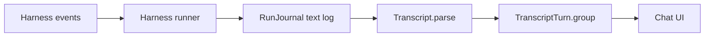
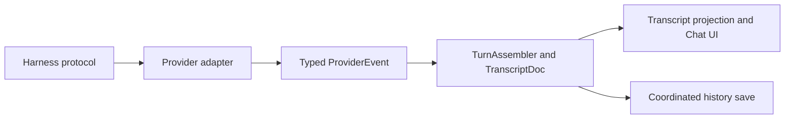

# Harness Chat UI comparison

Historical comparison, made before the event-journal implementation described
in [architecture.md](architecture.md). Rota's loss of event identity, buffered
chat display, local-log delivery inference, and mutable session configuration
are addressed there. Live checks verified Grok interject with the installed
leader: its acknowledgment is `{"result":{"status":"queued"}}`, and the
agent used the injected instruction. The subsequent implementation adds direct
PTY ownership for interactive Claude and live permission/question forms for
protocol-based runners. Additional harnesses remain separate product work. Rota now leaves
permission and sandbox policies to the harness configuration and no longer
auto-approves Grok requests; see the launch contract in architecture.md.

Rota's largest Chat UI gap is the loss of structured harness events before
rendering. Static analysis of the installed super.engineering executable
confirms a shared event protocol, explicit turn assembly, delivery handling,
and richer provider-specific transports. The recommended starting points are
typed events, delivery state, Grok interjection, and per-response model identity.

Scope: Rota source and targeted ARM64 disassembly of super.engineering build
`ac45e7aa`. This is binary analysis, not recovered original Rust source or a
live compatibility test of every provider.

## Implementation verification

The event-journal implementation retains streamed text, tool inputs and results,
plans, explicit answer phases, provider metadata, and identified outgoing messages.
It preserves legacy logs and freezes the launch configuration for continuation.
A transport write and a provider acknowledgment remain distinct; a timeout leaves
an uncertain delivery state and never retries automatically.

The installed Claude, Codex, and Grok CLIs passed message delivery and continuation
checks. Separate live checks passed cancellation for every harness and explicit
model selection for every agent. Grok's queue acknowledgment was also captured
through an independent ACP client before verifying it in the Rota runner.
Synthetic UI checks rendered the shipping transcript and composer in both system
appearances at the 820 pt minimum width, verified tool result expansion and exact
failed-message restoration, and reported no layout violations. These were the first implementation checks; later PTY and request checks are recorded
in the launch contract in architecture.md.

The subsequent checks verified interactive Claude steering and continuation on
Rota's directly owned PTY, terminal input and resize through its private socket,
print-mode Claude permission decisions and clarifying-question answers, Codex
and Grok steering, and cancellation. Native request forms were captured in both
appearances at the minimum chat width. Mutation checks independently detected
repeated approval and loss of the controlling terminal. Interactive Claude now
bridges `AskUserQuestion` and one-time tool permissions into the same chat forms
using per-run hooks and a private socket. Live checks verified multiple answers,
explicit tool approval and cancellation without answering in Terminal; the PTY
remains available for native prompts outside those hook events.

## Evidence boundary

The installed executable retains Rust function symbols, trait implementations,
provider registry vtables, serialization literals, and compile-site source
paths. Function bodies were disassembled with Xcode's `llvm-objdump`; calls,
branches, and referenced data were inspected. Registry keys were matched to
their factory functions through the actual vtable pointers, including the three
Pi-family descriptors. A symbol name alone is not behavioral proof.

Binary SHA-256:
`98b2cd02995a1d720f18ec63cc057982c3b7f9bf66b5a52890ca053355812f92`.
Addresses below are unslid Mach-O virtual addresses for this exact binary.

Read-only `sc chat providers --json` confirmed that the installed application
exposes the Chat UI provider families in the documentation: Claude Code, Codex,
Cursor, OpenCode, Pi, Oh My Pi, Grok, Kimi, Prime Agent, and fx. Availability in
discovery does not prove successful runtime integration. Other providers are
documented as terminal-only. No sessions were launched or modified.

Sources:

- [Providers and models](https://super.engineering/docs/providers-and-models/)
- [Terminal and chat](https://super.engineering/docs/terminal-and-chat/)
- [Notifications and approvals](https://super.engineering/docs/notifications-and-approvals/)
- [Session history and restore](https://super.engineering/docs/session-history-and-restore/)
- [Developer repositories](https://github.com/superdoteng)

## Rota's implementation

| Harness | Transport and continuation | Sending during work | Transcript handling |
| --- | --- | --- | --- |
| Claude print mode | Child process, stream-json stdin/stdout; `--resume` | Writes another user message to stdin | Formats assistant blocks into text; `result` finishes the run |
| Claude interactive mode | Detached `screen`; reads provider JSONL; `--resume` | Bracketed paste and Return through `screen` | Incremental JSONL reads, then the same text formatter; watches turn completion and queued input |
| Codex | Shared app-server daemon, proxy, JSON-RPC over WebSocket; `thread/resume` | `turn/steer` with the expected turn ID | Writes tool descriptions, completed agent messages, and plans; finishes on `turn/completed` |
| Grok | Shared leader, ACP JSON-RPC over stdio; `session/load` | Another `session/prompt`; counts outstanding prompts | Buffers message chunks, writes tool titles and plans; suppresses history replay while loading |
| Shell | Detached `screen` | Terminal attachment | Plain command output |

Implementation sources: `Sources/RotaCore/ClaudeStreamRun.swift`,
`ClaudeInteractiveRun.swift`, `CodexDaemonRun.swift`, `GrokACPRun.swift`,
`ScreenRun.swift`, and `JSONRPC.swift`.

The common seam is already present: `RoutineLaunching`, `RunControl`,
`RunEvents`, and `LaunchSpec` in `Runner.swift`. Rota does not need to replace
its scheduler to improve the conversation model.



## Differences that matter

The binary confirms a shared `ProviderEvent` protocol. Its serializer handles
message chunks, turn lifecycle, tool input, queued message resolution, user
input, subagent progress, model selection, and context compaction. The
`TurnAssembler.apply_provider_event` body dispatches into explicit transcript
operations for these events. Rota instead reconstructs turns from display text.



This diagram summarizes inspected components and calls; it omits other runtime
layers rather than claiming to reconstruct the complete application.

Rota's concrete limitations are visible in its source:

1. **Structured data becomes display text too early.**
   `StreamJSONFormatter` keeps text and a short tool description but discards
   tool identity, most input, thinking, and tool results. Codex handles a small
   notification subset and does not retain completed command/MCP results or
   message deltas. Grok retains tool titles but ignores tool update details.
   The UI cannot reconstruct discarded information.
2. **Streaming is incomplete.** Codex writes agent text at item completion.
   Grok's `RunJournal.text` accumulates chunks until a line, `endText`, or
   finish flushes them. `SessionView` polls the text log rather than receiving
   message deltas. The existing UI is not token-by-token streaming.
3. **Turn boundaries are inferred.** `TranscriptTurn.group` splits at user
   messages and calls the text after the last tool the answer. That does not
   preserve protocol turn IDs or assistant message phase. Mid-turn steering
   and queued follow-ups need explicit associations.
4. **Delivery is inferred from the local log.** `Outgoing.delivered` counts
   matching user text. Claude print mode, Codex, and Grok write that text before
   transport success. A rejected steer can therefore have a local user message
   plus an error, without a reliable failed-delivery state. Interactive Claude
   instead waits for provider transcript entries, a useful distinction to keep.
5. **Model identity follows mutable routine settings.** `RunRecord` stores no
   resolved model or effort. `ModelLabel` reads the current routine, and
   continuation builds a spec from that routine. Editing a routine can change
   the displayed label and the next continuation's requested model without
   recording the identity of earlier responses.
6. **Permissions and attention are different mechanisms.** Rota launches with
   bypass/full access; Grok selects an allow option for permission requests.
   Interactive Claude uses a notification hook directing the user to Terminal.
   `RunRecord.attention` is a text mark, not a provider request with a reply ID.
7. **Grok input has a more capable path.** Rota sends another `session/prompt`.
   super.engineering's steer handler queues interjections, and its drain body
   submits `_x.ai/interject` through `send_request_async`. It rejects image
   steering and directs that input to a later turn. Its code can request
   mid-turn intervention; successful behavior with the installed Grok version
   still needs a synthetic live test.
8. **Interactive Claude has a dedicated terminal engine.** The inspected body
   opens a `portable_pty` PTY directly, rather than invoking `screen`. Its turn
   driver combines transcript reads, terminal status, stop signals, pending
   questions, permission decisions, and answer verification. It includes
   recovery branches for prompts that were not accepted. Rota already uses the
   same broad transcript-driven idea, but relies on `screen` and fewer signals.

These are static source and binary findings, not newly reproduced live regressions. No
agent quota was spent, builds run, or runtime data changed.

## What to adopt

Priority order for Rota:

1. Preserve normalized, typed session events with stable message, turn, and
   tool IDs. Keep the readable log as an export. Build the UI from events.
   Retain adapter-specific fields where a common representation loses meaning.
2. Give each outgoing message explicit pending, accepted/queued, failed, and
   cancelled states. A successful write is not necessarily provider acceptance;
   the adapter must identify what its protocol actually confirms.
   Add a separately advertised Grok interject capability only after checking
   the installed protocol and proving acceptance, failure, and cancellation.
3. Store the requested and resolved model/effort with the run or response.
   Keep provider defaults distinct from explicit pins. Do not derive historical
   identity from the current routine.
4. Describe capabilities by transport: mid-turn steering, queued input, live
   text, structured questions, approvals, tool results, and resume validation.
   Use this to explain what Send does and which controls are available.
5. Add structured questions and richer tool results to the common event layer.
   Permissions for attended continuations are a separate product decision;
   scheduled unattended runs must not unexpectedly block on a new default.
6. Separate viewing local history, validating a resume target, and actually
   continuing a provider session. Preserve a failed continuation's draft and
   explain the missing target instead of silently creating unrelated context.

Rota should retain its routine scheduling, bounded interruption recovery,
clean launch environment, and session-specific context. It already supports
both Claude transports and genuine Codex/Grok continuation. Worktree fleets,
Git review routing, account management, and additional harnesses are separate
product scope; they are not prerequisites for fixing the conversation layer.

## Chat UI transports recovered from the binary

| Provider | Inspected transport | Evidence and relevant difference |
| --- | --- | --- |
| Claude Code | Print-mode stream-json | Launch body adds `--include-partial-messages`, input/output format flags, and processes message IDs, model and usage data |
| Claude interactive | Direct PTY plus transcript and signal files | `openpty` call, transcript mapper, question/permission handling, answer verification |
| Codex | Child `codex app-server`, stdin/stdout | Spawn body configures structured input, patch streaming and goals; separate active-turn steering acknowledgment; Rota uses shared daemon/proxy instead |
| Grok | ACP, child `grok agent stdio` | Launch body constructs `agent` and `stdio`; handshake handles load/new; live interject queue; Rota explicitly chooses `--leader` |
| Cursor | ACP | Spawn argument builder, initialize/load/new handshake, model acknowledgment and ordered session-update mapper |
| Kimi | ACP | Spawn calls the ACP argument builder; handshake negotiates capabilities and uses session load/new/fork paths |
| fx | ACP | Argument builder appends `acp`; handshake and steer handling include undelivered-steer recovery |
| OpenCode | Managed server, HTTP and SSE | Runtime startup calls the HTTP client; event mapper consumes SSE payloads |
| Pi | Shared Pi adapter, `--mode rpc` | Registry factory selects descriptor with `rpc`, `--session`, and `get_commands` |
| Prime Agent | Shared Pi adapter, `--mode rpc` | Registry factory selects descriptor with `rpc`, `--resume`, and `get_commands` |
| Oh My Pi | Shared Pi adapter, `--mode rpc-ui` | Registry factory selects descriptor with `rpc-ui`, `--resume`, and `get_available_commands` |

The registry contains 11 transport keys: two Claude modes and nine other
provider families. Factory calls and descriptor contents establish the Pi-family
sharing; it is not inferred from similar names. Terminal-only providers are
outside this Chat UI registry and this investigation.

## Binary evidence

The namespace prefixes below are recovered Rust symbol names. They describe
components inside super.engineering, not separate public projects.

| Function or data | Address | Inspected evidence |
| --- | --- | --- |
| `ProviderRegistry.with_defaults` | `0x100e47a34` | Inserts provider keys with factory vtables; factories resolve to concrete adapters |
| Pi / Prime / OMP flavor descriptors | `0x108b76a20`, `0x108b76ab8`, `0x108b76b90` | Key, mode, resume flag, and command-discovery string pairs |
| `CliCodexClient.steer_response` | `0x100cd0a30` | Thread/active-turn checks, pending steer queue, `PendingSteerAck` receiver, timeout/disconnection branches |
| `AppServerTransport.spawn` | `0x100f32c30` | Builds app-server argv and child pipes |
| `map_app_server_notification` | `0x100f3fcbc` | Calls message-ID/phase, tool detail, plan, diff, context/usage, and subagent mapping functions |
| `CliClaudeClient.stream_response_for_turn` | `0x100cd8144` | Partial-message flag, structured stdin, message/model/usage extraction |
| `InteractiveClaudeEngine.ensure_spawned_with_session_policy` | `0x100e5a80c` | Direct `portable_pty` open, child/session reuse checks, launch and shutdown paths |
| Claude interactive `drive_turn_inner` | `0x100e4f82c` | Transcript drain, prompt injection, pending permission/question processing, verification and recovery |
| `GrokProviderAdapter.try_steer_request` | `0x100ee41ac` | Empty/image rejection and interject queue admission |
| `GrokAcpTransport.drain_pending_interjects` | `0x100edc690` | `_x.ai/interject` literal passed on the async-request path |
| `GrokAcpTransport.stream_turn_inner` | `0x100ed4150` | Constructs `agent`/`stdio`, starts child, calls handshake and event mapping |
| `cursor_acp_spawn_args` | `0x100f7e9e4` | ACP launch arguments and model/permission options |
| `KimiAcpTransport.spawn` | `0x100f09f34` | ACP argument-builder call and stdin/stdout/stderr setup |
| `fx_acp_spawn_args` | `0x100e87e6c` | Writes the bytes `acp` into the appended argument |
| OpenCode `ensure_runtime_for_key` | `0x100f98e44` | Server launch, HTTP client construction and readiness request |
| `pi_rpc_startup_args` | `0x100eb1710` | Writes `--mode`; mode value comes from the selected flavor descriptor |
| `ProviderEvent.serialize` | `0x1010cfb6c` | Event variant and payload serialization branches |
| `TurnAssembler.apply_provider_event` | `0x10130e5d0` | Explicit turn completion, tool insertion/update, thinking snapshots, metadata and user-input handling |
| `RuntimePersistence.flush` | `0x1010dc030` | Captures history basis, submits durable save and checks that the basis is still current |

For example, the inspected Codex steering control flow is reconstructed as:

```text
Check provider thread and active turn
Build transport input
Enqueue pending steer and obtain acknowledgment receiver
Wait for acknowledgment
Handle acknowledgment, timeout, or disconnection separately
```

This describes the machine-code branches, not original Rust syntax. It supports
adopting explicit acceptance handling; it does not prove that every possible
provider race is correctly handled.

Reproduce a targeted inspection without launching an agent:

```sh
xcrun llvm-nm --demangle /Applications/super.engineering.app/Contents/MacOS/super.engineering
xcrun llvm-objdump -d --demangle --start-address=0x100cd0a30 --stop-address=0x100cd0d4c /Applications/super.engineering.app/Contents/MacOS/super.engineering
xcrun llvm-objdump -d --demangle --start-address=0x10130e5d0 --stop-address=0x1013113f8 /Applications/super.engineering.app/Contents/MacOS/super.engineering
```

## Remaining validation

Binary inspection establishes the transports and selected mechanisms across
the Chat UI families. It does not establish live pass rates, performance,
complete field layouts, every capability flag, or correctness of all restore
and cancellation races. Any implementation work must verify the installed
provider contract and use synthetic sessions to test steering acknowledgments,
startup cancellation, replay deduplication, model changes, questions and cold
restore. Original source would make a complete control-flow review easier but
is no longer a prerequisite for the findings above.
