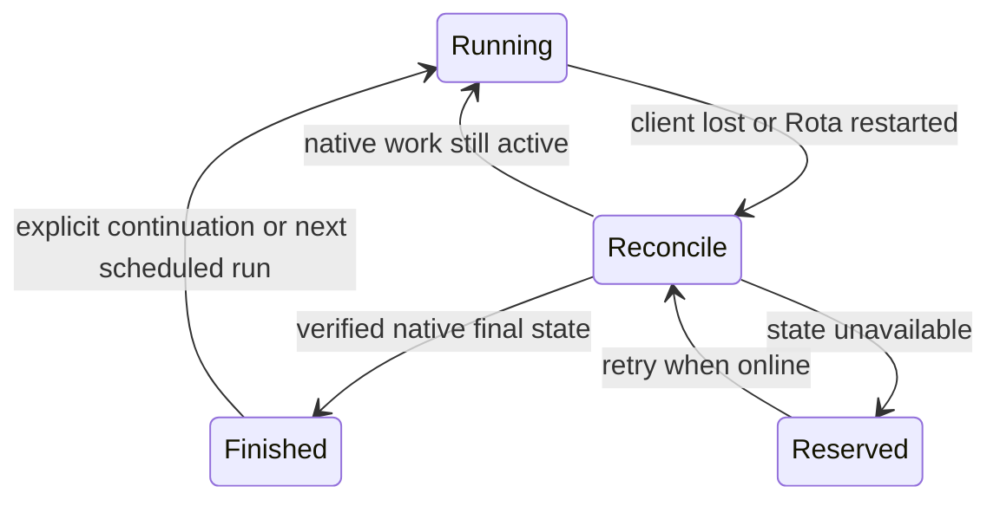

# Harness compatibility

Rota integrates execution modes, not interchangeable command-line programs.
`LaunchMode.capabilities` declares message delivery, question transport, native
image support, text streaming, reasoning and background-work behavior. The
coverage matrix and remaining gaps live in
[Architecture](architecture.md#feature-coverage-across-harnesses).
Native output sources, event-to-presentation mapping, regression tests and
unsupported-content boundaries live in the
[Harness output contract](harness-output-contract.md).

## Check levels

1. Run `swift test`. Synthetic peers exercise real adapters without a model:
   cancellation before readiness, queued prompt outcomes, paginated recovery,
   native item identity, images, reasoning, tool output and durable process
   recovery. Installed CLI flags and Codex schemas are checked when available;
   missing executables produce explicit skips.
2. Run `bash scripts/check-harnesses.sh`. This additionally reads installed model
   metadata without inference. It uses configured executable selections, reports
   versions in test output, checks advertised options and never saves agent
   defaults. A passing synthetic suite alone does not establish installed CLI
   compatibility.
3. After changing a runner, build with `./create-app.sh`, then run
   `bash scripts/check-harnesses.sh --live` with output redirected to a
   task-owned temporary log. It spends vendor quota. Set
   `ROTA_INTERACTIVE_TEST_DIR` to an already trusted synthetic workspace to
   exercise interactive Claude; tests never grant trust. The suite covers
   messaging, continuations, Stop, chosen models/effort, native images,
   session-scoped MCP identity, actual client disconnect/reconnect and native
   questions. It excludes the external-terminal GUI test. Optional isolated
   Antigravity MCP tool creation requires the additional setup in Architecture;
   report skipped tests explicitly.

`ROTA_LIVE`, `ROTA_LIVE_QUESTIONS`, `ROTA_PROTOCOL_CHECK` and
`ROTA_INTERACTIVE_TEST_DIR` are test inputs, not saved application settings.
`ROTA_HARNESS_REVIEW_OUTPUT` optionally exports native model catalogs to a local
JSON file during the installed metadata check. The weekly review hashes that
evidence; raw account catalogs and CLI logs are never published.
Run `scripts/ui-check.sh --harnesses-only` for Reasoning expansion, hidden empty
reasoning, tool image previews, collapsed/expanded diffs and version warnings in both appearances at the minimum
window width. It uses disabled
synthetic sessions and requires no installed agent. The full `scripts/ui-check.sh`
covers the other application surfaces. Use the native capture notice and preflight
procedure; the driver also checks the console before delivering a key. Its imported names may be personal; keep captures outside Git.

Codex continuation restores archived sessions through native `unarchive` before
resume; automatic recovery must never do that. Compressed rollout verification
must cover native expansion and relocation, rather than tailing a decompressed
copy. `SessionArchiveTests` checks restore failure and recovery boundaries.

Run builds, `maintain.sh` and UI checks sequentially. UI scripts also assemble
and sign `Rota.app`; SwiftPM's build lock does not cover bundle assembly or signing.

## Recovery and ownership

Reconciliation never sends a prompt. Unknown native state (`needsReconciliation` in the session API) reserves the routine,
including across Rota restarts and retention. Its ownership record cannot be
deleted while native state is unknown, so manual launches, scheduled slots and chat
cannot create another writer. A verified final network failure can still use
Rota's existing bounded network-retry policy; that is a separate continuation
shown as Continue in the chat.

Codex enumerates turn history and attaches to its active turn. Grok loads its
native session, replays messages and checks running-prompt/background metadata.
Local streams use private durable spools, wrapper exit files and leases. Screen
sessions are adopted in place. Local Stop tracks process birth times and owned
descendants; remote Stop waits for native confirmation instead of declaring
success after a timer expires. New journals persist replay identities. Legacy
journals and older processes without leases cannot gain metadata retroactively;
interactive Claude's timestamp-based replay retains its documented gap.

Inline images share a conservative aggregate byte budget; larger files remain
references. MIME types come from image content rather than filenames. The
policy accounts for partner differences in [Claude's image request limits](https://platform.claude.com/docs/en/build-with-claude/vision#request-limits),
without claiming native input for every file size or format. Grok's native
inputs follow its [JPEG/PNG contract](https://docs.x.ai/developers/model-capabilities/images/understanding);
Codex's image API accepts [non-animated GIFs](https://developers.openai.com/api/docs/guides/images-vision).
Unsupported formats retain their file-reference fallback.

Each run snapshots its execution mode, executable, CLI version and optional
server version. A mismatch is visible in the chat and `sessions.get` output.
Do not restart a shared daemon or leader while other clients use it.

## Updating an adapter

- Read the selected executable's `--help` and official primary documentation.
  For Claude, never use an unknown positional word as a subcommand: it becomes
  a prompt. Generate Codex app-server schemas. Read Grok's installed agent guide
  and probe its live ACP stream; archive method names are different. Check
  Antigravity's native stream and archives together.
- Compare request parameters, reply shapes, notifications, native statuses,
  model/effort options, question handling and attachment encodings. Preserve
  structured failure codes needed to distinguish missing sessions from an
  unavailable service. Never infer successful completion from transport loss.
- Add a synthetic regression with sanitized data. Break the guarded code and
  verify the test fails before trusting the assertion. Run all affected modes,
  including both Claude hosts. Keep native item identifiers through recovery.
- Run all three check levels and relevant UI checks. Record actual passes,
  skips and upstream limitations. Fixtures are evidence of a known shape, not
  a substitute for checking the currently installed implementation.
- Update the capability contract, Architecture matrix, user guide and transcript
  documentation together. Keep operational versions in command output and run
  metadata rather than maintaining a version table in prose.

## Live-test cleanup

Tests use synthetic `rota-live-*` working directories and print native session
IDs. Remove only sessions created by the current test run. Delete Codex threads
through `thread/delete` over the owning app-server, never by editing its SQLite
store. Shared-daemon sessions use `app-server proxy` with the WebSocket transport
implemented by `WebSocketTransport`; a separate stdio server cannot release the
daemon's writers. A recently stopped writer may need time to release its thread before
retrying deletion. Remove exact synthetic Grok session folders, exact Claude
transcripts and their owned subagent directories, and exact Antigravity brain
folders. A trusted workspace can contain unrelated Claude sessions: never delete
its entire project directory.

Stop only isolated leaders/daemons started by the test after their clients have
disconnected. Preserve pre-existing shared services. Remove task-owned spools,
sockets, scratch files and UI fixtures. Keep real user configuration unchanged;
session MCP overrides opt in only when Rota is already registered and do not
write the agent's global settings.
